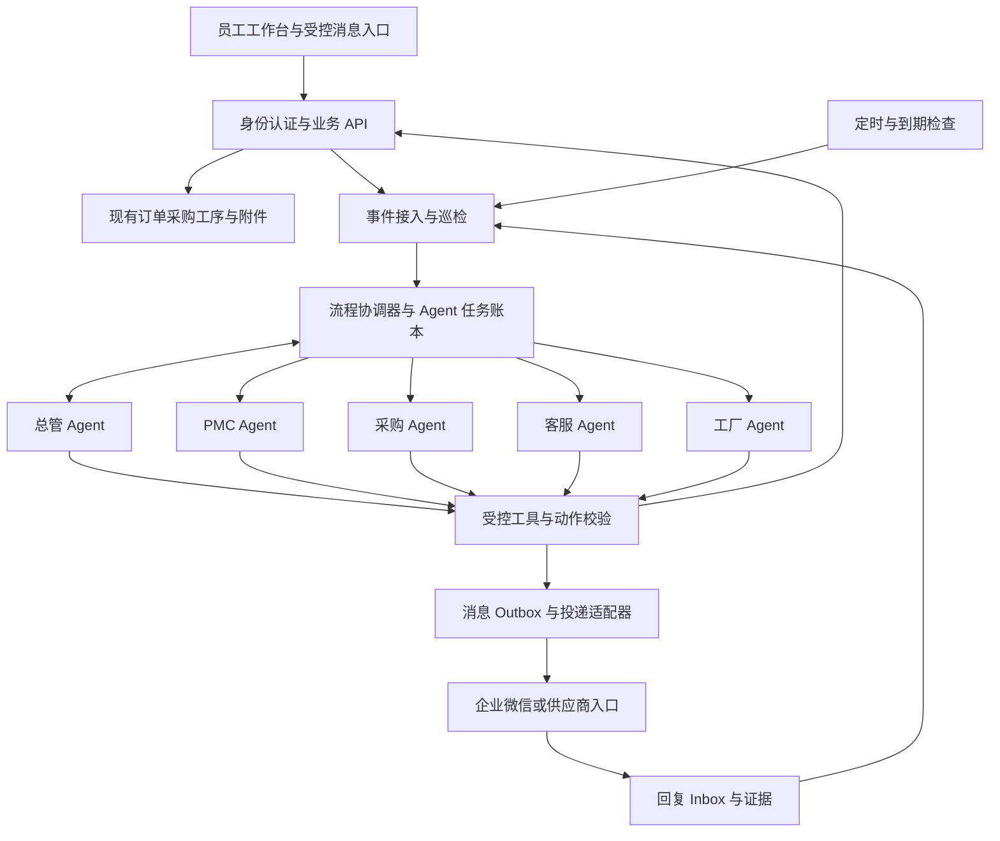

# DOON Agent 系统设计构想

> - 设计日期：2026-10-16（Asia/Shanghai）
> - 文档版本：v0.1 主线设计基线；2026-10-17 补充第一阶段执行约束，待实施与验收
> - 代码核对基线：`b10a5121799102d50351112b19a6ae657dc4cc89`
> - 实验资料快照：`c8ee1a93924bd0808b67227532801160c226fc42`（`codex/mastra-local-validation`）
> - 适用项目：DOON 订单协作中台，目标运行环境为阿里云 ECS

本文整理项目当前代码、Mastra 前期实验与本轮架构讨论，描述 Agent 系统的目标、职责、运行机制和落地边界。本文不是部署记录，也不表示文中方案已全部实现。除单独标明的历史验证结果外，架构、周期、资源预算和验收标准均属于建议方案。

本文统一使用 Agent 表示岗位智能体。组织岗位、Agent、实际负责人和执行进程是不同概念，一个岗位 Agent 可以服务多名获授权成员，也可以按任务绑定不同负责人。

**当前实施边界（2026-10-17）：第一阶段固定程序优先，LLM 按需辅助，人工确认关键判断。** 本文的岗位 Agent、持续自主协调和 A—F 路线为后续目标；当前以第 1.3 节及[第一阶段实施清单](phase-one-implementation-checklist.md)为准。测试分支 `codex/mastra-local-validation` 保留更完整的 Agent 设计与实验资料，不因同步本原则将测试功能并入主线或部署到 8787。

## 目录

1. [目标与设计原则](#1-目标与设计原则)
2. [现有代码基础](#2-现有代码基础)
3. [前期验证与证据边界](#3-前期验证与证据边界)
4. [总体架构](#4-总体架构)
5. [总管与岗位 Agent](#5-总管与岗位-agent)
6. [Mastra 的组织方式](#6-mastra-的组织方式)
7. [事项、任务与事件模型](#7-事项任务与事件模型)
8. [两条核心业务链路](#8-两条核心业务链路)
9. [触发、调度与补跑](#9-触发调度与补跑)
10. [上下文窗口管理](#10-上下文窗口管理)
11. [Memory 管理](#11-memory-管理)
12. [Skills 设计](#12-skills-设计)
13. [Tools 设计](#13-tools-设计)
14. [身份、权限与审批](#14-身份权限与审批)
15. [企业微信与供应商交互](#15-企业微信与供应商交互)
16. [持久化、幂等与故障恢复](#16-持久化幂等与故障恢复)
17. [模型接入与调用预算](#17-模型接入与调用预算)
18. [阿里云部署与容量](#18-阿里云部署与容量)
19. [可观测性、审计与工作台](#19-可观测性审计与工作台)
20. [Mastra 复用与自主开发边界](#20-mastra-复用与自主开发边界)
21. [数据保全与发布策略](#21-数据保全与发布策略)
22. [实施阶段与验收门槛](#22-实施阶段与验收门槛)
23. [预期能力与实际限制](#23-预期能力与实际限制)
24. [待确定事项与参考依据](#24-待确定事项与参考依据)

## 1. 目标与设计原则

### 1.1 目标

远期建设按岗位分工、能持续追踪业务事项的 Agent 系统，覆盖发现异常、核实事实、分派任务、催办下游、接收回复、跟踪履约、超时升级和验证关闭。当前第一阶段先交付固定程序和必要的人工核验。

远期主要场景（不代表第一阶段全部采用）：

- PMC Agent 从订单和齐料信息发现采购风险，委派采购 Agent 核查供应商履约情况。
- 采购 Agent 核对采购明细、供应商复期和收货记录，在允许的渠道发起催交并持续跟踪。
- 客服 Agent 发现工厂复期未兑现，要求 PMC Agent 核查；PMC Agent 再协调工厂 Agent 和对应工序负责人。
- 总管 Agent 汇总跨岗位异常，处理责任不清、结论矛盾、反复超时和多个事项之间的依赖。
- 管理人员能够查询当前风险、责任归属、最后有效回复、证据和下一步动作。

### 1.2 核心原则

1. **事实由业务系统提供。** 数量、日期、状态和权限由程序核算；确需语言理解时模型提供带来源的候选或建议，第一阶段经人工核验后才可用于业务动作。
2. **固定程序优先。** 已明确输入、规则与输出的任务直接由程序执行；分派、到期提醒和升级不必调用模型，能用普通函数或任务流程完成的脚本不强制改为 Agent／processors。
3. **长期工作保存在账本中。** 聊天记录不能作为唯一任务存储，清空上下文不应导致工作丢失。
4. **动作通过受控工具执行。** 模型输出必须经过权限、版本、内容和幂等校验。
5. **新增记录与原始业务数据分开。** 默认只读引用既有订单、采购、历史版本和附件；不改变原记录、主键、关联或账号权限。
6. **自动化以既有明确授权为边界。** 已授权的固定任务按规则运行；新增业务动作、超范围与模型参与的业务判断进入人工确认，不因写入设计而获得催办、外发或正式修改权限。
7. **处理完成须有依据。** 收到回复、重新承诺和实际履约是不同状态。
8. **按验证结果逐步开放能力。** 合成数据通过不等于真实模型、正式权限、消息通道和生产容量已通过。

### 1.3 第一阶段的三方职责与执行路径

用户明确第一阶段不能完全依赖 LLM 自行判断。以下约束优先于后文尚未开放的自动化目标，不以建立多 Agent、接入 Studio 或完成模型评测作为固定功能的前置条件。

| 责任方 | 第一阶段负责 | 交付与限制 |
| --- | --- | --- |
| 固定程序 | 文件解析、精确映射、校验、计算、去重、差异预览、受控执行、调度及结果回读 | 输出可复核结果；未知值与冲突保留待核查；权限、来源版本及幂等由服务端控制 |
| LLM 辅助 | 必要的非标准文本提取、歧义候选、异常解释、建议草稿 | 输出来源位置、候选、未知与冲突；不能自己确认客户／物料、价格、承诺、权限或异常关闭；第一阶段无自主业务写入与外发权限 |
| 人工确认 | 核对模型候选与依据、处理例外、决定业务取舍、确认执行范围 | 有权限人员可改、拒绝或暂缓；批准绑定当前内容与版本，不能跳过固定校验 |

执行路径：结构化输入直接进入固定校验与预览；确需理解的输入先由 LLM 生成候选，经人工核验后进入同一固定流程。需要业务确认的动作按“预览 → 人工决定 → 执行前重验 → 固定执行 → 结果回读与留痕”处理。未回复或超时不等于批准；内容、来源或权限变化使旧批准失效；结果不明先查原动作，不换幂等键盲重试。已明确授权的固定任务不额外要求每次人工批准。

现有 `scripts/data-tools` 的 19 个工具，其已定义用途均可用固定程序完成。LLM 如有价值应放在不规范输入的候选整理环节。旧 CLI 可能有顶层副作用、默认正式路径或缺少显式 dry-run，须先审计并拆分预览／执行，不能直接导入 Processor 或向员工暴露 Shell。Studio 用于技术验证；人工检查入口面向业务人员，不要求员工进入 Studio。

第一阶段先交付脚本清单与规则核对、固定程序的安全封装和合成验收，再选择一个有明确价值的可选 LLM 辅助试点。普通函数／任务队列即可承载确定性步骤；仅在确需跨来源开放式分析、工具选择时再评估 Agent。模型停用或不可用时，固定功能与人工入口继续可用。

通用业务与固定程序走 `main`，Agent／LLM／Studio 功能走测试分支。开发验证只使用独立目录、端口及合成数据；当前 Studio 本地验证使用 8797。此次文档修改不构建、不部署、不重启 8787，也不改正式数据、账号权限和调度。

## 2. 现有代码基础

### 2.1 已有可接入能力

| 代码位置 | 当前能力 | 对 Agent 设计的作用 |
| --- | --- | --- |
| `lib/domain.ts` | 成员、订单、`canRead` 和字段写入边界 | 复用业务权限口径；仍需补齐各模块的完整授权链路 |
| `lib/store.ts` | 共享状态快照、修订号校验提交、当前身份与业务审计 | 业务事实和正式写入的受控入口 |
| `lib/purchases.ts` | 采购来源版本、来源截至日期、复期、预计到货、下次催交、收货和退货待补 | 形成采购核查与履约判断工具 |
| `lib/purchase-api.ts` | 采购查询、跟进、收货事件、历史和版本检查 | 后续专用 API 的业务逻辑基础，不能直接向模型开放全部字段 |
| `lib/pmc.ts`、`lib/pmc-api.ts` | PMC 核对轮次、来源版本和排期维护 | 支持核查进度和来源变化识别 |
| `lib/ledger.ts`、`lib/departments.ts` | 日期、欠数、工序口径和部门职责 | 提供确定性的异常判定和责任范围 |
| `lib/project-collaboration.ts` | 负责人、任务状态、跟进历史、完成和确认 | 可借鉴任务设计；其任务绑定客户项目，不直接改造成全局追单账本 |
| `standalone/auth.mjs`、`standalone/runtime.mjs` | 本地会话、可信身份上下文、SQLite WAL、在线备份 | 阿里云 standalone 运行方式的接入基础 |
| `standalone/server.mjs`、`standalone/云端员工入口.md` | 员工入口、8787 后台、代理校验和 systemd 运维说明 | 保留现有员工入口，Agent 执行与长耗时请求分离 |

### 2.2 必须补齐的业务建模

- 采购记录的客户订单引用不等于完整 BOM、物料需求和齐套关联。多订单共料、分批采购、拆单合单和相同订单号不能靠模型猜测。
- 需要独立的、可版本化的订单—采购—工序关联记录；不明确时建立待核查事项。关联确认不改原始记录。
- 采购预计到货日期是内部预期，供应商复期是供应商承诺。内部预计日期已过不能直接写成“供应商违反承诺”。
- 收货数量未知时应显示“待核对”，不能当作零收货；归档、取消、关闭和未审核状态均应按业务规则处理。
- 包装或入仓足量不代表验收、出货或结单。关闭条件必须与具体事项类型对应。
- 当前共享快照会读取整个工作空间。Agent 初期集中获取事实并分发，后续按实际规模增加增量接口，避免每个岗位频繁独立全表扫描。

## 3. 前期验证与证据边界

### 3.1 证据来源及版本

本节依据用户提供的初期 P1 `README.md`、`ACCEPTANCE.md`，本机实验 worktree 中的 P0 README 和部分测试实现，以及刷新远端后取得的实验分支最新验收材料整理。最新材料包括 P2、真实模型与身份修复、主线认证及资源权限适配、员工网关和云端空闲基线。结果按对应历史验收报告引用；本轮仅阅读材料和部分实现，没有重新运行这些实验，也没有将实验代码合入主线。

| 项目 | 历史记录 |
| --- | --- |
| 实验分支 | `codex/mastra-local-validation`，独立于主业务运行时 |
| P0 基线 | `ab0ad731323d2f2056f26490bd1d68e98506f049` |
| Mastra 上游提交 | `f88217d19b63d362ff97723c1a339fbf89a1bbb0` |
| 固定依赖 | `@mastra/core 1.77.0`、`@mastra/libsql 1.26.1`、`zod 3.25.76` |
| P1 权限纯函数编译 | `esbuild 0.28.0` |
| 后续真实模型适配器 | DeepSeek 原生适配器 `3.0.52`，实验固定依赖 |
| 历史运行环境 | Windows PowerShell；原报告 Node 24.14.0，复现记录 Node 24.19.0 |
| 验收记录日期 | 2026-10-15 至 2026-10-16，北京时间 |

所有实验使用合成员工、订单及独立临时库。初期 P0/P1 使用脚本模拟模型，后续 P2 和两轮 P1 联调已调用真实 DeepSeek 官方 API；始终没有接正式业务库或企业微信。初期 P1 身份选择器后续已关闭，并逐步改为合成凭据与主线认证源码适配，仍不是正式员工生产入口。

### 3.2 P0：已记录的 11 项集成验证

| 验证项 | 已支持的有限结论 |
| --- | --- |
| 每日新上下文 | 同一 Agent 的下一次无记忆调用不包含上一轮私有标记 |
| Schema 工具调用 | SDK 能完成真实工具执行循环 |
| 人工批准 | 暂停期间无工具副作用，批准后才执行 |
| 多 Agent 交接 | 过滤后的交接没有传递父会话私有标记 |
| 固定脚本工具 | 可通过受控工具执行限定参数的本地脚本 |
| 工作流跨进程恢复 | 一个进程暂停，另一个进程读取持久化状态继续 |
| 人工拒绝 | 拒绝后未创建合成任务和对应业务审计 |
| 审批人不匹配 | 应用校验拒绝非指定审批人 |
| 来源已变化 | 应用版本校验阻止旧审批放行 |
| 重复执行 | 相同动作重试 100 次仅形成一项任务与一项审计，变更内容被拒绝 |
| 调度定义持久化 | 暂停状态的北京时间计划重建后仍存在，未绑定历史会话 |

验收记录：11 项通过；711 个恢复的上游原始核心文件与固定提交 Git blob 匹配；另有 5 项直接源码检查通过。未完成上游 monorepo 全量构建或全量测试。

审批人、来源版本和幂等保护是实验应用代码实现的保障。计划持久化没有证明真实时钟触发、跨日执行和宕机补跑。

### 3.3 初期 P1：已记录的 23 项自动化验收

| 范围 | 数量 | 记录中的验证内容 |
| --- | ---: | --- |
| 权限与合成数据适配 | 7 | 实际 `canRead` 适配、员工客户范围隔离、禁用及供应商拒绝、DTO 白名单、分页和来源失效、读取不改源对象 |
| HTTP、Agent、建议与恢复 | 9 | 未登录拒绝、SDK 经 HTTP 只读工具查询、4 条建议归属、来源变化和撤权隐藏、业务写入拒绝、伪造来源拒绝、本机地址边界、完整及部分结果恢复 |
| SDK 补充验证 | 7 | generate/stream 工具循环、无记忆新调用、批准及拒绝、libSQL 审批暂停跨进程恢复，含内部 reasoning 标记保存 |

页面验收记录包括两员工各自只能看到其范围订单与建议、身份切换清空旧内容、详情与空态，以及浏览器页面错误日志为空。没有批准、保存、派发或写回入口。

数据不变检查覆盖合成源对象、建议库哈希及跨进程恢复后的既有建议；部分结果通过应用幂等重算补齐。实验修复了默认跟随重定向和用“库非空”误判生成完成的问题。

这些结果不等于正式库完整性核验，不等于 Durable Agent 崩溃重放认证，也不证明大模型判断质量。P1 工具发现超过单页 50 条时中止生成，不能据此宣称已经支持全量订单巡检。

### 3.4 P2：真实 DeepSeek 协议与恢复验证

后续 P2 报告记录：官方 `deepseek-v4-pro`、thinking 开／关下的普通工具、流式工具、跨进程模拟批准和拒绝共 8 个场景、12 个子进程阶段通过。16 次官方请求均 HTTP 200，含 12 次非流式和 4 次 SSE；4 个开启 thinking 的场景核对了 reasoning 哈希回传。

批准前零副作用，恢复批准后各产生一条合成效果，拒绝后零效果。审批决定由测试程序模拟，使用正常退出后的重建，不代表真实审批身份、任意崩溃或断电恢复。初轮保守费用估算为 ¥0.092809，不是供应商账单。历史记录见 [P2 验收](https://github.com/DOON-100/doon-order-workspace/blob/c8ee1a93924bd0808b67227532801160c226fc42/experiments/mastra-p2/ACCEPTANCE.md)。

对抗 HTTP 请求覆盖跨客户、伪造身份、额外字段、旧版本写、重复请求、绕过审批、附件和批量超限。初期公开选择身份的缺口曾被明确复现，随后被修复；写入口关闭时的拒绝不计为未来写操作的权限或幂等验收。

### 3.5 后续 P1：身份与真实建议链路

实验先关闭自由选择身份入口，以服务端凭据和会话控制 A/B 合成员工，并在工具和最终提交前重验权限、来源版本及完整 DTO 指纹。模型仅选择已读取来源与允许规则，提案经应用校验后生成固定文案并按单员工事务保存，模型自由文本不直接写入建议。

独立合成认证版本的真实模型联调新增 6 次官方请求，A/B 各产生 2 条建议，4 次连续工具循环的 reasoning 哈希核对通过；当时 P1 完整套件 85/85，P2 离线套件 29/29。该轮累计 22 次请求、保守估算 ¥0.191215。详见 [身份与模型历史验收](https://github.com/DOON-100/doon-order-workspace/blob/c8ee1a93924bd0808b67227532801160c226fc42/experiments/mastra-p1/AUTH-MODEL-ACCEPTANCE.md)。

后续将主线 `standalone/auth.mjs` 与 `runtime.mjs` 原文复制、哈希核对后在独立子进程及新合成 SQL 库执行，验证真实建账号、scrypt、首次改密、会话、注销、撤销及跨 worker 恢复。通过 17 个白名单权限模块适配订单九角色、CRM、团队和三类任务规则；P1 当轮 147/147，其中认证 15 项、资源权限 34 项、认证 HTTP 9 项等已包含在总数内。详见 [主线认证与资源权限验收](https://github.com/DOON-100/doon-order-workspace/blob/c8ee1a93924bd0808b67227532801160c226fc42/experiments/mastra-p1/PROJECT-AUTH-ACCEPTANCE.md)。

上述认证真源仍为合成状态，没有连接真实员工和正式数据库。主线函数的适配通过支持后续实施，不等于整个生产路由栈或生产跨库一致性通过。

### 3.6 最新 P1：新认证真实复测与员工网关

新认证路径再次接入真实 DeepSeek：新增 6 次请求，A/B 各 2 条建议；来源深比较未变、跨客户读取 404、4 次 reasoning 哈希回传通过。该轮输入／输出为 7,215／1,015 tokens，保守估算 ¥0.092341；累计 28 次请求、¥0.283556，未知 usage 为 0。金额为历史报告的保守估算，不作为当前费率或生产成本预测。

另有员工网关实验原样复制并核验五个认证／网关／服务源文件，以新临时目录和回环随机端口运行原生 HTTP 登录、改密、会话与退出。业务 workspace API 被明确的只读身份探针替代。网关桥接到 P1 的建议链路使用 mock 模型；收费 DeepSeek 复测走 `project-auth` 子进程路径，两者不能合并描述成一次真实 TLS＋HTTP 网关＋收费模型端到端验收。

| 最新报告项目 | 记录结果 | 边界 |
| --- | --- | --- |
| P1 完整套件 | 162/162，0 失败、取消和跳过 | 包含原生网关 12 项、桥接与建议 3 项等；不再与早期 23/85/147 相加 |
| P2 离线回归 | 32/32 | 无真实模型费用，不重复计入收费场景 |
| 云采样脚本 | 语法／帮助通过，12/12 离线模拟 | 未在 ECS 执行脚本，不能代替实机容量 |
| 原生网关 | 登录、改密、会话、退出、CSRF、角色与 Cookie 属性等 | HTTP 模拟代理头、手动回传 Cookie；真实 TLS 和浏览器策略未验收 |

最新结果见 [登录、模型复测与网关验收](https://github.com/DOON-100/doon-order-workspace/blob/c8ee1a93924bd0808b67227532801160c226fc42/experiments/mastra-p1/LOGIN-LIVE-ACCEPTANCE.md)。历史费用账本应保留累计记录，不换目录清零；本次整理文档没有调用收费模型。

### 3.7 云端空闲基线

实验分支最新报告记录用户在 2026-10-16 北京时间 23:28:49 起提供的短时手动采样：可用内存快照约 2.9 GiB，剔除 vmstat 首行后的 10 个一秒区间 CPU idle 平均约 98.8%，根分区可用约 60G，短窗口未观察到交换活动，并提供了运行服务清单。

这些是用户提供的非敏感摘要，未由本轮助手远程复核；不能推导业务高峰、最小可用内存、Agent 吞吐或同机影响。项目源码采用 SQLite，云端实际运行版本和配置仍待确认。详见 [云容量记录](https://github.com/DOON-100/doon-order-workspace/blob/c8ee1a93924bd0808b67227532801160c226fc42/experiments/mastra-p1/CLOUD-CAPACITY-ACCEPTANCE.md)。

### 3.8 仍未验证的能力

- 真实模型的大范围业务判断质量、错误建议与漏报率、429／超时／断流、持续负载和成本稳定性；已有小样本协议联调不覆盖这些。
- 真实员工及生产会话接入，Agent 专用授权，生产来源一致性，真实 TLS／浏览器和 HTTP 网关＋收费模型组合。
- 超出已测主线纯函数矩阵的完整业务路由、全部字段、对象附件和持续并发权限。
- 正式追单状态机、可信审批、事务幂等账本、不可变审计和业务写回。
- 真实定时触发、重复触发、异常退出恢复、跨日上下文与宕机补跑。
- 企业微信供应商外部群主动发送、获取回复、身份关联和发送回执。
- Linux 存储兼容、生产备份还原、规模分页、资源容量及持续运行。
- PostgreSQL 等替代存储；SQLite/libSQL 的实验通过不能迁移为其他数据库的验证结论。

本次文档编写未重新执行上述历史测试。不同阶段的完整套件含有重叠用例，不能将 23、85、147、162 相加作为独立验证数。主项目历史 TypeScript 结果、未完成的业务回归均不计为本次通过。

## 4. 总体架构



各组件的职责：

| 组件 | 职责 |
| --- | --- |
| 业务系统 | 保存正式业务事实、既有权限和历史，处理正式业务提交 |
| 巡检与事件接入 | 形成异常候选，接收回复和业务变化，避免重复读取和重复触发 |
| 流程协调器 | 执行固定路由、状态转换、领取锁、幂等和超时策略 |
| 总管 Agent | 分析复杂异常、跨岗位协调、全局风险摘要和管理问答 |
| 岗位 Agent | 在授权事项内核实、分析、跟进并返回结构化结果 |
| 任务账本 | 保存事项、任务、承诺、下一步、证据、版本和执行历史 |
| 工具层 | 控制可调用 API、字段、记录范围和实际副作用 |
| 消息适配层 | 处理渠道差异、群绑定、频率、发送状态和回复关联 |
| 运维层 | 进程托管、监控、资源限制、备份和恢复 |

全局值守是整个服务持续运行。总管模型在需要协调时被调用，不持续占用一次推理，也不把所有明细常驻在上下文中。

## 5. 总管与岗位 Agent

### 5.1 总管 Agent

总管有以下职责：

- 查询授权范围的风险汇总、未结事项、阻塞和超时。
- 对责任不明确、跨岗位结论冲突和多个依赖事项进行分析。
- 提出分派、合并、补充证据、升级或待人工决策的结构化动作。
- 汇总岗位处理结果，并回答管理人员的问题。

总管不直接判断不存在证据的实际履约，不擅自更改正式交期、数量和权限，不持有任意数据库或服务器操作工具。

### 5.2 岗位划分

| Agent | 核心职责 | 主要交接对象 |
| --- | --- | --- |
| PMC Agent | 齐料、复期、生产瓶颈和交付风险协调 | 采购、工厂、客服 |
| 采购 Agent | 采购关联、供应商复期、欠交、补料及履约核查 | PMC、供应商、采购负责人 |
| 客服 Agent | 客户承诺风险、核查请求和已确认进展汇总 | PMC、客服负责人 |
| 工厂 Agent | 工序实绩、瓶颈和原因核查，收集进度依据 | PMC、工序负责人或主管 |
| 总管 Agent | 跨岗位协调、反复超时、冲突和全局风险 | 各岗位 Agent、获授权管理人员 |

供应商首先是外部参与方，不要求供应商部署 Agent。岗位与实际负责人用独立的 `agent_assignment` 映射，记录范围、有效期、替补和版本。文员转为主管接收任务时修改映射，不重写工作流，也不自动改变原账号权限。

## 6. Mastra 的组织方式

### 6.1 建议模块

以下为拟新增的逻辑模块，不代表目录已经建立：

```text
agent-runtime/
  agents/          总管与岗位 Agent 定义
  workflows/       单轮协调、证据核查、审批与结果归并
  tools/           受控业务查询与动作
  skills/          经过审核和版本管理的业务操作规范
  policies/        路由、动作、升级、字段与接收范围策略
  context/         当前任务资料包、预算和脱敏
  memory/          会话隔离、摘要与检索适配
  scheduler/       触发接入与补跑核对
  ledger/          事项、任务、运行、Inbox 和 Outbox
  channels/        企业微信与工作台适配
  observability/   指标、追踪和审计关联
```

初期独立依赖及 lockfile，沿用已验证版本作为候选基线，不直接把实验目录合并到正式服务。新文档中的 API 能力须对照固定版本确认后再实现。

### 6.2 两种委派

以下为后续确需 Agent 协作时的设计。第一阶段固定任务由规则分派，单次 LLM 辅助不必采用多 Agent 委派。

| 委派形式 | 场景 | 实现选择 |
| --- | --- | --- |
| 同轮分析 | 总管请采购 Agent 分析已授权异常，当场返回结论 | 原生 subagent 或受控工具封装调用 |
| 持久化任务 | 采购需追供应商，等待数小时或跨天 | 创建任务、提交队列、单独唤醒岗位 Agent，结果通过事件返回 |

长等待优先以应用任务状态表达。Mastra 工作流可以在需要时暂停和恢复，但所有未结事项不应依赖一个永不结束的总管会话。机制参考 [Mastra Workflows](https://mastra.ai/docs/workflows/overview) 与 [Subagents](https://mastra.ai/docs/subagents)。

### 6.3 单轮协调

```text
校验事件与当前权限
→ 读取事项和最新事实
→ 应用固定规则
→ 必要时调用 LLM，保存带来源的待核验候选
→ 业务动作受 LLM 影响时，人工核验依据、对象及完整载荷
→ 重验权限、来源版本、审批与结构化输入；未知或未经确认则待核查
→ 原子保存任务和获准的待执行动作
→ 固定程序执行或等待，并回读实际结果
→ 记录本轮结果
```

所有模型结论均带证据引用；任务 ID、身份和真正授权由服务端产生。模型提出的目标岗位是待人工核验的候选，不直接触发派单；固定路由按已授权责任配置选择实际负责人并核对接收范围。

## 7. 事项、任务与事件模型

### 7.1 独立记录

| 拟定记录类型 | 作用 | 关键字段示例 |
| --- | --- | --- |
| `agent_case` | 一项需跟踪的业务异常 | 类型、来源引用、版本、状态、责任岗位、截止时间、父事项 |
| `agent_task` | 分派到某岗位的一次工作 | caseId、目标岗位、负责人、任务范围、状态、结果、下一次检查 |
| `agent_event` | 不可覆盖的业务过程事件 | 事件类型、事项、发生时间、来源、因果关联、载荷摘要 |
| `agent_commitment` | 收到的承诺及核查状态 | 回复来源、承诺日期和数量、可信状态、替代关系 |
| `agent_run` | 一次实际执行 | runId、任务、尝试次数、lease、模型/规则版本、耗时和用量 |
| `agent_action` | 拟执行和已执行动作 | 动作类型、内容哈希、来源版本、策略版本、幂等键、结果 |
| `agent_inbox` / `agent_outbox` | 外部收发账本 | 渠道事件 ID、目标绑定、消息哈希、状态、回执、重试时间 |
| `agent_approval` | 需确认动作的授权凭证 | 审批人、内容哈希、版本、有效期、批准或拒绝 |
| `agent_assignment` / `agent_policy` | 新 Agent 层的职责与动作配置 | 岗位映射、范围、权限、版本和生效时间 |

以上使用新记录或新表，不将原订单改成 Agent 任务，不为新功能重建业务主键。

### 7.2 状态区分

| 对象 | 建议状态 |
| --- | --- |
| 事项 | 待核查、处理中、等待回复、等待履约、待验证、已关闭、已取消 |
| 岗位任务 | 待分派、已分派、处理中、阻塞、已提交结果、已验收、已取消 |
| 执行 | 排队、运行、暂停、完成、失败、结果待核对 |

升级是事件和级别，不替代事项当前状态。供应商回复后可进入等待履约；承诺日期过去、仍无履约依据时重新核查。下游任务完成不自动关闭上游风险事项。

### 7.3 防重复和循环

- 以来源稳定 ID、异常类型和有效业务范围识别未结事项；跨天巡检继续更新同一事项。
- 规则版本作为判断依据留痕，不因每日日期或规则发布就自动复制未结事项。
- 一条订单可能对应多个供应商或采购行，分别保留子事项；对同一供应商可合并消息，但不合并掉明细证据。
- 业务恢复后再次发生异常时追加新发生轮次或新事项，保留旧关闭依据。
- 保留父事项、因果事件和委派路径，禁止无新增证据的往返转派；初期可设置最多 4 层自动委派，超过后交人工核查。

## 8. 两条核心业务链路

### 8.1 PMC → 采购 → 供应商

1. 巡检发现订单齐料风险，先检查来源截至时间、数量口径、订单和采购关联。
2. 事实不足时建立待核查事项，不直接向供应商发送欠交结论。
3. PMC Agent 建立采购核查任务，采购 Agent 查询关联采购行、复期、预计到货、已收及退货待补。
4. 确认存在有效欠交时，按已配置策略生成催交动作；消息层重新核验供应商和群绑定。
5. 保存回复及证据；自然语言或表格中的复期先形成独立承诺记录，必要时由有权限人员核对。
6. 到期检查收货或履约凭证。无回复、再次失约、日期矛盾或责任不明时按策略升级。
7. 欠料事项满足关闭标准后通知 PMC 重新评估齐料与投产风险；不自动改写原订单。

采购数量未知、单位不一致、多行关联不明确、源表过旧或单据未审核时，应形成不同原因码的核查任务，避免错误催交。

### 8.2 客服 → PMC → 工厂

1. 客服 Agent 识别工厂复期到期且未取得完成依据的订单，向 PMC Agent 请求核查。
2. PMC Agent 对照当前排期、工序实绩和材料信息，定位可能的阻塞点。
3. 工厂 Agent 通过岗位映射向对应工序负责人索取进度、原因和计划，保留实际回复人的身份。
4. PMC Agent 归并核查结论；多个部门结论矛盾时交总管协调，不自动选择有利版本。
5. 客服获得已确认事实和待处理内容。面向客户的交期承诺仍遵循正式业务权限与确认流程。

系统只有在实绩或凭证满足规则时才能关闭。负责人回复“完成”可以触发验证，不能直接替代入仓、验收或出货依据。

## 9. 触发、调度与补跑

### 9.1 初始触发配置

以下频率为试点建议，须结合数据量、服务器资源和业务工作时段调整：

| 触发类型 | 建议 | 处理方式 |
| --- | --- | --- |
| 新回复、岗位结果、关键业务变化 | 入队后约 10–30 秒合并 | 处理相关事项，复杂情况再调用模型 |
| 任务或承诺到期 | 每分钟检查 Agent 账本 | 领取到期任务，执行规则或唤醒 Agent |
| 订单、采购和工序巡检 | 每 15 分钟 | 集中判断异常；无变化时跳过重复分析 |
| 全局风险汇总 | 每日 09:00、17:30，北京时间 | 汇总重点风险、未结事项和需介入内容 |
| 人工询问或要求核查 | 按需 | 依据请求人的真实身份与范围运行 |
| 服务恢复 | 启动时一次核对 | 恢复到期任务、失效 lease 和未决动作 |

触发频率不等于消息发送频率，也不保证上述秒数内完成模型分析。内部与外部通知分别配置工作时段、冷却时间、合并窗口和升级阈值。

### 9.2 调度实现

候选方案为 Mastra Schedules 触发工作流，systemd 托管长驻进程。正式接入须验证固定 SDK 版本的 scheduler 启动方式、时区和持久化行为，不仅创建计划定义。

每个计划只能有一个主调度入口。若改用 systemd timer，停用对应 Mastra 计划；不得让两个调度器独立执行同一业务计划。运行拓扑参考 [Mastra Scheduled Workflows](https://mastra.ai/docs/workflows/scheduled-workflows)。

调度入口只产生持久化任务，业务执行依赖账本领取。模型暂不可用时，已授权的固定规则和待办跟踪仍可继续。

### 9.3 时间与补跑

- 时间戳以 UTC 保存，业务日期及展示明确使用 `Asia/Shanghai`。
- 记录计划时间、实际入队时间和实际执行时间，避免将延迟执行伪装为准时。
- 数据修订号不变时仍检查到期时间；时间推进本身可能产生新风险。
- 断机恢复后依据执行账本核对遗漏，合并过期巡检，重新读取最新事实；不补发停机期间每一条历史催单。
- 已归档、已撤权、已履约或来源已失效的待执行动作应取消或转核查。
- 队列积压时优先到期承诺和高影响事项，汇总任务可延后；指标展示实际延迟。

## 10. 上下文窗口管理

### 10.1 每轮资料结构

| 层次 | 内容 | 管理方式 |
| --- | --- | --- |
| 固定指令 | 职责、边界、输出格式 | 版本化，与组织策略分开 |
| 触发资料 | 事件、时钟、目标和本轮预算 | 本轮有效 |
| 事项摘要 | 状态、责任人、期限、阻塞和最后有效结果 | 从账本生成，带版本 |
| 当前事实 | 授权字段、数量、日期、来源截至时间和版本 | 通过受控工具刷新 |
| 关键历史 | 有效承诺、冲突、升级与确认结论 | 按当前权限筛选 |
| 按需证据 | 明细或相关来源 | 分页读取，限定返回量 |

总管的全局视图优先是按风险和部门聚合的摘要，处理某事项时再读取详情。岗位 Agent 仅获得完成该任务所需的投影，不共享全局资料。

### 10.2 初始预算

| 项目 | 建议值 | 说明 |
| --- | --- | --- |
| 常规单事项输入 | 约 8k–16k tokens | 包括指令、工具定义、事实和当前工具返回 |
| 复杂事项输入上限 | 先设 32k tokens | 不等于模型标称最大窗口 |
| 单轮输出预算 | 约 4k tokens | thinking 的额外消耗按实际供应商协议计入 |
| 模型工具循环 | 初期最多 6 步 | 子调用和重试另计，并设全链路总预算 |
| 同轮分析委派 | 初期最多 2 次 | 持久化岗位任务不靠无限嵌套处理 |

预算由服务端实施，超过后拆分任务、缩小查询或暂停待核查。必须计算每次工具返回后的实际上下文，不仅限制初始输入。结果截断、分页未完成和证据缺失必须显式标记。

### 10.3 摘要与截断

- 摘要保留来源引用、版本、时间、未决问题和已确认承诺，不能只留下结论。
- 优先缩减重复工具结果与无关历史，不能截掉权限指令、待执行动作或未完成工具调用所需的消息。
- 保持工具调用和结果配对，遵守模型供应商对 reasoning 等协议字段的要求。
- 不在真实模型协议未验证时直接应用通用删除消息策略。
- 大表先由程序计算异常候选；模型读取候选和必要证据，完整分页工作由工具完成。

### 10.4 多 Agent 上下文交接

原生 Mastra subagent 默认会接收父会话上下文。项目使用白名单交接资料包，过滤父会话，并设置过滤失败即中止。前期测试已覆盖 `messageFilter` 和 `hookErrorStrategy: 'throw'` 的合成情形。默认行为与钩子见 [Mastra Subagents](https://mastra.ai/docs/subagents)。

过滤不能只检查历史消息。委派 prompt、附件引用和返回结果也必须投影；更稳妥的正式岗位任务由应用从账本重新生成授权资料包，再独立调用岗位 Agent。

## 11. Memory 管理

### 11.1 五类记忆

| 类别 | 保存内容 | 是否作为事实或执行依据 |
| --- | --- | --- |
| 业务事实 | 原订单、采购、实绩和凭证 | 是，依赖业务权限及来源有效性 |
| 工作状态 | 事项、任务、有效承诺、下一步和审计 | 是，由应用账本管理 |
| 会话记忆 | 某次分析或某事项内的人机问答 | 辅助，执行前重查事实 |
| 工作摘要 | 当前事项的压缩进展 | 辅助，带来源版本，可重建 |
| 知识与反馈 | 已审核 SOP、术语、错误案例 | 辅助，不能自动改写权限或业务规则 |

“记住未完成任务”主要通过工作状态实现，不需要把所有历史聊天永久注入模型。框架的不同记忆机制参考 [Mastra Memory](https://mastra.ai/docs/memory/overview)。

### 11.2 会话与资源隔离

- 日常巡检默认新上下文，以日期、岗位和运行 ID 关联；跨天未结任务从账本重载。
- 同事项的分析会话可按 `caseId + 岗位 + 权限分区 + 会话轮次` 分开保存。
- `threadId`、`resourceId` 由服务端生成和绑定，不能让浏览器或模型自由指定。
- Memory 的标识符只是隔离键，不是授权机制；读取前仍需检验实际访问权限。
- 不同客户、团队、岗位和供应商的数据不得因共用一个资源级 Working Memory 或语义检索空间而互通。
- 总管向采购提供的资料不能因为同属一家公司，就自动包含客服私有备注、价格或其他供应商信息。

### 11.3 Mastra Memory 的采用顺序

1. 先实现无长期对话依赖的任务账本和结构化摘要。
2. 在确有多轮追问需求的事项内使用受限消息历史。
3. 按需启用 Working Memory，限定作用域并控制可写字段。
4. 观察式摘要与语义召回作为后续候选，先验证固定版本、检索隔离、成本和事实保真；初期不依赖向量数据库。

撤权后，历史回复、摘要、索引和缓存都应停止返回；恢复执行时也重新校验。已保存但不再可展示的数据按保留策略受限保存，不因撤权自动删除原业务历史。

### 11.4 保留与纠错

- 事项与业务审计的保留期限按现有数据保全要求另行制定，默认不自动清理原始证据。
- 技术追踪和模型输入输出设置独立保留策略，减少不必要的原文保存。
- 摘要错误通过新版本更正并保留依据；不修改原始回复来迁就模型结论。
- 用户反馈先形成待审核规则建议，不能让 Agent 自行修改生产 Skill、权限或升级政策。

## 12. Skills 设计

Skill 描述“按什么业务方法处理”，Tool 实现“允许执行什么具体动作”。Skill 文本不授予工具权限。

| 拟定 Skill | 内容 | 主要使用者 |
| --- | --- | --- |
| `delivery-risk-review` | 交期、欠数、数据新鲜度、异常分类 | 总管、客服、PMC |
| `procurement-followup` | 采购关联、复期、收货核查和补料 | 采购、PMC |
| `factory-promise-review` | 工序瓶颈、责任部门和实绩依据 | 工厂、PMC |
| `cross-role-coordination` | 分派、依赖、冲突和升级规范 | 总管 |
| `followup-communication` | 内外部模板、必要披露、合并和频率 | 采购、客服、PMC |
| `case-closure-verification` | 各事项的关闭凭据和复核要求 | 各岗位 |

Skills 来源为经过审核的仓库文件或受控发布配置，记录名称、版本、内容哈希和适用范围。根据岗位与当前任务加载必要内容，详细资料按需读取。

订单备注、供应商文件和群消息均作为资料，不能变成 Skill 或系统指令。Agent 不自行下载、安装或更新 Skill。需要脚本时由固定工具执行白名单程序，不开放通用 Shell。

Mastra 技能发现、读取和按需加载可作为候选能力；业务规范、审核流程、适用范围与版本验收由项目实现。机制参考 [Mastra Agent Skills](https://mastra.ai/docs/skills)。

## 13. Tools 设计

### 13.1 总管工具

| 工具 | 能力 | 关键限制 |
| --- | --- | --- |
| `get_operations_summary` | 获取风险和未结事项聚合 | 只返回授权范围和允许字段 |
| `get_case_evidence` | 查询某事项的最新事实 | 来源存在性、版本、范围和时效校验 |
| `get_responsibility_map` | 查询岗位、负责人和升级路径 | 禁止任意生成真实成员身份 |
| `delegate_case_task` | 新建岗位工作任务 | 目标岗位白名单、接收范围、幂等、禁止循环 |
| `get_task_results` | 获取岗位处理结果 | 区分事实、承诺、推断和缺失证据 |
| `request_escalation` | 请求升级 | 校验策略、次数、级别和人工接收人 |
| `request_notification` | 形成待发送动作 | 不接受任意 URL、群或收件人 |
| `request_case_closure` | 请求关闭事项 | 程序重新核对关闭标准 |

### 13.2 岗位专用工具

采购工具可包括采购明细投影、收货事件、供应商有效承诺、受控复期表解析和催交请求。PMC 工具提供排期、齐料、工序和依赖查询。工厂工具提供任务范围实绩与核查反馈。客服工具提供可对客披露的确认进度。

供应商复期表保留原件与哈希，在隔离解析流程提取结构化字段并关联来源。无法确定明细、日期或数量时要求核对，不自动覆盖正式采购复期。

### 13.3 统一工具约束

- 输入和输出均定义 schema，校验长度、枚举、数量、日期和分页。
- 记录 ID 可由模型引用，但真实身份、授权上下文、幂等控制和执行凭证由服务端生成并核查。
- 返回 `asOf`、来源版本、完整性和数据新鲜度，不以空结果代替访问失败。
- 每次查询与执行重做权限校验，不只在 Agent 启动时校验。
- 写入或发送前重查来源，变化时作废旧动作或重新核查。
- 不提供任意 SQL、任意文件路径、通用 HTTP 或服务器运维工具。
- 长耗时操作返回任务 ID，由工作台查询结果，避免占用现有业务 HTTP 请求直至模型完成。

## 14. 身份、权限与审批

### 14.1 身份来源

员工会话复用真实服务端认证。后台巡检使用独立的 Agent 服务身份和明确授权策略，不复用员工密码、不伪造管理员会话。

Agent 服务身份是新增授权记录，引用现有成员与岗位，不改变原成员权限。总管跨部门可见范围须明确配置，不能因为名称是总管就获得全库读取权。

可信身份、任务范围、策略版本等由服务端写入 Mastra `RequestContext`。不信任来自模型参数、外部消息或未经认证请求头中的身份声明。

### 14.2 有效权限

每个动作同时满足：

```text
岗位服务授权 ∩ 当前任务范围 ∩ 工具动作策略 ∩ 当前来源可见性
```

涉及人工请求或正式业务变更时，再叠加请求人、审批人的现行权限。跨岗位委派可以由预先获授权的目标岗位独立查证，但总管不能把自己有权看到的全部资料直接转交给目标。

任务分派最多授予经核准的任务摘要访问，不自动授予完整客户、项目、订单或附件权限。应用必须为各来源复用完整模块权限，不能只调用订单 `canRead` 就认为采购、CRM、财务也已授权。

### 14.3 动作等级

| 等级 | 动作 | 建议策略 |
| --- | --- | --- |
| A | 授权读取、异常计算、摘要生成 | 固定程序在有效权限内执行；模型摘要标为待核验，不能直接推进业务 |
| B | 新增独立任务、内部催办、规则内升级 | 固定规则按预先授权策略执行；受模型判断影响的业务动作先人工核验 |
| C | 对供应商催交 | 校验渠道能力、目标绑定、模板和频率；固定模板按正式授权策略执行，模型参与的对象、判断或正文先人工核验 |
| D | 正式复期、数量、收货、订单状态变更或对客承诺 | 经有权限人员确认及原业务接口校验 |
| E | 账号权限调整、删除原始记录、改写历史审计、生产运维 | 不向业务 Agent 提供工具 |

已明确授权的固定催办不要求每次人工确认，按审核后的策略执行；本设计不新增发送授权。第一阶段凡模型参与的业务判断均须人工核验，不能以已配置自动策略跳过；超出策略、证据矛盾和高影响例外也进入人工决策。

### 14.4 审批绑定

审批凭证绑定动作类型、确切内容哈希、来源版本、目标、策略版本、指定审批人、有效期和一次性执行状态。批准后的来源或内容改变则失效；执行前再次检查审批人及相关业务权限。

Mastra 的暂停、批准和拒绝可复用。可信审批入口、审批凭证、业务事务和防重放由项目实现，不能只接收一个 `approved: true`。参考 [Mastra Human-in-the-loop](https://mastra.ai/docs/agents/human-in-the-loop)。

## 15. 企业微信与供应商交互

### 15.1 已确认场景与尚未确认能力

用户确认供应商主要使用企业微信外部群。当前未接入该企业的管理配置、发送权限、会话内容获取和回执能力。官方开发文档部分页面本轮访问失败，因此本文不对该企业已具备的外部群全自动收发能力作认证。

外部群需独立验证，不能直接套用内部群 webhook。发送和接收是两个接入项目；能发通知不代表能读取回复。会话内容存档等能力是否可用，应核实实际开通范围、接口和适用要求。

### 15.2 通道分层

1. 内部任务优先在工作台落账，企业微信作为通知及受控操作入口。
2. 对外消息经过供应商—采购范围—群标识的受控绑定，使用允许字段生成。
3. 若通道需要成员确认，记录“待成员确认发送”，不能提前显示“已发送”。
4. 若暂无可验证的主动外部群通道，进入采购待办；可用供应商入口或带身份验证的回复表单形成结构化回执。
5. 通道具备能力并通过验收后，逐步开放预先批准的自动催交策略。

供应商消息仅包含其对应采购单、品项、数量、交期和核查请求，不包含其他供应商、内部成本、客户隐私或未授权附件。消息链接不自动开放原业务页面访问。

### 15.3 回复处理

按渠道消息 ID 去重，核验发送者、群、供应商和事项关联。引用明确的任务编号优先；“明天交”“这一单已送”等含糊回复应核查日期、数量、批次和时区，无法唯一关联时不自动更新任务结论。

保留原始回复与证据引用，提取结果分为事实、承诺、说明和待核实。重承诺不能抹去旧承诺及失约记录。外部消息中的指令不改变权限或执行策略。

## 16. 持久化、幂等与故障恢复

### 16.1 存储职责

| 存储 | 内容 | 访问边界 |
| --- | --- | --- |
| 原业务 SQLite 与附件 | 正式业务、账号、历史和原件 | 保持现有业务服务控制 |
| Agent 账本 SQLite | 事项、任务、事件、动作、Inbox、Outbox、策略 | 初期 Agent 服务单写入责任方 |
| Mastra 状态存储 | 工作流快照及按需启用的会话历史 | 独立文件和目录，SDK 管理其结构 |

初期不因使用 Mastra 强制引入 PostgreSQL、Redis、向量库或消息中间件。需要横向扩容时再评估迁移，并重新验证事务、锁、隔离、备份和恢复。

### 16.2 动作与消息一致性

Agent 账本内，在同一事务保存任务变化、事件及 Outbox 动作。投递服务随后领取消息。业务库与 Agent 库没有跨库原子事务保证：正式业务动作应由业务服务在自己的事务中校验版本、保存幂等结果与业务审计，再由 Agent 账本对账。

统一使用唯一运行 ID、动作内容哈希和业务幂等键。内容变化不能沿用原动作批准。队列允许重复投递，但业务动作应做到效果幂等。

消息状态至少区分待发送、待成员确认、已提交、已发送、失败、结果不明、已取消。外部发送不能无条件承诺恰好一次；网络超时但可能已经发送时，先查询或人工核对，不直接盲重发。

### 16.3 领取与恢复

采用有期限的任务领取 lease、心跳和领取版本，避免一个旧执行进程在新执行者接管后继续提交。状态转换和提交同时校验领取版本。等待回复时保存状态并释放 worker，不占用并发槽。

| 故障 | 恢复策略 |
| --- | --- |
| 模型超时或限流 | 有限重试、退避；仍失败则保留任务并告警，固定规则继续 |
| Agent 进程退出 | 依据 lease、动作账本和最新事实决定重做分析或恢复，不盲目重放副作用 |
| 来源更新或撤权 | 取消旧动作、重新核查；停止返回旧正文 |
| 消息结果不明 | 查询回执或进入待核对 |
| 数据库忙或磁盘不足 | 暂停新增执行并告警，保留已有业务状态 |
| 重复回调或乱序回复 | Inbox 去重、版本检查和事件因果关联 |
| 错过调度 | 核对漏执行窗口，合并补跑，避免历史消息集中补发 |

Mastra 暂停恢复可以降低流程实现成本，但不替代应用对每个副作用的检查。Durable Agent 仅在固定版本和存储方案完成异常退出验收后考虑启用。

## 17. 模型接入与调用预算

前期实验已使用官方 `deepseek-v4-pro`、原生 DeepSeek 适配器 3.0.52 和 Mastra core 1.77.0 完成小样本验证；两种 thinking 的协议测试，以及 thinking enabled、reasoningEffort high 的合成建议链路均有历史通过记录。生产接入以此作为候选基线，仍须对照接入时可用配置、SDK 版本及扩展评测确定，不把实验结果扩大为生产质量认证。

- 固定供应商、模型配置、依赖、提示词和规则版本，记录运行所使用的版本。
- 用合成业务集验证普通及流式调用、多轮工具、批准与拒绝、跨进程恢复、thinking 协议字段、错误、超时和限流。
- 供应商要求保留的 reasoning 等字段按协议正确处理；内部标记恢复成功不代表真实供应商协议已兼容。
- 输入预算、输出及 reasoning 用量、重试、subagent 和摘要调用均计入全链路成本。
- 设置单任务和每日费用预算；超限时延后模型分析并告警，不静默丢任务。
- 模型切换后重新验收，不在有副作用的半途调用中无条件换模型重放。

业务数据只有经过字段投影才发送给模型供应商。默认不上传原始附件、完整总表、账号信息和无关会话。真实业务数据进入模型前需明确允许字段与处理范围。

## 18. 阿里云部署与容量

### 18.1 环境依据

用户提供的连接说明记录为共享型 ECS、2 vCPU、4 GiB 标称内存、Ubuntu 24.04 系列及本地磁盘；该说明核实日期为 2026-10-14。本轮此前只读连接因本机 Workbench 管道访问权限被拒绝，没有取得独立实时采样。随后刷新实验分支，发现已记录的用户空闲时段采样及运行服务清单，摘要见第 3.7 节；助手未直接连接 ECS。

本文不包含实例 ID、地址、凭据或私有托管配置。硬件说明和短时空闲采样支持继续准备试点，不能作为业务高峰、可承载并发和同机影响的证明。

### 18.2 初始部署

- 保留现有业务服务；员工 HTTPS 入口通过既有代理访问后台 8787。
- 新建独立 Agent Node 服务，由 systemd 托管；采用专用普通用户、独立状态目录和最小文件权限。
- 主业务接口用于认证与受控查询/写入；新增内部端点须认证，不能因为只监听回环地址就免鉴权。
- Agent 服务不读取员工密码，不直接挂载业务数据库与附件目录；通过受控接口读取允许字段。
- 初期一个 Agent worker，模型调用并发 1；总管和岗位是逻辑角色，可在同一服务内按需执行。
- 服务密钥保存在私有凭据配置中，不进入提示词、任务载荷、公开仓库或普通日志。
- 对 CPU、内存、状态存储和日志设置经压测确认的上限；保留业务服务资源。

现有后台 HTTP 请求超时为 30 秒，因此采用提交任务并查询进度的异步方式。浏览器关闭不取消已落账的合法任务。

### 18.3 试点容量门槛

沿用前期记录中的候选门槛：相同业务负载下 P95 延迟退化不超过 10%，无新增 5xx/OOM，持续负载无明显交换抖动，并保留约 768 MiB 可用内存。它们是初始验收建议，尚未实测，不能据此宣布同机部署可行。

先采集无 Agent 的业务基线，再做模拟和受控负载。未达标时降低扫描频率、限制任务量或将 Agent worker 拆到独立实例。交换空间不算可用运行内存。

初期单机仍有主机级单点故障。拆 worker 和迁移存储属于后续容量方案，不以多个进程替代备份和恢复设计。

## 19. 可观测性、审计与工作台

### 19.1 运行观测

运行指标包括队列长度、最老待办、计划延迟、任务成功率、工具错误、模型延迟和用量、重复抑制、发送状态不明、来源过旧、权限拒绝、数据库忙和可用磁盘。

每条任务关联 `caseId`、`taskId`、`runId`、动作 ID、来源版本、规则/Skill/模型版本和渠道事件 ID，能还原为什么分派、为什么发送和为什么关闭。

### 19.2 业务审计

业务事件采用追加方式，工具不提供更改历史接口。普通应用日志与业务审计分开。追加表和哈希链只能提高可追查性，不能单独证明管理员无法篡改；若要求不可变审计，需补充独立权限、异地校验或具有相应保留能力的存储并验收。

Mastra tracing 用于调试工具和模型调用，不作为唯一业务审计。生产默认减少完整提示词、工具返回和 reasoning 原文留存；对必要原文实施访问控制与保留策略。

### 19.3 工作台

建议在现有工作台增加统一入口，至少展示：

- 按岗位和负责人筛选的待办、阻塞、到期和升级事项。
- 当前事实、数据截至时间、来源版本及变化提醒。
- 最后有效回复、承诺日期、核查结果、证据引用和下一次处理时间。
- 消息是待发送、待确认、已发送还是结果不明。
- 总管的风险汇总与需人工介入清单。
- 需确认动作的确切内容、影响范围及来源变化提示。

所有页面和历史详情重新鉴权。跨身份切换清空旧内容；任务摘要可见不代表可打开完整来源。每条输出区分事实、承诺、推断和待核查内容。

## 20. Mastra 复用与自主开发边界

| 能力 | Mastra 可复用部分 | 项目自行实现部分 | 当前证据 |
| --- | --- | --- | --- |
| Agent 调用 | generate/stream、工具循环、结构化输出机制 | 岗位职责、生产配置、结果校验 | 真实模型小样本协议及建议链路已记录通过；规模质量待验收 |
| 多 Agent | 原生委派和委派钩子 | 白名单交接、岗位路由、跨天任务 | P0 过滤交接已记录通过 |
| 工具 | `createTool`、schema 和执行机制 | API、权限、来源、字段和幂等 | 合成 HTTP 链路、真实模型、主线认证及部分资源矩阵通过 |
| Workflow | 步骤、暂停和恢复、存储适配 | 事项状态机、跨库对账、异常恢复 | 暂停跨进程恢复已记录通过 |
| 调度 | Schedules 与计划管理 | 补跑、漏执行检测、冷却与催办规则 | 暂停定义持久化通过；真实触发待验证 |
| Memory | 消息历史、Working Memory、处理器等候选能力 | 范围隔离、摘要、事实新鲜度和保留策略 | 无记忆新调用通过；完整 Memory 策略未验证 |
| Skills | 发现和按需加载机制 | 业务规范、审核、版本和适用范围 | 候选机制，未完成项目专项验证 |
| 人工介入 | 工具批准/拒绝、暂停恢复 | 审批身份、内容绑定、重鉴权、业务事务 | 真实模型＋模拟批准拒绝跨进程通过；生产身份和动作未接入 |
| 观测 | tracing、调用用量与 Studio 调试 | 业务告警、审计、脱敏和保留 | 生产配置与规模待验证 |
| 消息通道 | 用 Tool 调用适配器 | 企业微信接入、群绑定、收发回执 | 尚未接入 |
| 业务数据保全 | 不由框架自动保证 | 在线备份、原件校验、发布与回退 | 按项目规则单独执行 |

官方文档随版本更新。表中“可复用”表示机制可作为实现基础，不表示在固定版本和本项目生产环境中全部开箱可用。

## 21. 数据保全与发布策略

### 21.1 原始数据保护

保留现有业务记录、主键、关联、历史版本、附件原件及账号权限。Agent 功能使用独立记录类型，只读引用旧数据。不得清库、重置、导入演示数据或用旧库覆盖现库。

正式业务维护仅在有明确范围的授权下增量执行并留痕。消息或模型抽取不直接覆盖正式复期、数量、收货和历史版本。

### 21.2 正式更新流程

1. 保存可回退的代码版本和发布信息。
2. 对运行中的 SQLite 使用在线快照，核验附件原件，建立一致性备份清单；禁止直接复制正在运行的主数据库文件。
3. 在隔离数据副本完成迁移、备份还原和功能验收。
4. 正式更新后核对原记录与附件完整性，校验报告仅输出摘要与哈希。
5. 失败优先回退代码；不自动用旧数据库覆盖更新期间的业务新增。数据恢复另需明确授权并核对期间增量。

原业务库、Agent 账本和 Mastra 状态库分别快照，以备份批次和核对时间建立关联；不声称多库在线快照天然处于同一事务时刻。恢复方案应包含未决消息和执行动作对账。

### 21.3 公开仓库边界

仅提交源码、方案、合成测试和允许公开的说明。数据库、原表、附件、会话、密钥、生产任务载荷、备份明文与私有配置不提交。

需要同步生产备份时沿用项目已授权的加密流程：SQLite 在线快照、附件校验、完整解密还原验证后，仅将 AES-256-GCM 密文及无业务内容公开清单放入 `encrypted-backups/`；密钥只留在本机被忽略的私有目录。源码和文档编辑不自动触发数据同步。

Git 提交和推送不等于部署。本设计文档的提交不启动、停止或重启正式服务。

## 22. 实施阶段与验收门槛

以下 A—F 阶段属于后续 Agent 能力路线，不与历史 P0/P1 或当前业务第一阶段混用。第一阶段执行顺序以[实施清单](phase-one-implementation-checklist.md)为准：先整理和封装固定工具、预览与人工确认，再选择可选 LLM 辅助试点。A 的模型评测只阻塞拟启用的模型能力，不阻塞固定程序；B 的权限与可信事实、C 的规则闭环可按需要独立实现。D/E 的真实渠道与正式动作不在此次文档任务的授权范围。

| 阶段 | 交付内容 | 通过条件 |
| --- | --- | --- |
| A：扩展事实与模型评测 | 复用已通过的真实模型基线，增加复杂合成业务和错误分类 | 普通/流式、thinking 和恢复不回退；补齐超时限流、业务质量和成本评测 |
| B：生产权限适配的只读试点 | 复用主线认证及已测资源矩阵，补充生产一致性、受控 DTO、完整分页、独立事项和影子决策 | 全链路未登录、跨范围、停用、撤权、伪造身份全部拒绝；业务数据不变 |
| C：内部追单闭环 | 先用固定规则完成 PMC 与采购任务、事件、定时、恢复及最小人工入口；Agent 按需要增加 | 重复执行不重复派单；跨天继续；异常退出恢复；超时升级可解释；模型不可用不影响固定闭环 |
| D：供应商通道 | 外部群或替代入口、身份及群绑定、Inbox/Outbox、回复关联 | 用合成消息验证发送、确认、回执、模糊回复、重复和乱序；不能越供应商披露 |
| E：有限业务动作 | 经确认的业务变更、内容绑定、事务幂等和业务审计 | 撤权、版本变化、重复批准、跨库结果不明均不产生错误副作用 |
| F：扩展与容量 | 客服—PMC—工厂链、持续负载、多责任人和更多事项类型 | 达到业务延迟和资源门槛，明确单机限制、预算和恢复能力 |

阶段 B 首先核对真实服务权限实现，在合成或隔离环境验收；访问真实业务与向真实模型传输数据须在明确授权范围和允许字段内开展。阶段 D 的真实消息发送、阶段 E 的业务变更均按对应授权及发布流程进行，不能因已有方案文档自动执行。

### 必测失败场景

- 采购关联不唯一、数量未知、单位变化、来源表过旧或复期互相矛盾。
- 订单已关闭、来源变更、人员停用、撤权或责任人转移。
- 重复巡检、重复回复、乱序回调、重复审批和循环转派。
- 模型失效、返回非法动作、预算耗尽、工具分页不完整或上下文过滤失败。
- 消息发送后网络超时、回执丢失、外部群绑定错误和模糊自然语言回复。
- 保存任务前后、发送前后、批准后执行前等关键位置异常退出。
- 备份还原、磁盘不足、SQLite 竞争和服务重新启动。
- 仅收到“已完成”回复、部分交货或重新承诺时，不得错误关闭事项。

修改业务代码时按项目规则执行 `node tests/run.mjs` 和 `node node_modules/typescript/bin/tsc --noEmit`；涉及 standalone 运行时还需构建并运行 `node standalone/test.mjs`。Agent 新模块增加有意义的合成场景验收，避免连接正式数据和 8787 作为测试环境。

## 23. 预期能力与实际限制

### 23.1 完成验收后的目标能力

| 能力 | 员工或管理人员看到的结果 |
| --- | --- |
| 持续巡检 | 新风险进入待办，同一未结风险不会每天复制 |
| 岗位委派 | 每条任务有责任岗位、实际负责人、证据和期限 |
| 自动追踪 | 回复后等待履约，到期继续核查，而非发完消息结束 |
| 升级协调 | 无回复、再次失约和结论冲突按规则进入对应负责人 |
| 管理问答 | 可回答卡在哪、谁在处理、最后承诺是什么、下一步是什么 |
| 跨天连续 | 新上下文仍能加载未完成事项和有效承诺 |
| 过程追溯 | 可查看来源版本、分派原因、消息状态和关闭依据 |
| 人工控制 | 可在权限内暂停、重新核查、确认动作和调整职责策略 |

### 23.2 合成目标示例

以下仅为目标体验，不是已经发生的生产记录：

```text
事项：合成订单 SYN-ORDER-001 的齐料风险
当前状态：等待供应商履约
责任链：PMC → 采购 → 供应商
已核查：合成采购行仍有未交数量，来源截至时间有效
最后承诺：供应商回复次日交付指定批次数量
下一步：次日到期核查收货凭证
升级条件：到期无履约依据，转采购负责人并通知 PMC
上游影响：订单交付风险尚未关闭
证据：采购明细版本、回复引用、发送回执和收货查询结果
```

### 23.3 限制

- 系统不能从未接入的 MES、金蝶或供应商系统自动获知事实，不能用模型推测代替实绩。
- 无明确物料与订单关联时，只能协助核查，不能可靠完成齐套判断。
- 未验证的企业微信外部群能力可能限制全自动催交；内部任务闭环仍可先实施。
- 模型输出可能出错，关键事实和动作需要程序验证及必要的人为判断。
- 现有小规格 ECS 的可用容量、长时间稳定性和单机故障恢复仍待验证。
- 系统可减少重复查询、催办和汇总工作，但不能据此承诺完全替代所有现场确认与管理决策。

## 24. 待确定事项与参考依据

### 24.1 上线前待确定

1. 采购—订单—工序关联的权威来源、处理多对多关系的方法。
2. 各岗位职责、实际负责人、替补和升级路径。
3. 内部与对外催办的自动动作策略、工作日历、冷却时间及汇总规则。
4. 企业微信外部群实际可用的发送、回复读取及回执能力；不可用时的替代入口。
5. 正式模型、适配器、thinking 配置、允许传输字段和预算。
6. 各异常类型的证据标准、关闭标准和重新发生规则。
7. 状态与审计保留策略、备份恢复要求及同机部署资源预算。

这些是实施配置与验收事项，不要求在编写本文时执行部署、发送真实消息或修改业务数据。

### 24.2 历史材料

- 用户提供的《阿里云服务器连接说明.md》：环境说明，本文不复制连接标识和凭据。
- 用户提供的 P1《README.md》《ACCEPTANCE.md》：历史验证范围与结果；本轮未重跑。
- 本机实验分支 `codex/mastra-local-validation` 的 `examples/mastra-local/README.md`、`validation.test.mjs`、`lab.mjs`、`runtime-worker.mjs`：本轮读取了部分实现核对边界；不表示这些文件已合入主分支。
- 远端实验快照 `c8ee1a93924bd0808b67227532801160c226fc42` 下 P1 的 `AUTH-MODEL-ACCEPTANCE.md`、`PROJECT-AUTH-ACCEPTANCE.md`、`LOGIN-LIVE-ACCEPTANCE.md`、`CLOUD-CAPACITY-ACCEPTANCE.md` 与 P2 的 `ACCEPTANCE.md`、README：本轮读取最新记录，具体证据链接见第 3 节。

### 24.3 当前代码

- [订单与成员权限](../lib/domain.ts)、[共享状态与提交](../lib/store.ts)。
- [采购事实与状态](../lib/purchases.ts)、[采购 API](../lib/purchase-api.ts)。
- [PMC 核对](../lib/pmc.ts)、[PMC API](../lib/pmc-api.ts)、[数量和日期口径](../lib/ledger.ts)。
- [项目协同任务](../lib/project-collaboration.ts)、[客户责任](../lib/customer-responsibility.ts)。
- [standalone 运行时](../standalone/runtime.mjs)、[身份认证](../standalone/auth.mjs)、[服务入口](../standalone/server.mjs)、[云端员工入口](../standalone/云端员工入口.md)。
- [项目协作与数据保全规则](../AGENTS.md)。

### 24.4 官方参考

以下资料于 2026-10-16 核对，文档持续更新，落地时需与固定依赖版本重新对照。本文对这些资料的引用是机制参考，不代替本项目验收。

- [Mastra Agents](https://mastra.ai/docs/agents/overview)：Agent 调用与工具执行基础。
- [Mastra Workflows](https://mastra.ai/docs/workflows/overview)：受控步骤编排。
- [Mastra Subagents](https://mastra.ai/docs/subagents)：委派、上下文转发和钩子。
- [Mastra Memory](https://mastra.ai/docs/memory/overview)：历史、Working Memory、摘要与检索机制。
- [Mastra Processors](https://mastra.ai/docs/agents/processors)：上下文处理、限量和过滤机制。
- [Mastra Request Context](https://mastra.ai/docs/server/request-context)：可信运行上下文的传递载体。
- [Mastra Scheduled Workflows](https://mastra.ai/docs/workflows/scheduled-workflows)：定时触发与运行拓扑。
- [Mastra Human-in-the-loop](https://mastra.ai/docs/agents/human-in-the-loop)：工具批准、拒绝和暂停恢复。
- [Mastra Agent Skills](https://mastra.ai/docs/skills)：技能发现与加载机制。
- [Mastra Observability](https://mastra.ai/docs/observability/overview)：追踪和调试基础。
- [DeepSeek Thinking Mode](https://api-docs.deepseek.com/guides/thinking_mode/)：thinking 与工具调用的协议要求。
- [企业微信开发文档](https://developer.work.weixin.qq.com/)：外部群与会话能力须结合实际企业配置重新核实；本轮部分具体页面未能访问。
