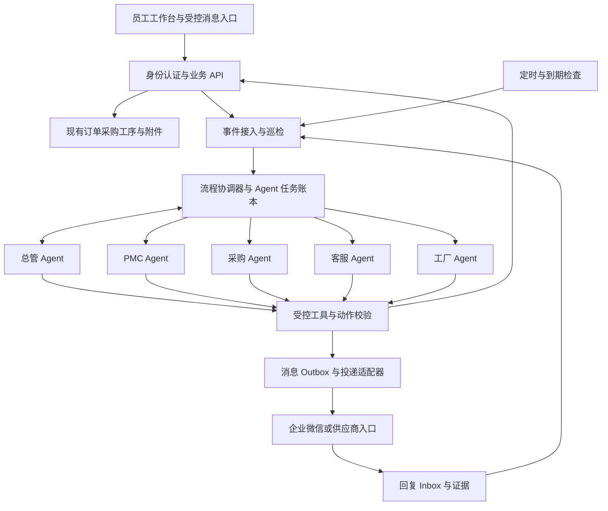

# DOON Agent 系统设计构想

> - 设计日期：2026-10-16（Asia/Shanghai）
> - 修订日期：2026-10-17（Asia/Shanghai）
> - 文档版本：v0.4，补入分阶段实施计划、当前完成度、优先级、待办及验收门槛
> - 代码核对基线：`b10a5121799102d50351112b19a6ae657dc4cc89`
> - 历史实验资料快照：`c8ee1a93924bd0808b67227532801160c226fc42`（`codex/mastra-local-validation`）；服务资源与监听归属补充记录：`768392e37a7fea08e381a278209dc28daf9dea7a`
> - 实施计划编制核对：2026-10-17；当时测试分支 `768392e37a7fea08e381a278209dc28daf9dea7a`，主线 `a35d40a80f1a59e249d4f80876187a41613f135c`；编制时仅只读比较
> - 准备阶段执行：已通过 `199624df584ccf50331387c5034321e8c725a9cc` 合入上述主线，纳入 v0.4 并整理合成契约资料；实际验收与待确认项见[准备阶段记录](../experiments/mastra-preparation/ACCEPTANCE.md)
> - 适用项目：DOON 订单协作中台，目标运行环境为阿里云 ECS

本文整理项目当前代码、Mastra 前期实验与本轮架构讨论，描述 Agent 系统的目标、职责、运行机制和落地边界。本文不是部署记录，也不表示文中方案已全部实现。除单独标明的历史验证结果外，架构、周期、资源预算和验收标准均属于建议方案。

本文统一使用 Agent 表示岗位智能体。组织岗位、Agent、实际负责人和执行进程是不同概念，一个岗位 Agent 可以服务多名获授权成员，也可以按任务绑定不同负责人。

v0.3 已将设计评审中的边界补入对应章节：委派授权与派生内容权限、共享采购事项和数量分配、事项再发生及暂停、承诺取值、Inbox/Outbox 事务、跨库执行核对和备份恢复、规则升级与影子运行切换。

v0.4 在第 22 节补入与测试分支实际进度对应的实施计划，区分已完成基础、待办、优先级、阶段依赖和验收标准，明确首个采购内部闭环及贯穿各阶段的运行保障。历史验收记录保持各自证据范围；本次修订仅编辑文档，没有新增实现、测试、模型调用、真实消息发送或部署，不操作业务数据和 8787 服务。

准备阶段执行补记：测试分支现已同步上述主线并建立[首条采购闭环资料](../experiments/mastra-preparation/README.md)。这些资料是合成契约和预期结果，不是 A/B/C 的实现或运行验收；真实业务映射与授权仍待确认。同步只带入主线已有代码，本轮未另改业务代码，也未操作业务库或 8787。

2026-10-17 本地 Studio 实施补记：测试分支新增[官方 Mastra Studio 本地入口](../experiments/mastra-studio/README.md)，登录后通过左上角原公司图标进入新标签页。原数据台布局保持不变；Studio 页面、静态资源及 API 复用会话并限定管理员/程序员。已提供离线合成的总管、PMC、采购、客服 Agent，演示工具委派、草稿工作流、最近 12 条消息的持久化记忆及本地执行轨迹。业务库与 Studio 库均为独立测试目录，未接正式数据、真实模型、企业微信或定时任务，也不代表第 22 节 A/B/C 已完成。该补记描述新增实现，前文 v0.4 的“仅编辑文档”限定于当时的规划修订。

## 目录

1. [目标与设计原则](#1-目标与设计原则)
2. [现有代码基础](#2-现有代码基础)
3. [前期验证与证据边界](#3-前期验证与证据边界)
4. [总体架构](#4-总体架构)
5. [总管与岗位 Agent](#5-总管与岗位-agent)
6. [Mastra 的组织方式](#6-mastra-的组织方式)
7. [事项、任务与事件模型](#7-事项任务与事件模型)
8. [两条核心业务链路](#8-两条核心业务链路)
9. [触发、调度与补跑](#9-触发调度与补跑)
10. [上下文窗口管理](#10-上下文窗口管理)
11. [Memory 管理](#11-memory-管理)
12. [Skills 设计](#12-skills-设计)
13. [Tools 设计](#13-tools-设计)
14. [身份、权限与审批](#14-身份权限与审批)
15. [企业微信与供应商交互](#15-企业微信与供应商交互)
16. [持久化、幂等与故障恢复](#16-持久化幂等与故障恢复)
17. [模型接入与调用预算](#17-模型接入与调用预算)
18. [阿里云部署与容量](#18-阿里云部署与容量)
19. [可观测性、审计与工作台](#19-可观测性审计与工作台)
20. [Mastra 复用与自主开发边界](#20-mastra-复用与自主开发边界)
21. [数据保全与发布策略](#21-数据保全与发布策略)
22. [实施阶段与验收门槛](#22-实施阶段与验收门槛)
23. [预期能力与实际限制](#23-预期能力与实际限制)
24. [待确定事项与参考依据](#24-待确定事项与参考依据)

## 1. 目标与设计原则

### 1.1 目标

建设按岗位分工、能持续追踪业务事项的 Agent 系统，覆盖发现异常、核实事实、分派任务、催办下游、接收回复、跟踪履约、超时升级和验证关闭。

主要场景：

- PMC Agent 从订单和齐料信息发现采购风险，委派采购 Agent 核查供应商履约情况。
- 采购 Agent 核对采购明细、供应商复期和收货记录，在允许的渠道发起催交并持续跟踪。
- 客服 Agent 发现工厂复期未兑现，要求 PMC Agent 核查；PMC Agent 再协调工厂 Agent 和对应工序负责人。
- 总管 Agent 汇总跨岗位异常，处理责任不清、结论矛盾、反复超时和多个事项之间的依赖。
- 管理人员能够查询当前风险、责任归属、最后有效回复、证据和下一步动作。

### 1.2 核心原则

1. **事实由业务系统提供。** 数量、日期、状态和权限由程序核算；模型负责理解、分析、沟通与提出协调动作。
2. **固定流程按规则执行。** 已明确的分派、到期提醒和升级规则无需每次重新调用总管模型。
3. **长期工作保存在账本中。** 聊天记录不能作为唯一任务存储，清空上下文不应导致工作丢失。
4. **动作通过受控工具执行。** 模型输出必须经过权限、版本、内容和幂等校验。
5. **新增记录与原始业务数据分开。** 默认只读引用既有订单、采购、历史版本和附件；不改变原记录、主键、关联或账号权限。
6. **自动化以已配置策略为边界。** 规则允许的内部催办可以自动执行；重要业务字段变更进入对应业务确认流程。
7. **处理完成须有依据。** 收到回复、重新承诺和实际履约是不同状态。
8. **按验证结果逐步开放能力。** 合成数据通过不等于真实模型、正式权限、消息通道和生产容量已通过。

## 2. 现有代码基础

### 2.1 已有可接入能力

| 代码位置 | 当前能力 | 对 Agent 设计的作用 |
| --- | --- | --- |
| `lib/domain.ts` | 成员、订单、`canRead` 和字段写入边界 | 复用业务权限口径；仍需补齐各模块的完整授权链路 |
| `lib/store.ts` | 共享状态快照、修订号校验提交、当前身份与业务审计 | 业务事实和正式写入的受控入口 |
| `lib/purchases.ts` | 采购来源版本、来源截至日期、复期、预计到货、下次催交、收货和退货待补 | 形成采购核查与履约判断工具 |
| `lib/purchase-api.ts` | 采购查询、跟进、收货事件、历史和版本检查 | 后续专用 API 的业务逻辑基础，不能直接向模型开放全部字段 |
| `lib/pmc.ts`、`lib/pmc-api.ts` | PMC 核对轮次、来源版本和排期维护 | 支持核查进度和来源变化识别 |
| `lib/ledger.ts`、`lib/departments.ts` | 日期、欠数、工序口径和部门职责 | 提供确定性的异常判定和责任范围 |
| `lib/project-collaboration.ts` | 负责人、任务状态、跟进历史、完成和确认 | 可借鉴任务设计；其任务绑定客户项目，不直接改造成全局追单账本 |
| `standalone/auth.mjs`、`standalone/runtime.mjs` | 本地会话、可信身份上下文、SQLite WAL、在线备份 | 阿里云 standalone 运行方式的接入基础 |
| `standalone/server.mjs`、`standalone/云端员工入口.md` | 员工入口、8787 后台、代理校验和 systemd 运维说明 | 保留现有员工入口，Agent 执行与长耗时请求分离 |

### 2.2 必须补齐的业务建模

- 采购记录的客户订单引用不等于完整 BOM、物料需求和齐套关联。多订单共料、分批采购、拆单合单和相同订单号不能靠模型猜测。
- 需要独立的、可版本化的订单—采购—工序关联记录，以及需求和数量分配依据；关联确认不改原始记录。不明确时建立待核查事项，不能由“存在关联”推导“已满足需求”。共享来源与数量约束见第 7 节。
- 采购预计到货日期是内部预期，供应商复期是供应商承诺。内部预计日期已过不能直接写成“供应商违反承诺”。
- 收货数量未知时应显示“待核对”，不能当作零收货；归档、取消、关闭和未审核状态均应按业务规则处理。
- 包装或入仓足量不代表验收、出货或结单。关闭条件必须与具体事项类型对应。
- 当前业务端共享快照会读取整个工作空间。初期由业务服务集中扫描并按可信身份和字段策略生成事实投影，Agent 不接收完整工作空间快照，也不直接读取业务库。后续按实际规模增加增量接口，避免各岗位重复全表扫描；快照修订号与动作来源版本的区别见第 13.4 节。

## 3. 前期验证与证据边界

### 3.1 证据来源及版本

本节依据用户提供的初期 P1 `README.md`、`ACCEPTANCE.md`，本机实验 worktree 中的 P0 README 和部分测试实现，以及刷新远端后取得的实验分支最新验收材料整理。最新材料包括 P2、真实模型与身份修复、主线认证及资源权限适配、员工网关和云端空闲基线。结果按对应历史验收报告引用；本轮仅阅读材料和部分实现，没有重新运行这些实验，也没有将实验代码合入主线。

| 项目 | 历史记录 |
| --- | --- |
| 实验分支 | `codex/mastra-local-validation`，独立于主业务运行时 |
| P0 基线 | `ab0ad731323d2f2056f26490bd1d68e98506f049` |
| Mastra 上游提交 | `f88217d19b63d362ff97723c1a339fbf89a1bbb0` |
| 固定依赖 | `@mastra/core 1.77.0`、`@mastra/libsql 1.26.1`、`zod 3.25.76` |
| P1 权限纯函数编译 | `esbuild 0.28.0` |
| 后续真实模型适配器 | DeepSeek 原生适配器 `3.0.52`，实验固定依赖 |
| 历史运行环境 | Windows PowerShell；原报告 Node 24.14.0，复现记录 Node 24.19.0 |
| 验收记录日期 | 2026-10-15 至 2026-10-16，北京时间 |

所有实验使用合成员工、订单及独立临时库。初期 P0/P1 使用脚本模拟模型，后续 P2 和两轮 P1 联调已调用真实 DeepSeek 官方 API；始终没有接正式业务库或企业微信。初期 P1 身份选择器后续已关闭，并逐步改为合成凭据与主线认证源码适配，仍不是正式员工生产入口。

### 3.2 P0：已记录的 11 项集成验证

| 验证项 | 已支持的有限结论 |
| --- | --- |
| 每日新上下文 | 同一 Agent 的下一次无记忆调用不包含上一轮私有标记 |
| Schema 工具调用 | SDK 能完成真实工具执行循环 |
| 人工批准 | 暂停期间无工具副作用，批准后才执行 |
| 多 Agent 交接 | 过滤后的交接没有传递父会话私有标记 |
| 固定脚本工具 | 可通过受控工具执行限定参数的本地脚本 |
| 工作流跨进程恢复 | 一个进程暂停，另一个进程读取持久化状态继续 |
| 人工拒绝 | 拒绝后未创建合成任务和对应业务审计 |
| 审批人不匹配 | 应用校验拒绝非指定审批人 |
| 来源已变化 | 应用版本校验阻止旧审批放行 |
| 重复执行 | 相同动作重试 100 次仅形成一项任务与一项审计，变更内容被拒绝 |
| 调度定义持久化 | 暂停状态的北京时间计划重建后仍存在，未绑定历史会话 |

验收记录：11 项通过；711 个恢复的上游原始核心文件与固定提交 Git blob 匹配；另有 5 项直接源码检查通过。未完成上游 monorepo 全量构建或全量测试。

审批人、来源版本和幂等保护是实验应用代码实现的保障。计划持久化没有证明真实时钟触发、跨日执行和宕机补跑。

### 3.3 初期 P1：已记录的 23 项自动化验收

| 范围 | 数量 | 记录中的验证内容 |
| --- | ---: | --- |
| 权限与合成数据适配 | 7 | 实际 `canRead` 适配、员工客户范围隔离、禁用及供应商拒绝、DTO 白名单、分页和来源失效、读取不改源对象 |
| HTTP、Agent、建议与恢复 | 9 | 未登录拒绝、SDK 经 HTTP 只读工具查询、4 条建议归属、来源变化和撤权隐藏、业务写入拒绝、伪造来源拒绝、本机地址边界、完整及部分结果恢复 |
| SDK 补充验证 | 7 | generate/stream 工具循环、无记忆新调用、批准及拒绝、libSQL 审批暂停跨进程恢复，含内部 reasoning 标记保存 |

页面验收记录包括两员工各自只能看到其范围订单与建议、身份切换清空旧内容、详情与空态，以及浏览器页面错误日志为空。没有批准、保存、派发或写回入口。

数据不变检查覆盖合成源对象、建议库哈希及跨进程恢复后的既有建议；部分结果通过应用幂等重算补齐。实验修复了默认跟随重定向和用“库非空”误判生成完成的问题。

这些结果不等于正式库完整性核验，不等于 Durable Agent 崩溃重放认证，也不证明大模型判断质量。P1 工具发现超过单页 50 条时中止生成，不能据此宣称已经支持全量订单巡检。

### 3.4 P2：真实 DeepSeek 协议与恢复验证

后续 P2 报告记录：官方 `deepseek-v4-pro`、thinking 开／关下的普通工具、流式工具、跨进程模拟批准和拒绝共 8 个场景、12 个子进程阶段通过。16 次官方请求均 HTTP 200，含 12 次非流式和 4 次 SSE；4 个开启 thinking 的场景核对了 reasoning 哈希回传。

批准前零副作用，恢复批准后各产生一条合成效果，拒绝后零效果。审批决定由测试程序模拟，使用正常退出后的重建，不代表真实审批身份、任意崩溃或断电恢复。初轮保守费用估算为 ¥0.092809，不是供应商账单。历史记录见 [P2 验收](https://github.com/DOON-100/doon-order-workspace/blob/c8ee1a93924bd0808b67227532801160c226fc42/experiments/mastra-p2/ACCEPTANCE.md)。

对抗 HTTP 请求覆盖跨客户、伪造身份、额外字段、旧版本写、重复请求、绕过审批、附件和批量超限。初期公开选择身份的缺口曾被明确复现，随后被修复；写入口关闭时的拒绝不计为未来写操作的权限或幂等验收。

### 3.5 后续 P1：身份与真实建议链路

实验先关闭自由选择身份入口，以服务端凭据和会话控制 A/B 合成员工，并在工具和最终提交前重验权限、来源版本及完整 DTO 指纹。模型仅选择已读取来源与允许规则，提案经应用校验后生成固定文案并按单员工事务保存，模型自由文本不直接写入建议。

独立合成认证版本的真实模型联调新增 6 次官方请求，A/B 各产生 2 条建议，4 次连续工具循环的 reasoning 哈希核对通过；当时 P1 完整套件 85/85，P2 离线套件 29/29。该轮累计 22 次请求、保守估算 ¥0.191215。详见 [身份与模型历史验收](https://github.com/DOON-100/doon-order-workspace/blob/c8ee1a93924bd0808b67227532801160c226fc42/experiments/mastra-p1/AUTH-MODEL-ACCEPTANCE.md)。

后续将主线 `standalone/auth.mjs` 与 `runtime.mjs` 原文复制、哈希核对后在独立子进程及新合成 SQL 库执行，验证真实建账号、scrypt、首次改密、会话、注销、撤销及跨 worker 恢复。通过 17 个白名单权限模块适配订单九角色、CRM、团队和三类任务规则；P1 当轮 147/147，其中认证 15 项、资源权限 34 项、认证 HTTP 9 项等已包含在总数内。详见 [主线认证与资源权限验收](https://github.com/DOON-100/doon-order-workspace/blob/c8ee1a93924bd0808b67227532801160c226fc42/experiments/mastra-p1/PROJECT-AUTH-ACCEPTANCE.md)。

上述认证真源仍为合成状态，没有连接真实员工和正式数据库。主线函数的适配通过支持后续实施，不等于整个生产路由栈或生产跨库一致性通过。

### 3.6 最新 P1：新认证真实复测与员工网关

新认证路径再次接入真实 DeepSeek：新增 6 次请求，A/B 各 2 条建议；来源深比较未变、跨客户读取 404、4 次 reasoning 哈希回传通过。该轮输入／输出为 7,215／1,015 tokens，保守估算 ¥0.092341；累计 28 次请求、¥0.283556，未知 usage 为 0。金额为历史报告的保守估算，不作为当前费率或生产成本预测。

另有员工网关实验原样复制并核验五个认证／网关／服务源文件，以新临时目录和回环随机端口运行原生 HTTP 登录、改密、会话与退出。业务 workspace API 被明确的只读身份探针替代。网关桥接到 P1 的建议链路使用 mock 模型；收费 DeepSeek 复测走 `project-auth` 子进程路径，两者不能合并描述成一次真实 TLS＋HTTP 网关＋收费模型端到端验收。

| 最新报告项目 | 记录结果 | 边界 |
| --- | --- | --- |
| P1 完整套件 | 162/162，0 失败、取消和跳过 | 包含原生网关 12 项、桥接与建议 3 项等；不再与早期 23/85/147 相加 |
| P2 离线回归 | 32/32 | 无真实模型费用，不重复计入收费场景 |
| 云采样脚本 | 语法／帮助通过，12/12 离线模拟 | 未在 ECS 执行脚本，不能代替实机容量 |
| 原生网关 | 登录、改密、会话、退出、CSRF、角色与 Cookie 属性等 | HTTP 模拟代理头、手动回传 Cookie；真实 TLS 和浏览器策略未验收 |

最新结果见 [登录、模型复测与网关验收](https://github.com/DOON-100/doon-order-workspace/blob/c8ee1a93924bd0808b67227532801160c226fc42/experiments/mastra-p1/LOGIN-LIVE-ACCEPTANCE.md)。历史费用账本应保留累计记录，不换目录清零；本次整理文档没有调用收费模型。

### 3.7 云端空闲基线

实验分支最新报告记录用户在 2026-10-16 北京时间 23:28:49 起提供的短时手动采样：可用内存快照约 2.9 GiB，剔除 vmstat 首行后的 10 个一秒区间 CPU idle 平均约 98.8%，根分区可用约 60G，短窗口未观察到交换活动，并提供了运行服务清单。

这些是用户提供的非敏感摘要，未由本轮助手远程复核；不能推导业务高峰、最小可用内存、Agent 吞吐或同机影响。项目源码采用 SQLite，云端实际运行版本和配置仍待确认。详见 [云容量记录](https://github.com/DOON-100/doon-order-workspace/blob/c8ee1a93924bd0808b67227532801160c226fc42/experiments/mastra-p1/CLOUD-CAPACITY-ACCEPTANCE.md)。

后续用户提供的单次服务属性显示项目服务和 Nginx 均在运行，当前内存分别约 56.7 MiB、6.7 MiB，所报统计峰值分别约 66.5 MiB、10.2 MiB，自动重启计数均为 0。相邻监听摘要中，8787 的监听 PID 与项目服务 MainPID 一致。两次查询未附同步时间，不据此推断持续稳定或业务健康；服务级限制为 infinity 也不能排除父级限制。补充记录见 [服务资源与监听归属](https://github.com/DOON-100/doon-order-workspace/blob/768392e37a7fea08e381a278209dc28daf9dea7a/experiments/mastra-p1/CLOUD-CAPACITY-ACCEPTANCE.md)。公开文档不记录实际 PID、实例标识或私有服务配置。

### 3.8 仍未验证的能力

- 真实模型的大范围业务判断质量、错误建议与漏报率、429／超时／断流、持续负载和成本稳定性；已有小样本协议联调不覆盖这些。
- 真实员工及生产会话接入，Agent 专用授权，生产来源一致性，真实 TLS／浏览器和 HTTP 网关＋收费模型组合。
- 超出已测主线纯函数矩阵的完整业务路由、全部字段、对象附件和持续并发权限。
- 正式追单状态机、可信审批、事务幂等账本、不可变审计和业务写回。
- 真实定时触发、重复触发、异常退出恢复、跨日上下文与宕机补跑。
- 企业微信供应商外部群主动发送、获取回复、身份关联和发送回执。
- Linux 存储兼容、生产备份还原、规模分页、资源容量及持续运行。
- PostgreSQL 等替代存储；SQLite/libSQL 的实验通过不能迁移为其他数据库的验证结论。

本次文档编写未重新执行上述历史测试。不同阶段的完整套件含有重叠用例，不能将 23、85、147、162 相加作为独立验证数。主项目历史 TypeScript 结果、未完成的业务回归均不计为本次通过。

## 4. 总体架构



各组件的职责：

| 组件 | 职责 |
| --- | --- |
| 业务系统 | 保存正式业务事实、既有权限和历史，处理正式业务提交 |
| 巡检与事件接入 | 形成异常候选，接收回复和业务变化，避免重复读取和重复触发 |
| 流程协调器 | 执行固定路由、状态转换、领取锁、幂等和超时策略 |
| 总管 Agent | 分析复杂异常、跨岗位协调、全局风险摘要和管理问答 |
| 岗位 Agent | 在授权事项内核实、分析、跟进并返回结构化结果 |
| 任务账本 | 保存事项、任务、承诺、下一步、证据、版本和执行历史 |
| 工具层 | 控制可调用 API、字段、记录范围和实际副作用 |
| 消息适配层 | 处理渠道差异、群绑定、频率、发送状态和回复关联 |
| 运维层 | 进程托管、监控、资源限制、备份和恢复 |

全局值守是整个服务持续运行。总管模型在需要协调时被调用，不持续占用一次推理，也不把所有明细常驻在上下文中。

## 5. 总管与岗位 Agent

### 5.1 总管 Agent

总管有以下职责：

- 查询授权范围的风险汇总、未结事项、阻塞和超时。
- 对责任不明确、跨岗位结论冲突和多个依赖事项进行分析。
- 提出分派、合并、补充证据、升级或待人工决策的结构化动作。
- 汇总岗位处理结果，并回答管理人员的问题。

总管不直接判断不存在证据的实际履约，不擅自更改正式交期、数量和权限，不持有任意数据库或服务器操作工具。

### 5.2 岗位划分

| Agent | 核心职责 | 主要交接对象 |
| --- | --- | --- |
| PMC Agent | 齐料、复期、生产瓶颈和交付风险协调 | 采购、工厂、客服 |
| 采购 Agent | 采购关联、供应商复期、欠交、补料及履约核查 | PMC、供应商、采购负责人 |
| 客服 Agent | 客户承诺风险、核查请求和已确认进展汇总 | PMC、客服负责人 |
| 工厂 Agent | 工序实绩、瓶颈和原因核查，收集进度依据 | PMC、工序负责人或主管 |
| 总管 Agent | 跨岗位协调、反复超时、冲突和全局风险 | 各岗位 Agent、获授权管理人员 |

供应商首先是外部参与方，不要求供应商部署 Agent。岗位与实际负责人用独立的 `agent_assignment` 映射，记录范围、有效期、替补和版本。文员转为主管接收任务时修改映射，不重写工作流，也不自动改变原账号权限。

## 6. Mastra 的组织方式

### 6.1 建议模块

以下为拟新增的逻辑模块，不代表目录已经建立：

```text
agent-runtime/
  agents/          总管与岗位 Agent 定义
  workflows/       单轮协调、证据核查、审批与结果归并
  tools/           受控业务查询与动作
  skills/          经过审核和版本管理的业务操作规范
  policies/        路由、动作、升级、字段与接收范围策略
  context/         当前任务资料包、预算和脱敏
  memory/          会话隔离、摘要与检索适配
  scheduler/       触发接入与补跑核对
  ledger/          事项、任务、运行、Inbox 和 Outbox
  channels/        企业微信与工作台适配
  observability/   指标、追踪和审计关联
```

初期独立依赖及 lockfile，沿用已验证版本作为候选基线，不直接把实验目录合并到正式服务。新文档中的 API 能力须对照固定版本确认后再实现。

### 6.2 两种委派

| 委派形式 | 场景 | 实现选择 |
| --- | --- | --- |
| 同轮分析 | 总管请采购 Agent 分析已授权异常，当场返回结论 | 原生 subagent 或受控工具封装调用 |
| 持久化任务 | 采购需追供应商，等待数小时或跨天 | 创建任务、提交队列、单独唤醒岗位 Agent，结果通过事件返回 |

长等待优先以应用任务状态表达。Mastra 工作流可以在需要时暂停和恢复，但所有未结事项不应依赖一个永不结束的总管会话。机制参考 [Mastra Workflows](https://mastra.ai/docs/workflows/overview) 与 [Subagents](https://mastra.ai/docs/subagents)。

以上分类描述执行方式，不决定授权方式。同轮调用与持久化任务都必须明确采用第 14.2 节的哪种授权模式，不能因更换 Agent 或转入后台队列而扩大权限。

### 6.3 单轮协调

```text
校验事件、授权模式与当前权限
→ 读取事项版本、自动跟进控制状态和最新事实
→ 应用固定规则
→ 必要时调用 Agent 分析
→ 校验结构化决策
→ 以事项版本为条件，原子保存任务、事件和待执行动作
→ 经出站许可及目标服务校验后执行，或保存等待状态
→ 记录本轮结果
```

所有模型结论均带证据引用；任务 ID、身份和真正授权由服务端产生。模型可以提出目标岗位，服务端依据责任配置选择实际负责人并检查是否可接收该任务摘要。

新执行与恢复对账使用不同路径。已出站动作先查询原动作结果，不因为来源版本变化就认定其从未成功；具体顺序见第 16 节。发生版本冲突时重新读取并按预算有限重试，不在数据库事务内等待模型或网络。

## 7. 事项、任务与事件模型

### 7.1 独立记录与版本

以下均为拟定记录或表，尚未实现；字段为设计要点，不表示已完成 schema、权限或事务验收。不将原订单改成 Agent 任务，不重建业务主键。

| 拟定记录类型 | 作用及关键字段示例 |
| --- | --- |
| `agent_case` | 业务异常；caseId、类型、规范业务范围、来源引用、caseVersion、状态、主责岗位、截止时间、previousCaseId、autoFollowupState、controlEpoch |
| `agent_impact` | 事项间的多对多影响关系；订单风险事项、采购事项、关联依据、数量核算引用、版本和有效性 |
| `agent_task` | 岗位工作；caseId、任务版本、依据的 caseVersion、目标岗位、负责人、范围、状态、结果、下次检查；发起人、委派模式和授权依据见第 14.2 节 |
| `agent_event` | 追加的过程事实；事件 ID、事项、发生及接收时间、实际参与人、因果关联、证据摘要 |
| `agent_commitment` | 承诺；来源、适用采购行及批次、数量口径、单位、日期、核查状态、确认人、替代关系及版本 |
| `agent_run` | 执行；runId、任务、尝试次数、lease 与领取版本、模型/规则版本、耗时和用量 |
| `agent_action` | 动作；caseId、依据的 caseVersion、任务及来源版本、策略版本、内容哈希、幂等键和结果 |
| `agent_inbox` / `agent_outbox` | 收发账本；渠道事件 ID、目标绑定、消息哈希、状态、回执和重试时间 |
| `agent_approval` | 授权凭证；动作、确切内容、版本、指定审批人、有效期和一次性执行状态 |
| `agent_assignment` / `agent_policy` | 职责与策略；岗位映射、范围、替补、允许动作、版本和生效时间 |

事项状态、主责、有效范围、有效承诺或自动跟进设置发生实质变化时，`caseVersion` 递增；追加技术观测不应无条件使所有任务失效。任务结果归并、审批及动作执行须校验当前事项版本、任务版本、来源版本、权限和适用策略；持有 lease 的执行还须校验领取版本。校验与账本提交在同一事务完成，正式业务与外部发送的边界见第 16 节。

旧版本结果不能直接推进事项，也不能简单丢弃：保留原结果为待复核证据，按当前版本确认仍适用后重新归并。并行任务分别记录执行者和状态，事项另设主责协调人；事项摘要由未完成依赖和有效证据归并，不能由最后返回的 Agent 覆盖。一个子任务完成不自动关闭整体风险。

### 7.2 唯一事项与影响关系

采购欠交事项按“采购行稳定 ID＋异常类型＋规范业务范围”识别，同一键最多存在一个非终态事项。范围由可信来源及经确认的批次、品项或履约区间确定，不采用模型自由文本，也不包含负责人、Agent 名称、当天日期或规则版本。范围无法确定时保持待核查，不据此拆出多个自动催办事项。

规范业务范围还须检查包含和重叠关系，不能让“整行欠交”和覆盖同一数量的“批次欠交”仅因键不同就各自催办。拆分或合并范围由经确认的业务规则处理，原事项与新范围建立替代关系，明确未决动作和数量归属；无法排除重叠时不新增自动催办。

订单风险事项通过 `agent_impact` 引用采购事项：一条订单可受多个采购事项影响，一个采购事项也可影响多个订单。不能为每条订单复制同一采购欠交事项。采购催办、回复、承诺和履约证据在采购事项中保存一次；订单入口按权限引用，并独立判断本订单的齐料影响。关联记录版本化，确认关联不改原始订单、采购或库存记录。

跨天巡检复用未结事项；发布规则或调整人员不复制事项。同一供应商的消息可以合并，但必须保留采购行、批次和证据边界，不把共用采购行的数量重复相加。不同供应商不得合并披露。

初期统一采用“再次发生即新建 caseId”的方案，并以 `previousCaseId` 引用同一业务键的前一已关闭或已取消事项，不在旧 caseId 中另开轮次。只有最新事实确认需要重新处理，或获授权人员提出重新核查且通过去重检查，才创建新事项；新事项从待核查开始。旧关闭依据、审批和动作不能继承为本轮授权，创建前仍须核对旧事项未决出站，不能借换 caseId 绕过原动作幂等。保留因果与委派路径，禁止无新增证据的往返转派；自动委派初期限 4 层，超限转人工。

再次发生需有关闭后新的异常事实或经授权的重新核查依据。取消时保存适用范围、原因及禁止自动重建的条件；条件仍成立时，重复巡检不能用相同旧事实重建事项。恢复该范围的自动发现须有明确的新事实或授权变更并留痕。

### 7.3 允许的状态转换

事项、岗位任务和实际执行分别保存状态。执行可以排队、运行、暂停、完成、失败或结果待核对；执行完成不等于任务验收，更不等于业务履约。升级记录为事件和级别，不替代事项状态。

| 事项转换 | 必要条件 |
| --- | --- |
| 新建 → 待核查 | 通过唯一键检查，保存来源、原因及当前证据 |
| 待核查 → 处理中 | 范围与事实足以开展工作，主责及下一步明确 |
| 处理中 → 等待回复 | 内部任务已有效分派或消息已达到可等待回复状态，设置回复期限；队列入账不冒充发送成功 |
| 等待回复 → 处理中 | 收到可关联回复，或到期进入无回复处理；回复内容仍需核查 |
| 处理中 → 等待履约 | 存在适用范围内已确认的有效承诺，明确到期核查点 |
| 处理中／等待回复／等待履约 → 待验证 | 获得待复核的履约证据，或履约检查到期；口头“完成”仅触发验证 |
| 待验证 → 已关闭 | 当前来源与类型对应的关闭条件全部满足，保存核算结果及证据快照 |
| 待验证 → 处理中／等待履约 | 验证不通过后继续处理；后者必须有尚有效的承诺，不能凭新日期掩盖旧失约 |
| 任一非终态 → 待核查 | 来源、数量、关联或证据出现实质变化或冲突，当前结论不足以继续 |
| 任一非终态 → 已取消 | 获授权人员或明确策略确认事项不再适用，记录理由并处置未决动作；取消不表示已经履约 |

未列出的转换默认拒绝；无状态变化的证据追加仍保留事件。关闭和取消后不直接重开。晚到回复、回执和履约凭证继续按原事项留痕，真实投递结果可更新对应动作，但不得自动推进旧事项或触发新发送；需要重新处理时按 7.2 建立新事项。

岗位任务的正常路径为“待分派 → 已分派 → 处理中 → 已提交结果 → 已验收”；处理中可进入阻塞并在条件满足后返回。结果被退回时记录理由、递增任务版本后回到处理中；任一未终结任务可按权限取消。已验收或已取消任务不直接恢复，后续工作新建任务并关联旧任务。关闭事项前须确认所需任务与证据，不能只检查任务计数是否归零。

### 7.4 自动跟进与人工控制

`autoFollowupState` 独立于业务状态，取值为“运行、暂停中、暂停、人工接管”。暂停中的事项仍可能等待履约，不能被显示为已解决。初次启用及影子事项转正式跟进还须满足第 22 节的试点与存量接管条件。

暂停请求通过权限与版本校验后立即进入暂停中，停止自动派发后续任务并阻止新的自动出站许可；正在分析的结果仅可作为待复核证据保存。投递前必须执行第 16 节的出站许可检查，不能只看入队时的事项状态。

已取得出站许可或已提交渠道的动作列为在途，不能宣称已经取消或撤回；发送结果不明时继续查询或人工核对，不自动重发。待执行动作已冻结、在途清单及后续核对责任已明确后，可进入暂停或人工接管，界面继续显示未决在途结果。暂停不关闭收件与证据入口。

人工接管停止自动决策推进，显式人工动作仍需当前权限、版本和出站许可。恢复先以原稳定 actionId／业务幂等键查回执；已出站未决动作保留原标识，不能换 ID 重发。确定未执行，且内容、业务意图、来源与权限仍适用时，可按当前版本重新授权原动作，生成新的 attempt 和出站许可；只有内容或业务意图确实变化时才新建关联的替代动作并重新审批，仍不得绕过旧动作的未决结果。恢复计划须重新读取事实和有效承诺，不盲重发旧 Outbox 或积累的历史催办。

## 8. 两条核心业务链路

### 8.1 PMC → 采购 → 供应商

1. 巡检发现订单齐料风险，先检查来源截至时间、审核状态、需求数量、单位及订单—采购—工序关联。资料不足时建立原因明确的待核查事项，不向供应商直接发送欠交结论。
2. PMC 创建订单风险事项并引用已有采购欠交事项；确无对应未结事项时才按唯一键新建。采购 Agent 查询对应采购行、供应商复期、内部预计到货、已收、验收及退货待补，多个订单共享同一核查结果。
3. 程序确认有效欠交后，按策略形成催交动作；每个动作绑定采购范围、事项及来源版本。消息层在出站许可检查中复核供应商、群绑定、允许披露字段及暂停状态。
4. 收到回复后保存原件或原文引用及实际回复人，核对采购行、批次、数量、日期和单位。自然语言或表格提取先进入待核查承诺，不能直接成为正式复期或自动关闭依据。
5. 对已确认的有效承诺安排到期核查；无回复、失约、日期冲突或责任不明按策略升级。收到部分货物只核减对应范围，不把整行或所有受影响订单一起标记完成。
6. 采购事项达到其关闭标准后，通知 PMC 重新计算各订单的齐料与投产风险；下游已关闭不代表上游风险自动解除，不改写原订单。

### 8.2 需求、分配与净合格量

关联成立只表示存在业务联系，不表示已为订单分配足够物料。拟定的版本化核算引用至少记录：需求来源及版本、物料/规格和批次、需求量、基础单位、允许的换算依据、对应采购行、经确认的分配量及凭证。新增关联和核算引用不替代正式库存预留、领料或采购分配流程，也不自动写回这些业务字段。

净合格量仅采用同一范围内已审核、具有验收依据的实收量，扣除其后确认的退货、冲销或失效数量，且同一扣减凭证不得重复计算。若原系统已经提供净值，应使用明确口径的净值，不能再次扣退货。预计到货、供应商承诺、在途量和未验收收货不能计作净合格量；缺失收货信息是未知，不是零。

按采购行及批次维护可核对的数量守恒：同一份净合格量不能同时计给不同订单，已分配或已履约份额不得再次计入其他需求。退货或来源修正使既有分配依据失效时，标记受影响关联待核查，保留旧依据，不自动调走其他订单的份额。退货待补是待履约需求，不因供应商承诺补发就恢复合格可用量。

例如，采购行 P 的净合格量为 100 件，订单 A、B 各需求 80 件；两条关联不能让 A、B 都被判为齐料。经确认分配 A 80、B 20 时，A 的该物料满足需求，B 仍缺 60；若尚无分配依据，两订单均显示“分配待核查”，不能由模型选择优先顺序。即使 A 的该物料足量，也须核对其他必需物料及适用条件后才能判断整单齐料。

采购单位、需求单位或退货单位不同，须有经确认、带版本的转换关系；不同规格、批次和不可互换物料不能直接相加。数量未知、需求口径缺失、共料分配不明、转换失效、多行关联不明、源表过旧或未审核分别使用原因码，阻止自动齐料判断与无依据催交。

### 8.3 有效承诺与正式复期

正式采购复期、内部预计到货和 Agent 收到的承诺是三类资料。前两者来自原业务系统；内部预计日期过去不等于供应商违约。独立承诺用于追踪和核查计划，不自动修改正式复期；正式字段变更仍须经有权限人员确认及原业务接口校验。

承诺应明确采购行、批次、数量和单位，并区分“追加数量”“累计交付目标”与“剩余未交数量”。“明天交”“再送 50”在日期或数量口径未核清前不生效。只对同一适用范围内、已确认且未撤销的承诺建立明确替代关系；不能简单按最新消息覆盖全部批次或订单。互相冲突且未解决的承诺转待核查，不自动择优。

核查计划采用当前范围的已确认有效承诺；确认新承诺会更新该范围的下一核查点和事项版本，旧承诺及已发生失约继续保留，原风险不因重新承诺而关闭。部分替代只影响对应数量或批次，其余承诺仍独立到期。没有已确认有效承诺时，保持核查或按已批准策略追问，不借内部预计日期虚构供应商承诺。

工作台分别展示“正式复期”“当前有效承诺”和“下次核查时间”，说明是否已同步正式业务；任何同步都必须有对应正式提交结果。待核查的新回复不能延后有效承诺的到期检查，也不能消除已有升级。承诺的到期核查与采购欠交、订单齐料的关闭条件分别计算。

### 8.4 客服 → PMC → 工厂

1. 客服 Agent 识别工厂复期到期且未取得完成依据的订单，向 PMC 请求核查，引用当前订单及承诺版本。
2. PMC 对照排期、工序实绩和材料信息定位阻塞点；涉及采购时复用对应采购事项及影响关系，不再创建一套催办。
3. 工厂 Agent 经岗位映射向相应工序负责人索取进度、原因和计划，记录实际回复人及证据。各工序任务独立反馈，由主责协调人归并。
4. 多部门结论矛盾时交总管协调，保留冲突与待验证部分，不自动选择有利版本。任务“已提交结果”不能代替工序实际完成。
5. 客服仅获得获授权、已确认的进展和待处理事项；对客交期承诺仍走正式业务权限与确认流程。

系统只有在实绩或凭证满足具体事项类型的规则时才能关闭。负责人回复“完成”只触发验证，不能替代入仓、验收或出货依据；部分履约和重新承诺不得错误关闭整体风险。

## 9. 触发、调度与补跑

### 9.1 初始触发配置

以下频率为试点建议，须结合数据量、服务器资源和业务工作时段调整：

| 触发类型 | 建议 | 处理方式 |
| --- | --- | --- |
| 新回复、岗位结果、关键业务变化 | 入队后约 10–30 秒合并 | 处理相关事项，复杂情况再调用模型 |
| 任务或承诺到期 | 每分钟检查 Agent 账本 | 领取到期任务，执行规则或唤醒 Agent |
| 订单、采购和工序巡检 | 每 15 分钟 | 集中判断异常；无变化时跳过重复分析 |
| 全局风险汇总 | 每日 09:00、17:30，北京时间 | 汇总重点风险、未结事项和需介入内容 |
| 人工询问或要求核查 | 按需 | 依据请求人的真实身份与范围运行 |
| 服务恢复 | 启动时一次核对 | 恢复到期任务、失效 lease 和未决动作 |

触发频率不等于消息发送频率，也不保证上述秒数内完成模型分析。内部与外部通知分别配置工作时段、冷却时间、合并窗口和升级阈值。

### 9.2 调度实现

候选方案为 Mastra Schedules 触发工作流，systemd 托管长驻进程。正式接入须验证固定 SDK 版本的 scheduler 启动方式、时区和持久化行为，不仅创建计划定义。

每个计划只能有一个主调度入口。若改用 systemd timer，停用对应 Mastra 计划；不得让两个调度器独立执行同一业务计划。运行拓扑参考 [Mastra Scheduled Workflows](https://mastra.ai/docs/workflows/scheduled-workflows)。

调度入口只产生持久化任务，业务执行依赖账本领取。模型暂不可用时，已授权的固定规则和待办跟踪仍可继续。

每个计划执行窗口使用稳定键，例如 `scheduleId + 计划代次 + scheduledFor`。计划代次仅在执行语义经过确认的变更时更新，不因进程重启或每次尝试生成新值。同一窗口重复触发只定位已有执行记录。窗口记录、任务入队和扫描进度推进在同一 Agent 账本事务中完成；进度只表示任务已持久化，不表示业务已经处理成功。执行成功、失败和补跑分别留痕，调度器内存不能作为完成依据。

计划改时、停用或更换调度器时，先持久保存切换边界和旧窗口处理策略，再启用新入口。新旧进度不能各自独立推进；不得用更新策略版本的方式绕过去重。服务恢复时按已入队窗口与实际执行状态核对，不仅查看最近一次成功时间。

### 9.3 时间与补跑

- 时间戳以 UTC 保存，业务日期及展示明确使用 `Asia/Shanghai`。
- 记录计划时间、实际入队时间和实际执行时间，避免将延迟执行伪装为准时。
- 数据修订号不变时仍检查到期时间；时间推进本身可能产生新风险。
- 断机恢复后依据执行账本核对遗漏，合并过期巡检，重新读取最新事实；不补发停机期间每一条历史催单。
- 已归档、已撤权、已履约或来源已失效的待执行动作应取消或转核查。
- 队列积压时优先到期承诺和高影响事项，汇总任务可延后；指标展示实际延迟。

初次启用与宕机补跑分开处理。影子事项不会自动因服务启动或模式切换转成真实派单；存量接管流程见第 22.1 节。

## 10. 上下文窗口管理

### 10.1 每轮资料结构

| 层次 | 内容 | 管理方式 |
| --- | --- | --- |
| 固定指令 | 职责、边界、输出格式 | 版本化，与组织策略分开 |
| 触发资料 | 事件、时钟、目标和本轮预算 | 本轮有效 |
| 事项摘要 | 状态、责任人、期限、阻塞和最后有效结果 | 从账本生成，带版本 |
| 当前事实 | 授权字段、数量、日期、来源截至时间和版本 | 通过受控工具刷新 |
| 关键历史 | 有效承诺、冲突、升级与确认结论 | 按当前权限筛选 |
| 按需证据 | 明细或相关来源 | 分页读取，限定返回量 |

总管的全局视图优先是按风险和部门聚合的摘要，处理某事项时再读取详情。岗位 Agent 仅获得完成该任务所需的投影，不共享全局资料。

### 10.2 初始预算

| 项目 | 建议值 | 说明 |
| --- | --- | --- |
| 常规单事项输入 | 约 8k–16k tokens | 包括指令、工具定义、事实和当前工具返回 |
| 复杂事项输入上限 | 先设 32k tokens | 不等于模型标称最大窗口 |
| 单轮输出预算 | 约 4k tokens | thinking 的额外消耗按实际供应商协议计入 |
| 模型工具循环 | 初期最多 6 步 | 子调用和重试另计，并设全链路总预算 |
| 同轮分析委派 | 初期最多 2 次 | 持久化岗位任务不靠无限嵌套处理 |

预算由服务端实施，超过后拆分任务、缩小查询或暂停待核查。必须计算每次工具返回后的实际上下文，不仅限制初始输入。结果截断、分页未完成和证据缺失必须显式标记。

### 10.3 摘要与截断

- 摘要保留来源引用、版本、时间、未决问题和已确认承诺，不能只留下结论。
- 优先缩减重复工具结果与无关历史，不能截掉权限指令、待执行动作或未完成工具调用所需的消息。
- 保持工具调用和结果配对，遵守模型供应商对 reasoning 等协议字段的要求。
- 不在真实模型协议未验证时直接应用通用删除消息策略。
- 大表先由程序计算异常候选；模型读取候选和必要证据，完整分页工作由工具完成。

### 10.4 多 Agent 上下文交接

原生 Mastra subagent 默认会接收父会话上下文。项目使用白名单交接资料包，过滤父会话，并设置过滤失败即中止。前期测试已覆盖 `messageFilter` 和 `hookErrorStrategy: 'throw'` 的合成情形。默认行为与钩子见 [Mastra Subagents](https://mastra.ai/docs/subagents)。

过滤不能只检查历史消息。委派 prompt、附件引用和返回结果也必须投影；更稳妥的正式岗位任务由应用从账本重新生成授权资料包，再独立调用岗位 Agent。

### 10.5 每次模型出站前的检查

权限检查同时覆盖向模型供应商发送数据的边界。首次调用、工具结果续轮、重试、子 Agent、摘要和恢复调用均检查当前授权主体、任务范围、来源依赖、允许外发字段及预算。模型循环不得把首次鉴权视为整个运行期间持续有效的凭证。

资料包记录来源依赖与授权版本。发现停用、撤权、授权模式失效或受保护来源变化时，中止旧调用链，丢弃待提交提案，并从当前允许的资料重新建立协议完整的上下文；不能继续发送旧工具结果，也不能为删除单条敏感消息而破坏工具调用与结果、reasoning 等协议配对。禁止自动恢复使用被撤销的原权限。

当前调用已发送给供应商的内容无法通过本地撤权追回。撤权阻止后续出站、结果展示和新业务效果；在途调用尽力取消，剩余用量按费用账本保守记录。身份和权限变化也应通知在途运行停止，不只等待下一次工具调用。

## 11. Memory 管理

### 11.1 五类记忆

| 类别 | 保存内容 | 是否作为事实或执行依据 |
| --- | --- | --- |
| 业务事实 | 原订单、采购、实绩和凭证 | 是，依赖业务权限及来源有效性 |
| 工作状态 | 事项、任务、有效承诺、下一步和审计 | 是，由应用账本管理 |
| 会话记忆 | 某次分析或某事项内的人机问答 | 辅助，执行前重查事实 |
| 工作摘要 | 当前事项的压缩进展 | 辅助，带来源版本，可重建 |
| 知识与反馈 | 已审核 SOP、术语、错误案例 | 辅助，不能自动改写权限或业务规则 |

“记住未完成任务”主要通过工作状态实现，不需要把所有历史聊天永久注入模型。框架的不同记忆机制参考 [Mastra Memory](https://mastra.ai/docs/memory/overview)。

### 11.2 会话与资源隔离

- 日常巡检默认新上下文，以日期、岗位和运行 ID 关联；跨天未结任务从账本重载。
- 同事项的分析会话可按 `caseId + 岗位 + 权限分区 + 会话轮次` 分开保存。
- `threadId`、`resourceId` 由服务端生成和绑定，不能让浏览器或模型自由指定。
- Memory 的标识符只是隔离键，不是授权机制；读取前仍需检验实际访问权限。
- 不同客户、团队、岗位和供应商的数据不得因共用一个资源级 Working Memory 或语义检索空间而互通。
- 总管向采购提供的资料不能因为同属一家公司，就自动包含客服私有备注、价格或其他供应商信息。

### 11.3 Mastra Memory 的采用顺序

1. 先实现无长期对话依赖的任务账本和结构化摘要。
2. 在确有多轮追问需求的事项内使用受限消息历史。
3. 按需启用 Working Memory，限定作用域并控制可写字段。
4. 观察式摘要与语义召回作为后续候选，先验证固定版本、检索隔离、成本和事实保真；初期不依赖向量数据库。

撤权后，历史回复、摘要、索引和缓存都应停止返回；恢复执行时也重新校验。已保存但不再可展示的数据按保留策略受限保存，不因撤权自动删除原业务历史。

### 11.4 保留与纠错

- 事项与业务审计的保留期限按现有数据保全要求另行制定，默认不自动清理原始证据。
- 技术追踪和模型输入输出设置独立保留策略，减少不必要的原文保存。
- 摘要错误通过新版本更正并保留依据；不修改原始回复来迁就模型结论。
- 用户反馈先形成待审核规则建议，不能让 Agent 自行修改生产 Skill、权限或升级政策。

### 11.5 派生内容的来源与披露范围

事项标题、摘要、延期理由、模型提取结果、搜索摘要、时间线正文与 Memory 均属于可能包含业务信息的派生内容。每份内容记录来源依赖 `sourceDeps`、来源版本或指纹、生成规则版本、允许披露范围及失效状态。隐藏来源链接不等于正文已脱敏。

默认规则是：读取者须仍满足该内容全部受保护来源的访问条件及内容本身的披露策略。任一来源访问权限或披露授权失效时，整份正文停止展示和外发；需要继续展示时，仅从当前允许的结构化资料重新生成并建立新依赖，不能从旧自由文本中猜测删除敏感片段。来源事实更新与权限失效分开处理：旧结论不得作为当前事实或新执行依据，但历史事件、依据和回执仍可在现行权限允许下按原版本展示，并明确标记历史时间、来源版本及已过期状态。未能建立可靠依赖的自由文本按本次完整输入资料包的范围保护，采用保守限制。

岗位协作需要“可看任务摘要但不可看完整来源”时，使用经业务审核的独立摘要投影策略：限定字段、接收者、用途和策略版本，由程序生成允许披露的最小内容。该策略不改变接收者对原始来源的权限，不能由模型自行将敏感信息改写后宣布可见。没有适用策略时不返回正文。

索引、缓存、导出和技术追踪沿用同样的依赖与披露约束。缓存键包含身份或权限分区及版本，检索后仍做当前权限检查；后台重建与索引删除不能成为撤权生效的前提。

## 12. Skills 设计

Skill 描述“按什么业务方法处理”，Tool 实现“允许执行什么具体动作”。Skill 文本不授予工具权限。

| 拟定 Skill | 内容 | 主要使用者 |
| --- | --- | --- |
| `delivery-risk-review` | 交期、欠数、数据新鲜度、异常分类 | 总管、客服、PMC |
| `procurement-followup` | 采购关联、复期、收货核查和补料 | 采购、PMC |
| `factory-promise-review` | 工序瓶颈、责任部门和实绩依据 | 工厂、PMC |
| `cross-role-coordination` | 分派、依赖、冲突和升级规范 | 总管 |
| `followup-communication` | 内外部模板、必要披露、合并和频率 | 采购、客服、PMC |
| `case-closure-verification` | 各事项的关闭凭据和复核要求 | 各岗位 |

Skills 来源为经过审核的仓库文件或受控发布配置，记录名称、版本、内容哈希和适用范围。根据岗位与当前任务加载必要内容，详细资料按需读取。

运行开始时固定本轮使用的 Skill 与解释规则版本。运行中不热替换其正文；权限、禁止策略及暂停控制仍按当前版本执行。规则升级影响已有任务时按第 17.1 节处理，不将“留下版本号”视为已解决兼容性。

订单备注、供应商文件和群消息均作为资料，不能变成 Skill 或系统指令。Agent 不自行下载、安装或更新 Skill。需要脚本时由固定工具执行白名单程序，不开放通用 Shell。

Mastra 技能发现、读取和按需加载可作为候选能力；业务规范、审核流程、适用范围与版本验收由项目实现。机制参考 [Mastra Agent Skills](https://mastra.ai/docs/skills)。

## 13. Tools 设计

### 13.1 总管工具

| 工具 | 能力 | 关键限制 |
| --- | --- | --- |
| `get_operations_summary` | 获取风险和未结事项聚合 | 只返回授权范围和允许字段 |
| `get_case_evidence` | 查询某事项的最新事实 | 来源存在性、版本、范围和时效校验 |
| `get_responsibility_map` | 查询岗位、负责人和升级路径 | 禁止任意生成真实成员身份 |
| `delegate_case_task` | 新建岗位工作任务 | 目标岗位白名单、接收范围、幂等、禁止循环 |
| `get_task_results` | 获取岗位处理结果 | 区分事实、承诺、推断和缺失证据 |
| `request_escalation` | 请求升级 | 校验策略、次数、级别和人工接收人 |
| `request_notification` | 形成待发送动作 | 不接受任意 URL、群或收件人 |
| `request_case_closure` | 请求关闭事项 | 程序重新核对关闭标准 |

### 13.2 岗位专用工具

采购工具可包括采购明细投影、收货事件、供应商有效承诺、受控复期表解析和催交请求。PMC 工具提供排期、齐料、工序和依赖查询。工厂工具提供任务范围实绩与核查反馈。客服工具提供可对客披露的确认进度。

供应商复期表保留原件与哈希，在隔离解析流程提取结构化字段并关联来源。无法确定明细、日期或数量时要求核对，不自动覆盖正式采购复期。

### 13.3 统一工具约束

- 输入和输出均定义 schema，校验长度、枚举、数量、日期和分页。
- 记录 ID 可由模型引用，但真实身份、授权上下文、幂等控制和执行凭证由服务端生成并核查。
- 返回 `asOf`、来源版本、完整性和数据新鲜度，不以空结果代替访问失败。
- 每次查询与执行重做权限校验，不只在 Agent 启动时校验。
- 尚未执行的写入或发送先重查来源及授权；相关内容变化时作废旧授权或重新核查。已出站动作先依第 16 节核对原执行回执，不能把“来源已变”直接等同于“此前未执行”。
- 不提供任意 SQL、任意文件路径、通用 HTTP 或服务器运维工具。
- 长耗时操作返回任务 ID，由工作台查询结果，避免占用现有业务 HTTP 请求直至模型完成。

### 13.4 版本粒度、事实批次与完整分页

不同版本承担不同职责，不用一个“版本号”代替所有检查：

| 版本或标记 | 用途 |
| --- | --- |
| 工作空间修订号 | 检查业务端快照一致性及短事务提交冲突，不直接作为全部长期审批的内容版本 |
| 来源对象版本与相关字段指纹 | 判断动作所依据的采购行、订单或实绩是否改变；指纹由服务端按固定规范生成 |
| 关联与分配版本 | 判断订单—采购—工序关联、需求及数量分配是否改变 |
| 事项版本与控制代次 | 处理并发状态转换、暂停、重新领取和旧结果失效 |
| 授权、职责、策略及渠道绑定版本 | 判断当前执行与披露资格；不能因业务字段未变而跳过 |

每类动作声明完整的依赖集合和相关字段。字段规范包括数量精度、单位、日期、空值及枚举口径，不能由模型生成指纹。无关记录更新只触发重新获取一致快照；若相关依赖、目标与策略均未变，可继续使用原内容批准。相关依赖发生变化，则旧批准失效。业务服务仍在自己的短事务中核验当前权限、关联及数据条件，审批不能绕过原有并发控制。

一次分析使用带编号的事实批次，记录各来源版本、数据截至时间 `asOf`、读取时间 `observedAt`、关联版本与完整性。来自多个系统或多次读取的内容不能仅凭相同展示日期被视为同一事务快照；无法确认一致性时标为待核查，不作齐料或关闭结论。

分页游标由服务端绑定查询条件、稳定排序、事实批次和权限范围。业务侧可以生成有期限的授权投影批次，或在分页间检测版本变化后重启读取；不能跨模型等待保持数据库读事务。权限变化、游标过期、批次变化或页数超限必须明确返回不完整或失效，禁止把已读部分当作全量巡检结果。完整扫描和异常计算优先在程序中完成，模型只接收有界的异常与证据。

## 14. 身份、权限与审批

### 14.1 身份来源

员工会话复用真实服务端认证。后台巡检使用独立的 Agent 服务身份和明确授权策略，不复用员工密码、不伪造管理员会话。Agent 服务身份是新增授权记录，引用现有成员与岗位，不改变原成员权限。总管跨部门可见范围须明确配置，不能因名称是总管而获得全库读取权。

可信身份、任务范围、授权依据及其版本由服务端核验后写入 Mastra `RequestContext`。模型参数、外部消息、浏览器提交的角色和未经认证的请求头都不能构成身份或授权。持久任务保存授权记录及引用，不把员工密码或会话 Cookie 当作跨天执行凭证。

### 14.2 有效权限与委派模式

每个实际查询或动作均须同时满足：

```text
岗位服务授权 ∩ 当前任务范围 ∩ 工具动作策略 ∩ 当前来源可见性
```

服务端还须明确 `delegationMode`，不能把“员工提出需求”与“岗位已经获得独立业务授权”混为一谈：

| 模式 | 授权含义 | 执行及返回边界 |
| --- | --- | --- |
| `onBehalfOf` | 代表已认证请求人办理 | 在上述交集上叠加请求人的现行权限；委派不能扩大请求人可读范围或可执行动作 |
| `policyAuthorizedRoleTask` | 由经审核的业务策略授予岗位独立查证或动作权限 | 核验策略允许的触发条件、目标岗位、范围和动作；目标岗位按自身授权查证，返回资料另按接收者权限投影 |

人工请求默认采用 `onBehalfOf`。员工可以请求跨岗位核查，但请求本身不能切换模式、签发授权或扩大岗位范围。例如客服请求采购核查欠料，只有业务策略明确允许该类委派时，协调器才可建立独立采购任务；否则拒绝或交有权限人员决定。采购能够查到的成本、其他供应商资料，不因任务来自客服而自动成为客服可见内容。

任务须持久保存 `initiator`、`authorizationBasis`、`delegationGrant` 及相关版本：记录实际发起主体或系统触发来源、授权模式、策略及委派路径，以及被授予的岗位、任务范围、允许动作、有效期和责任映射版本。上述内容由服务端产生并校验；缺失授权依据、授权已撤销或范围变化时，暂停旧执行并重新核查，不自动降级为更宽的服务权限。恢复、转派和子任务继续沿用可追溯的授权链，不能只复制一个角色名称。

任务分派最多授予经核准的摘要访问，不自动授予完整客户、项目、订单或附件权限。各来源须复用完整模块权限，不能仅调用订单 `canRead` 就认为采购、CRM、财务也已授权。目标岗位、实际接收人和审批人的现行权限在相应动作发生前重查；正式业务变更同时满足原业务接口与该模式要求的人工授权。

标题、摘要、交接结论和消息正文等派生内容须保存 `sourceDeps` 与披露范围，按第 11.5 节重新计算可见性；隐藏证据链接不等于正文已脱敏。每次向模型外发资料，包括续轮、重试与恢复，执行第 10.5 节的上下文重鉴权。目标岗位可以独立查证，不代表能够向调用方返回其全部权限范围内的数据。

### 14.3 动作等级

| 等级 | 动作 | 建议策略 |
| --- | --- | --- |
| A | 授权读取、异常计算、摘要生成 | 在有效权限和模型外发范围内自动执行 |
| B | 新增独立任务、内部催办、规则内升级 | 预先配置策略后自动执行，核验接收范围 |
| C | 对供应商催交 | 校验渠道能力、目标绑定、受众、模板和频率；是否逐次确认按正式策略配置 |
| D | 正式复期、数量、收货、订单状态变更或对客承诺 | 经有权限人员确认及原业务接口校验 |
| E | 账号权限调整、删除原始记录、改写历史审计、生产运维 | 不向业务 Agent 提供工具 |

不要求每次固定催办都人工确认；先审核自动动作策略，再按策略执行。超出策略、证据矛盾和高影响例外进入人工决策。人工点击确认不能替代内容、来源、目标与权限检查，也不能授予确认者本身没有的权力。

### 14.4 审批绑定

审批凭证绑定唯一动作 ID、动作类型、执行主体及委派授权、指定审批人、确切目标、规范化 `payload` 哈希、`sourceFingerprints`、策略版本、有效期和一次性执行状态。对外消息还绑定渠道、供应商及采购范围、群绑定版本和受众版本；不只绑定一个可长期不变的群 ID。

规范化规则由应用固定并版本化，哈希覆盖实际将执行或发送的完整载荷。`sourceFingerprints` 记录所有相关来源的稳定标识、版本及影响决策字段的指纹。审批界面展示与该载荷对应的内容、目标和影响；审批后不得重新生成文案、替换对象或重新解析到另一目标而沿用原凭证。

实际执行前重查主体、审批人及相关业务权限，核验来源、策略、委派授权、群绑定和受众是否仍有效。绑定内容或版本变化、过期、撤销或拒绝均不允许产生新效果，须按策略重新核查并取得需要的授权。消息发送与受众变化之间的限制见第 15.3 节。

Mastra 的暂停、批准和拒绝可作为流程机制复用；可信审批入口、凭证、事务和防重放由项目实现，不能只接收一个 `approved: true`。参考 [Mastra Human-in-the-loop](https://mastra.ai/docs/agents/human-in-the-loop)。本节为拟实现的业务约束，不是生产审批已验收的声明。

### 14.5 一次性效果与回执对账

一次性授权约束实际副作用，不意味着同一凭证的重复查询必须失败。执行服务以动作 ID、载荷哈希和业务幂等键识别既有结果：已完成的同一动作按当前回执读取权限返回既有回执，不重新执行；同一键携带不同内容则拒绝。异常恢复与跨库对账中的回执查询属于受控读取；核实后可更新 Agent 账本，但不因此取得新的业务执行授权。确需重新执行时遵循第 16.3 节。

审批人后来撤权、来源后来变化，不抹除已经合法发生的效果，也不把已完成动作恢复为待执行。查询者无权读取回执正文时拒绝或仅返回其获准查看的内容，不泄露受限对象。没有确定回执或结果不明时进入对账，不能以“查不到结果”或再次批准为由盲目执行。业务事务、账本对账及消息结果不明的处理见第 16 节。

## 15. 企业微信与供应商交互

### 15.1 已确认场景与尚未确认能力

用户确认供应商主要使用企业微信外部群。当前未接入该企业的管理配置、发送权限、会话内容获取和回执能力。官方开发文档部分页面本轮访问失败，因此本文不对该企业已具备的外部群全自动收发能力作认证。

外部群需独立验证，不能直接套用内部群 webhook。发送、读取回复及核验当前受众是分别需要确认的能力；能发送不代表能读取回复或获取完整成员信息。会话内容存档等能力是否可用，应核实实际开通范围、接口和适用要求，不能凭方案假定已经具备。

### 15.2 通道分层与内容范围

1. 内部任务优先在工作台落账，企业微信作为通知及受控操作入口。
2. 对外消息经过供应商—采购范围—渠道—群标识的受控绑定，以允许字段生成，并保存绑定版本、受众依据和正文来源依赖。
3. 若通道需要成员确认，记录“待成员确认发送”，不能提前显示“已发送”；该确认不改变发送者或接收者的权限。
4. 若暂无可验证的主动外部群通道，进入采购待办，可通过可信供应商入口或带身份验证的回复表单形成结构化回执。
5. 通道能力、受众约束和失败处理通过验收后，才逐步开放预先批准的自动催交策略。

供应商消息仅包含其对应采购单、品项、数量、交期和核查请求，不包含其他供应商、内部成本、客户隐私或未授权附件。正文与附件分别检查披露权限；链接不自动开放原业务页面。消息标题、自由文本和合并摘要适用第 11.5 节的 `sourceDeps` 与披露范围规则，不能以字段名称符合白名单代替正文检查。

### 15.3 群受众变化与发送前检查

群 ID 只能标识通道，不能证明当前所有成员均可接收某份资料。同一群新增外部成员、供应商身份变化或成员退出后重新加入，都可能改变披露范围，即使采购记录、群 ID 和消息内容没有变化。

绑定记录须说明允许的供应商及内部参与范围、受众核验依据、核验时间和受众版本。生成动作、审批和实际发送前分别核对相应范围；发送前再次核验当前绑定、受众、正文依赖、来源版本及策略。发现成员或受众范围改变、核验过旧或不完整时，暂停排队消息，重新投影内容并取得策略要求的确认，不沿用旧审批继续发送。

应用层“先查询成员、再发送”不天然具有原子性；即使最近一次查询通过，群仍可能在发送前变化。正式通道验收须明确是否存在可验证的固定受众、版本约束或其他足以满足披露要求的机制，以及无法消除的时间窗口，不能宣称群成员校验消除了发送期间的变化风险。

无法验证当前受众或无法满足所需披露约束时，禁止向该群自动发送受保护内容，转可信供应商入口；如需通知，只发送经审核且不含受保护事项信息的内容。若存在符合组织要求的人工核验与手动发送方式，可由有权限人员核对实际接收对象和允许内容后手发并留痕。不能用一个“确认发送”按钮绕过受众不可验证的问题，也不能通过人工确认扩大原本允许的披露范围。人工或渠道尚无投递依据时，仍保留相应待确认或结果不明状态。

### 15.4 回复处理

按渠道消息 ID 去重，核验发送者、群、供应商和事项关联，并检查该发送者是否有权代表对应供应商回应该采购范围。群内消息、展示名称或任务编号本身不构成身份凭证。引用明确任务编号优先；“明天交”“这一单已送”等含糊回复须核查日期、数量、批次和时区，无法唯一关联时不自动更新任务结论。

保留原始回复与证据引用，提取结果分为事实、承诺、说明和待核实；重承诺不能抹去旧承诺及失约记录。原文及派生结果分别受内容权限约束。外部消息中的指令不改变权限、Skill 或执行策略，也不能成为审批凭证。发送者已确认、消息已投递和业务已履约是不同结论，仍须依各自证据更新状态。

## 16. 持久化、幂等与故障恢复

本节规定后续实现的提交与恢复契约，不表示已实现跨库事务、生产审批或任意崩溃恢复。原子性只在各自数据库的短事务内成立；HTTP、模型和外部消息调用均在事务外执行。

### 16.1 存储职责与状态权威

| 存储 | 内容 | 访问边界与权威范围 |
| --- | --- | --- |
| 原业务 SQLite 与附件 | 正式业务、账号、历史、原件及正式动作回执 | 保持现有业务服务控制；正式事实、权限及业务动作是否提交，以业务服务的记录为准 |
| Agent 账本 SQLite | 事项、任务、事件、动作、Inbox、Outbox、策略与控制版本 | 初期由 Agent 服务统一承担写入责任；协调状态、待执行意图和收发处理进度以此为准 |
| Mastra 状态存储 | 工作流快照及按需启用的会话历史 | 独立文件和目录，SDK 管理其结构；作为恢复执行的技术检查点，不替代前两者的权威记录 |

初期不因使用 Mastra 强制引入 PostgreSQL、Redis、向量库或消息中间件。需要横向扩容时再评估迁移，并重新验证事务、锁、隔离、备份和恢复。单写入责任方也可能处理多个运行结果，不能因此省略唯一约束和条件更新。

### 16.2 持久接收、消费与调度进度

Inbox 至少区分 `received` 与 `processed`。接收端先验证渠道身份和载荷边界，按渠道、渠道账号及消息 ID 组成的唯一键保存原始引用、内容哈希和接收时间。相同键但内容不同须转异常核查，不能覆盖首次内容。

只有 `received` 已持久提交，才向渠道确认接收；磁盘不足或保存失败不得返回成功确认。这一确认仅表示系统已可靠接收，不表示已理解回复或完成业务处理。重复回调可返回既有接收确认，但不能因为记录存在就跳过尚未完成的消费。后台持续领取未处理记录，进程重启后仍能重新发现它们。

消费时，在 Agent 账本同一事务中校验当前事项轮次、状态和版本，保存处理结论、事项／任务变化、追加事件及 Outbox 动作，并将 Inbox 标记为 `processed`。事务失败时全部回滚；忽略旧回复、无法关联或转人工也要留下明确结果。禁止先标记处理完成，再异步创建任务。需要调用模型时，先持久领取并在事务外分析，取得结果后再执行上述条件提交。

计划入队遵循第 9 节的稳定执行窗口键 `scheduleId + 计划代次 + scheduledFor`；实际启动时间和重试次数不参与换键。计划代次仅在明确且经过确认的执行语义变更时更新；普通配置版本用于留痕，不能自动重复同一窗口。任务入队与调度水位推进在同一账本事务中完成，并校验原水位；失败后重试使用原窗口键。合并补跑须保存被覆盖的计划区间及合并原因，不能仅把水位跳到当前时间而丢失待核查工作。

### 16.3 稳定动作标识与跨库提交

每个逻辑动作先生成稳定 `actionId`，将目标、作用域、规范化载荷哈希、来源版本、策略版本及所需批准持久落账，再允许任何外发。业务幂等键 `idempotencyKey` 在明确的调用方／业务动作作用域内唯一，并固定绑定该动作和载荷哈希；同键异内容必须拒绝。`runId` 与尝试编号仅用于追踪，重试、换 worker、工作流恢复或升级不能产生新的逻辑动作键。只有内容或业务意图确实变化时才形成关联原动作的替代动作，并重新取得所需授权，仍不得绕过旧动作的未决结果。任务、承诺和动作均绑定 `caseId`；再次发生的异常按第 7 节建立新 `caseId` 并记录 `previousCaseId`，不得把旧轮次的动作改挂到新事项。

Agent 账本内，在同一事务保存任务变化、事件及 Outbox 动作。正式业务动作由业务服务在自己的事务中校验当前业务条件、保存幂等结果与业务审计，再由 Agent 账本对账；不宣称两库同时原子提交。业务接口须提供经鉴权的幂等结果查询，已受理的键不能随普通运行日志提前清理。

恢复及重试先查询原键的权威结果，再决定是否执行新的业务提交。业务提交接口识别已完成同键请求时，应返回原结果，不能先按已推进的来源版本将它误判为失败。查询回执仍需鉴权，历史提交成功不等于当前调用者有权读取全部结果。

| 核对结果 | 处理规则 |
| --- | --- |
| `committed`：已有提交回执 | 核对键、作用域和载荷哈希，补记结果；即使来源后来变化，也不把已经发生的动作改记为取消 |
| `pending`：权威端仍在处理 | 等待或查询同键结果，不创建替代动作；超过时限进入核查 |
| `definitely-not-executed`：权威端确认未执行 | 重新检查当前条件与批准；同一意图、同一载荷可重新授权原 `actionId`／原键的新尝试，否则取消或提议替代动作；该结论须排除仍会提交的旧尝试 |
| `unknown`：无法确定 | 保持待核对并告警，不换键、不盲重发、不自动显示已取消或已完成 |

普通查询未找到记录、HTTP 超时或本地 lease 到期，都不足以单独证明外部动作未执行。来源变化或撤权可取消尚未获出站许可的动作；对已许可或已外发的动作，应停止新的尝试并先核对结果。确认未执行后才能记取消；确认已提交则保留真实历史，后续纠正另走正式流程。

### 16.4 领取、暂停与出站许可

任务领取使用有期限的 lease、心跳和单调递增的领取版本作为 fencing token。账本状态转换与结果提交同时校验任务／事项版本、当前领取版本及有效期，拒绝旧执行者提交。等待回复时保存状态并释放 worker，不占用并发槽。

事项另保存 `autoFollowupState` 与单调递增的 `controlEpoch`，含义与第 7、9 节一致；自动跟进状态为运行、暂停中、暂停、人工接管。暂停请求在同一账本事务中先推进 epoch、进入暂停中并阻止新自动许可；待执行动作已冻结、在途清单及核查责任明确后，可进入暂停，未核清结果继续独立显示。取消事项、人工接管或恢复自动跟进也须更新相应控制状态并推进 epoch；恢复不能让旧许可重新有效。领取到任务不等于获准发送或修改业务。

每次外部尝试前，执行器在短事务中申请并保存唯一出站许可，绑定 `actionId`、尝试编号、控制 epoch、领取版本、授权版本和有效期。事务检查当前自动跟进状态、事项与任务状态、动作内容、所需批准及已核验授权版本，并确保不存在未核清的同动作尝试。暂停或人工接管时拒绝自动许可；有权限人员显式提交的人工动作另按当前策略、版本和审批准入，不继承被冻结自动动作的许可。授权或策略变更须推进相应版本，使后续旧版本申请失败；异步缓存不能被当作已经即时同步的权威授权。

暂停与许可申请以该账本事务的先后顺序裁定：暂停先提交，旧 epoch 的新许可被拒绝；许可先提交，已有许可或已提交渠道的动作均按在途核对，未取得证据前保留 `unknown`。暂停只能阻止后续许可并尽力撤回，不能保证已发送内容或已提交业务被撤销。页面应分别显示“已暂停新自动动作”和仍待核对的在途动作，不能承诺暂停即刻撤回全部效果。

取得许可后先结束事务，再调用业务服务或通道。业务新执行仍须在业务服务自己的事务中重验权限、来源条件版本、审批有效性及幂等键等业务侧约束；本地 fencing 不能自动阻止已经离开本进程的 HTTP 请求。若业务侧不具备所需条件校验，相关写能力不得开放。外部消息无法提供这些业务事务能力时，按通道能力限制自动化，并对不明结果保留人工核查入口。

### 16.5 消息结果与技术快照恢复

消息状态至少区分待发送、待成员确认、已提交、已发送、失败、结果不明、已取消。接口接受、渠道发送和收件人阅读是不同证据；不得据其中一个推断其他状态，更不得推断业务履约。外部发送不承诺恰好一次；超时但可能已经发送时，先查询或人工核对。没有查询或幂等能力的通道，不以自动重试掩盖不确定性。

Agent 运行记录关联 Mastra 工作流／快照标识及所依据的账本版本。两者不在同一事务内更新，恢复前必须比较：账本已有结果而 SDK 快照落后时，向流程提供已核对结果，不重做副作用；快照声称完成而账本缺结果时，查询动作回执，不能信任快照文本直接补写业务成功。缺少稳定动作键、无法识别快照版本或关联不一致时，冻结相应动作并转核查。重新分析可以使用新运行 ID，但不自动继承旧批准或新建替代外发动作。

Mastra 暂停恢复可以降低流程实现成本，但不替代上述检查。Durable Agent 仅在固定版本和存储方案完成异常退出验收后考虑启用；正常退出后的恢复不计为任意崩溃重放通过。

### 16.6 故障处理与 SQLite 约束

| 故障 | 恢复策略 |
| --- | --- |
| 模型超时或限流 | 有限重试、退避并计入预算；失败后保留任务并告警，仍获授权的固定规则可继续 |
| Agent 进程退出 | 先核对控制状态、lease、动作回执和最新事实，再选择重做分析或恢复；不盲目重放副作用 |
| 来源事实更新 | 旧结论不得用于当前决策或新执行；历史正文按现行权限展示并标记过期。已出站动作按结果核对规则处理 |
| 访问权限或披露授权撤销 | 停止返回受限正文，阻止新的相关出站许可；已出站动作按结果核对规则处理 |
| 数据库忙或磁盘不足 | 有界退避；仍失败则暂停新增执行并告警，不虚报接收、提交或发送成功 |
| 重复回调或乱序回复 | Inbox 去重并核验轮次、版本和因果关联；晚到旧轮次事件仅留痕，不推进新事项 |
| 错过调度 | 核对持久水位和未完成任务，合并补跑，不集中补发历史催单 |

SQLite 写事务保持短小，配套唯一约束、条件更新和有界锁等待。不得在事务内等待模型、HTTP、人工审批或消息回执，也不通过无限重试扩大锁竞争。各数据库错误分别记录；一处写入失败不能将另一处已提交事实回写成“从未执行”。备份、恢复及版本兼容另按第 21 节处理。

## 17. 模型接入与调用预算

前期实验已使用官方 `deepseek-v4-pro`、原生 DeepSeek 适配器 3.0.52 和 Mastra core 1.77.0 完成小样本验证；两种 thinking 的协议测试，以及 thinking enabled、reasoningEffort high 的合成建议链路均有历史通过记录。生产接入以此作为候选基线，仍须对照接入时可用配置、SDK 版本及扩展评测确定，不把实验结果扩大为生产质量认证。

- 固定供应商、模型配置、依赖、提示词和规则版本，记录运行所使用的版本。
- 用合成业务集验证普通及流式调用、多轮工具、批准与拒绝、跨进程恢复、thinking 协议字段、错误、超时和限流。
- 供应商要求保留的 reasoning 等字段按协议正确处理；内部标记恢复成功不代表真实供应商协议已兼容。
- 输入预算、输出及 reasoning 用量、重试、subagent 和摘要调用均计入全链路成本。
- 设置单任务和每日费用预算；超限时延后模型分析并告警，不静默丢任务。
- 模型切换后重新验收，不在有副作用的半途调用中无条件换模型重放。

业务数据只有经过字段投影才发送给模型供应商。默认不上传原始附件、完整总表、账号信息和无关会话。真实业务数据进入模型前需明确允许字段与处理范围。

### 17.1 长期任务与版本升级

每次运行记录发布清单：应用版本、工具与 DTO schema、规则、Skill、提示词、模型配置及状态存储格式版本。模型服务可能调整同名配置背后的实现，记录实际返回的模型标识等可获得元数据，不能声称仅固定名称就固定了模型行为。

| 变更 | 对未完成任务的处理 |
| --- | --- |
| 历史分析、原始证据和已执行结果 | 保留当时版本，不改写为新规则结论 |
| 账号停用、撤权、禁止动作、暂停及渠道限制 | 即时用于后续出站许可申请；新的业务执行由业务侧重验，旧版本不保留越权资格。已获许可的在途动作按第 16 节核对，不承诺撤回 |
| 一般分析规则或提示词升级 | 当前轮不热替换；下一轮按明确发布策略使用新版本并记录差异 |
| 审批所绑定的动作策略、来源或目标变化 | 旧批准不用于新执行；重新核查并按需重新审批 |
| 工作流、工具 schema 或存储格式不兼容 | 暂停受影响任务，迁移或从权威账本重建；不直接恢复旧 SDK 快照 |

发布前形成兼容性清单及回退路径，明确哪些旧任务可以继续、哪些需要迁移、哪些只能重新分析。回退代码须能读取当前存储格式；采用可兼容的增量迁移，不能用覆盖旧数据库来完成代码回退。任务迁移和重新分析均保留原动作身份及回执关系，不能借升级生成新幂等键重放既有副作用。

## 18. 阿里云部署与容量

### 18.1 环境依据

用户提供的连接说明记录为共享型 ECS、2 vCPU、4 GiB 标称内存、Ubuntu 24.04 系列及本地磁盘；该说明核实日期为 2026-10-14。2026-10-16 用户进一步提供空闲时段采样、服务资源属性和监听摘要，详见第 3.7 节；这些信息并非助手直接连接 ECS 取得的独立实测。

本文不包含实例 ID、地址、凭据或私有托管配置。硬件说明和短时空闲采样支持继续准备试点，不能作为业务高峰、可承载并发和同机影响的证明。

### 18.2 初始部署

- 保留现有业务服务；员工 HTTPS 入口通过既有代理访问后台 8787。
- 新建独立 Agent Node 服务，由 systemd 托管；采用专用普通用户、独立状态目录和最小文件权限。
- 主业务接口用于认证与受控查询/写入；新增内部端点须认证，不能因为只监听回环地址就免鉴权。
- Agent 服务不读取员工密码，不直接挂载业务数据库与附件目录；通过受控接口读取允许字段。
- 初期一个 Agent worker，模型调用并发 1；总管和岗位是逻辑角色，可在同一服务内按需执行。
- 服务密钥保存在私有凭据配置中，不进入提示词、任务载荷、公开仓库或普通日志。
- 对 CPU、内存、状态存储和日志设置经压测确认的上限；保留业务服务资源。

现有后台 HTTP 请求超时为 30 秒，因此采用提交任务并查询进度的异步方式。浏览器关闭不取消已落账的合法任务。

### 18.3 试点容量门槛

资源初筛沿用所引用实验记录的口径：代表性窗口内 `MemAvailable` 不低于 1 GiB，且不低于系统可见内存的 25%；没有新增 OOM、持续换入换出或持续内存压力。另提出部署影响验收目标：可比业务负载下 P95 延迟退化不超过 10%、无新增 5xx；应事先定义采样窗口、有效样本量和判断方法。两类门槛均为本项目建议，不是框架或云厂商保证，目前没有完成相应实测。

先采集无 Agent 的业务基线，再在获准的隔离环境做模拟和受控负载。正式服务与 8787 不作为实验目标，不因本文允许压测、停止或重启它们。同机测试需要另行明确可验证的实验资源限制和停止条件；条件不足时使用独立实例。未达标时降低扫描频率、限制任务量或拆分 Agent worker。交换空间不算可用运行内存。

初期单机仍有主机级单点故障。拆 worker 和迁移存储属于后续容量方案，不以多个进程替代备份和恢复设计。

## 19. 可观测性、审计与工作台

### 19.1 运行观测

运行指标包括队列长度、最老待办、计划延迟、任务成功率、工具错误、模型延迟和用量、重复抑制、发送状态不明、来源过旧、权限拒绝、数据库忙和可用磁盘。

每条任务关联 `caseId`、`taskId`、`runId`、动作 ID、来源版本、规则/Skill/模型版本和渠道事件 ID，能还原为什么分派、为什么发送和为什么关闭。

### 19.2 业务审计

业务事件采用追加方式，工具不提供更改历史接口。普通应用日志与业务审计分开。追加表和哈希链只能提高可追查性，不能单独证明管理员无法篡改；若要求不可变审计，需补充独立权限、异地校验或具有相应保留能力的存储并验收。

Mastra tracing 用于调试工具和模型调用，不作为唯一业务审计。生产默认减少完整提示词、工具返回和 reasoning 原文留存；对必要原文实施访问控制与保留策略。

### 19.3 数据台中的三层入口

采用“统一 Agent 中心＋业务页面内的事项记录＋个人待办”。Agent 中心提供全局查看入口；订单、采购和工序页面提供业务上下文；员工在个人待办中处理需要本人参与的工作。

主要以事项串起多个 Agent 的协作过程。Agent 名称是筛选和查看维度，同一采购欠交事项的 PMC 核查、采购催办、供应商回复和履约验证应放在同一事项中连续呈现。

| 入口 | 展示内容 | 主要使用者 |
| --- | --- | --- |
| Agent 中心 | 风险、未结事项、超时升级、各 Agent 状态及授权管理入口 | 管理人员、岗位负责人及获授权员工 |
| 订单／采购／工序详情 | 当前来源关联的事项、Agent 核查、催办、回复和证据 | 有对应业务或任务访问权限的员工 |
| 我的待办 | 需要本人回复、补充证据、核查、确认或审批的任务 | 各员工 |

以上入口引用同一 `agent_case` 和 `agent_task`，共享当前状态、版本和时间线，不在各页面复制出独立的跟进记录。现有项目协同任务保持原类型，个人待办按权限聚合展示，并标明任务来源。

同一采购异常影响多个订单时，各订单入口通过影响关系打开同一采购事项，不复制回复、承诺或催办记录；订单自身的交付风险保留独立事项。列表分别标明“唯一事项数”和“受影响订单数”，避免把多个入口引用计作多个实际异常。

### 19.4 Agent 中心的信息结构

默认视图为“事项总览”，优先帮助用户判断哪些问题需要处理。设置三个主要视图：

| 视图 | 建议内容 | 交互 |
| --- | --- | --- |
| 事项总览 | 待核查、处理中、等待回复、等待履约、待验证、超时及需人工介入事项 | 按状态、岗位、负责人、订单、供应商和日期筛选，打开统一事项详情 |
| Agent 列表 | 总管、PMC、采购、客服、工厂等 Agent 的职责、工作范围、可用状态、当前任务、最近活动 | 进入某 Agent 的任务和活动列表；任务计数仅统计当前用户可见范围 |
| 运行与策略 | 触发计划、运行失败、队列、预算及自动动作策略 | 按管理权限查看和操作；变更策略需版本记录和相应确认 |

事项列表建议显示事项标题、关联来源、风险类型、当前责任岗位／负责人、状态、最后有效进展、下一步、截止时间和升级标记。总管风险汇总可放在列表上方，显示数据截至时间，并提供可追溯的事项链接。

按 Agent 查看活动时，每条活动仍可回到所属事项。区分“正在执行”“等待外部回复”“当前无到期任务”“执行失败”等状态，避免将等待供应商回复显示成 Agent 卡死。进程存活、模型调用成功和业务事项完成也分别展示。

### 19.5 统一事项详情与协作时间线

第一阶段采用可复用的事项详情侧面板；较窄屏幕可展开为完整详情页面。Agent 中心、业务详情、个人待办和消息链接均打开同一事项，按入口保留返回位置和筛选条件。

面板分为以下区域：

1. **当前状态**：现在卡在哪里、谁在处理、最后有效回复、接下来何时做什么，以及阻塞或升级原因。
2. **关联来源**：授权范围内的订单、采购行、工序、当前版本和数据截至时间；来源变化时给出复核提示。
3. **协作时间线**：发现、核查、分派、催办、发送状态、回复、承诺、升级、验证和关闭事件。
4. **证据**：来源引用、结构化核查结果、原始回复或凭证的受控入口，区分事实、承诺、推断和待核查内容。
5. **当前可执行操作**：按真实身份、任务状态、来源版本和动作策略计算，不由模型决定按钮权限。

时间线每条事件展示发生时间、执行的 Agent 或实际参与人、动作、业务理由、结果及可见证据引用。人工回复明确标记实际回复人；模型生成或提取的内容标记为待核查或已核查。技术重试可以折叠，业务消息发送失败和结果不明必须可见。

以下为合成界面内容示例，不是生产记录：

```text
事项：SYN-ORDER-001 齐料风险
当前状态：等待供应商履约
当前责任：采购
下一次核查：次日 10:00（Asia/Shanghai）

09:00  PMC Agent 发现齐料风险，引用订单和关联采购明细
09:02  采购 Agent 核查欠交数量和供应商复期
09:03  催交动作进入消息队列
09:05  通道确认已发送
10:20  收到供应商回复，承诺次日交付指定批次
10:21  采购 Agent 记录承诺，安排到期核查；上游风险仍未关闭
```

消息时间线明确区分待发送、待成员确认、已提交、已发送、失败和结果不明。只有取得相应依据才更新状态，不用“Agent 已处理”掩盖实际未投递或尚未履约。

### 19.6 个人待办与业务页面内交互

订单、采购或工序详情增加关联事项区，展示当前进展和需要本人处理的工作。个人待办聚合员工获授权的任务，点击直接定位事项详情和对应操作，无需先在 Agent 中心寻找。

| 操作 | 呈现与约束 |
| --- | --- |
| 补充反馈或证据 | 显示所需字段和任务范围，记录实际提交人，保留原始回复 |
| 请求重新核查或指出结论错误 | 创建新的核查事件，不覆盖旧结论及依据 |
| 转人工、暂停或恢复自动跟进 | 按事项管理权限执行，填写理由；展示控制状态和未决动作。先显示暂停处理中，已取得出站许可或已提交渠道的动作逐项核对，不能一键宣称全部已取消 |
| 确认或拒绝待审批动作 | 展示确切内容、目标、影响范围和来源版本；来源变化后重新核查 |
| 调整负责人或升级 | 依据岗位映射和允许路径校验，记录前后状态及操作人 |
| 请求关闭事项 | 展示关闭条件与证据，由程序复核，不以人工点击或 Agent 文本直接代替业务验证 |

业务字段变更仍进入其原有受控流程。事项详情中的“记录新承诺”不直接等同于正式采购复期修改，“提交完成结果”不直接等同于已收货或已结单。

企业微信消息提供事项链接和必要操作入口，打开后重新认证与鉴权。消息文本或链接不授予额外订单、附件和客户权限。

#### 19.6.1 人工审核与确认：弹窗／企微提醒＋快捷按钮

2026-10-17 用户明确交互要求：需要人工审核、确认或补充判断时，通过中台弹窗或企业微信提醒对应人员，以 `Approve`、`Reject`、`Standby` 等按钮快速完成交互。本节将该要求纳入设计，尚未实现或接入真实企业微信。

业务人员在中台“我的待办”、业务详情或手机确认页完成操作，Agent Studio 继续用于技术调试。多个入口引用同一个人工请求，不要求员工进入 Studio 手工查找 runId 或恢复工作流。

| 操作 | 默认展示 | 业务含义与后续 |
| --- | --- | --- |
| `approve` | 通过／确认 | 批准当前展示的确切动作或确认指定事实；服务端重验通过后，才允许执行节点或进入下一步。按钮按节点注明具体后果，例如“通过并发送”，不得把同意核查解释为同意改复期 |
| `reject` | 拒绝／退回 | 拒绝本次提议；按节点进入退回补充、重新核查或终止该动作分支。需要理由时提供快捷原因和简短补充，不因此宣称采购异常已经解决 |
| `standby` | 暂缓 | 保持依赖该决定的分支等待，选择稍后提醒时间；不授予执行权限、不等于拒绝，也不暂停其他无依赖工作 |
| 查看详情 | 查看依据 | 打开当前有权读取的事项、证据和动作内容；不改变审核状态 |

普通低风险确认以一次按钮提交完成，不增加无必要的重复确认；高影响动作仍遵守原业务流程和第 14 节授权要求。关闭弹窗只表示关闭界面，待办仍未处理；不暗含 `reject` 或 `standby`。

提醒与展示规则：

1. 先持久化人工请求，再发送提醒。根据节点要求和当前责任映射选择有权参与的人员；无人符合、人员离岗或映射失效时进入异常待办或明确的替代路径，不自动放行。
2. 登录在线人员收到站内提示，可展开为弹窗；正在填写未保存业务表单时使用不遮挡输入的通知并保留待办入口，避免强制弹窗打断工作。离线或达到策略阈值时按通知偏好发送企业微信提醒，支持同一请求的跨端查看。
3. 弹窗／确认页至少展示事项、来源 Agent、需要本人决定的内容、准确目标、执行后果、数据截至时间、有效期及必要证据。正文按当前权限投影，不把完整模型上下文放进通知。
4. 首次提醒、催办、暂缓后提醒分别设去重与冷却。`standby` 的重新提醒时间写入持久化计划，不能只依赖浏览器或容器中的内存定时器；到时重新检查有效性，仍需人工决定。超时按节点策略提醒、升级或失效，不能自动当成通过。

企业微信交互采用两级方案：

- **目标方案**：向内部对应成员发送可交互任务卡片，在企微中点击按钮后由可信回调入口提交决定；处理结果回写站内待办，并在平台能力允许时更新卡片状态。
- **兼容方案**：消息包含“去处理”入口，在企业微信内打开受控手机页面，完成认证后显示相同的快捷按钮。未完成身份核验前不接受审批，GET 打开链接不会执行动作。

内部人工审核与供应商外部群催交通道独立设计。不能假定内部应用卡片在供应商外部群中具有相同的发送、身份或回调能力。本轮尝试访问企业微信发送／回调官方文档未成功；应用可见范围、回调配置、成员绑定、交互卡片和卡片更新能力均列为实际企业环境验收项。无法确认时采用兼容方案，不把“可以收到消息”算作“可以可信审批”。

#### 19.6.2 请求、决定与工作流恢复

人工请求保存 `requestId`、`caseId`、`taskId`、对应 `actionId`、`workflowId/runId/stepId`、请求类别、当前版本、允许选项、指定参与人及责任映射版本、来源依赖、载荷哈希、创建／到期／下次提醒时间。标识由服务端生成；不在按钮 URL 中携带员工会话或长期审批凭证。

拟新增独立人工请求、决定事件及恢复投递记录，复用第 7、14、16 节的事项、动作和幂等机制，不迁移或改写旧业务审批记录。人工决定的权威记录由中台受控业务服务保存；Agent 存储保存工作流快照及其引用。站内按钮和企微回调进入同一业务决定接口，不分别维护两份审核结果。

```text
工作流产生人工参与请求
→ 中台保存待办＋通知 Outbox，Mastra 持久化并暂停相应步骤
→ 弹窗／企微提醒对应人员
→ 人员点击按钮，业务服务核验身份、现行权限、请求版本与确切载荷
→ 短事务保存决定事件＋恢复投递记录
→ Agent worker 拉取可信决定，核对原 run／step 并恢复相应分支
→ 回写执行状态与回执，更新待办和通知展示
```

以上步骤不假定跨库原子提交。请求先落账而工作流尚未暂停、决定先落账而恢复服务断线等情况，均用稳定标识对账；过早到达的决定等待对应检查点就绪，不能丢失或另建一份批准。恢复投递重试只重用原决定与原动作标识，不再发送一遍消息或重复变更业务数据。

Mastra 复用 `suspend()`／`resume()` 与持久化快照；等待人工期间不保留模型推理调用或浏览器长连接。Docker 更新后从持久化检查点恢复，工作流版本不兼容时按第 21 节暂停或迁移，不能直接套用旧快照。项目自行实现人员映射、通知、审批凭证、决定接口、可靠投递和业务事务，不能把客户端提交的 `approved: true` 直接当作可信授权。参考 [Mastra Suspend and Resume](https://mastra.ai/docs/workflows/suspend-and-resume)。

按钮提交额外遵守以下约束：

- 企微回调先完成渠道真实性校验，再将平台成员身份映射到现有中台成员；不相信正文中的姓名、角色或请求人字段。站内请求复用原有会话与跨站防护。
- 打开或点击时重新核验现行权限。来源、载荷、受众或策略变化时，旧请求失效并重新核查，不能沿用旧卡片批准新内容。
- 指定一人审核、候选人员任一人审核和会签是不同节点策略；默认不因群发通知而变成任意人可批准。会签未达到门槛时不得提前放行。
- 双击、企微重投和跨端同时提交使用原请求版本与幂等键；冲突决定拒绝覆盖，返回当前获准展示的处理状态。先暂缓后通过是新版本的合法转换，旧提醒中的按钮不能绕过它。
- “已批准”与“已执行成功”分开展示。执行失败或结果不明时保留原决定并进入重试／对账，不把审批按钮再次开放为第二次执行许可。
- 未完成请求、暂停快照及未决恢复投递不能按七天技术轨迹清理。业务决定、实际参与人、所批内容依据及执行回执独立留存；技术 Trace 不是唯一审核证据。

### 19.7 业务轨迹、技术轨迹与可见范围

| 轨迹 | 展示内容 | 访问范围 |
| --- | --- | --- |
| 业务轨迹 | 事实依据、核查结论、分派、催办、回复、承诺、升级及关闭原因 | 有该事项及相应内容权限的员工 |
| 技术轨迹 | runId、工具执行、耗时、错误、重试、模型用量和队列状态 | 获授权运维或开发人员 |

业务页面提供简要可核查的理由，不默认展示原始模型上下文和内部 reasoning。技术详情也需要脱敏；运维权限不自动授予全部业务原文访问权。

所有列表、聚合计数、时间线、搜索和历史详情均重新鉴权。跨身份切换清空旧内容，撤权或来源变化后失效旧缓存。任务摘要可见不代表可打开完整来源；关联对象或附件不可见时不泄露名称、数量、标识和私有字段。受控任务摘要与来源详情分别计算权限。

派生正文按第 11.5 节的来源依赖与摘要投影策略鉴权，不只检查链接权限。当前用户不能访问旧内容时，页面显示不含业务细节的失效或不可见状态；可保留其自己输入且仍获授权的草稿，但不保留撤权来源的复制正文。

### 19.8 第一阶段界面范围与验收

第一阶段围绕采购追单交付：一个 Agent 中心、一个统一事项详情组件，以及采购／订单详情和个人待办的关联入口。后续客服—PMC—工厂链复用该结构，按事项类型增加必要字段。

界面验收至少覆盖：

- 同一事项从不同入口进入时，状态、责任人、证据和时间线一致，不形成重复业务记录。
- Agent 总览、事项筛选、待办和聚合计数只呈现当前用户可见范围。
- 跨身份切换、撤权、来源更新和晚到响应不会展示旧员工资料或失效结论。
- 等待回复、等待履约、执行失败、消息结果不明和已关闭能明确区分。
- 双击、重复提交及旧版本操作不能重复派单、发送或覆盖新反馈。
- 同一人工请求可从弹窗、个人待办与企微确认页处理；一端处理后其他入口反映同一结果，指定人员、任一人审核与会签分别测试。
- `standby` 后依赖分支仍等待，到期只重新提醒／按规则升级；关闭弹窗不改变待办，超过七天仍未完成的任务与决定证据不被技术轨迹清理。
- 企微伪造或重复回调、未绑定成员、通知发错人、旧卡片、来源变更及并发不同决定均不能获得新执行许可；通道不可用时保留站内待办和手机确认入口。
- 决定落账后进程中断、通知失败、恢复投递重复及容器重启时，可核对并继续原流程，不丢决定、不重复执行，不能用“批准成功”代替动作回执。
- 审批或关闭缺少证据、来源版本变化时明确拒绝，可保留用户自行输入且仍有权访问的内容；撤权来源的复制正文不得继续显示。
- 共享采购行跨订单入口只展示一个采购事项及同一承诺记录，数量分配不足时不能显示全部订单已齐料。
- 新承诺、正式复期、旧失约记录及下一次核查时间分别显示，未确认回复不改变有效核查计划。
- 事项暂停后不再取得新的出站许可；在途消息和结果不明动作继续显示真实状态。已关闭事项收到旧回复只留痕，不改变新的发生事项。
- 窄屏能完成详情查看、反馈和确认；长时间线按需加载，分页不丢失业务事件。

本节为界面与交互规划，尚未据此新增生产页面或开放业务操作。

## 20. Mastra 复用与自主开发边界

| 能力 | Mastra 可复用部分 | 项目自行实现部分 | 当前证据 |
| --- | --- | --- | --- |
| Agent 调用 | generate/stream、工具循环、结构化输出机制 | 岗位职责、生产配置、结果校验 | 真实模型小样本协议及建议链路已记录通过；规模质量待验收 |
| 多 Agent | 原生委派和委派钩子 | 白名单交接、岗位路由、跨天任务 | P0 过滤交接已记录通过 |
| 工具 | `createTool`、schema 和执行机制 | API、权限、来源、字段和幂等 | 合成 HTTP 链路、真实模型、主线认证及部分资源矩阵通过 |
| Workflow | 步骤、暂停和恢复、存储适配 | 事项状态机、跨库对账、异常恢复 | 暂停跨进程恢复已记录通过 |
| 调度 | Schedules 与计划管理 | 补跑、漏执行检测、冷却与催办规则 | 暂停定义持久化通过；真实触发待验证 |
| Memory | 消息历史、Working Memory、处理器等候选能力 | 范围隔离、摘要、事实新鲜度和保留策略 | 无记忆新调用通过；完整 Memory 策略未验证 |
| Skills | 发现和按需加载机制 | 业务规范、审核、版本和适用范围 | 候选机制，未完成项目专项验证 |
| 人工介入 | 工具批准/拒绝、暂停恢复 | 审批身份、内容绑定、重鉴权、业务事务 | 真实模型＋模拟批准拒绝跨进程通过；生产身份和动作未接入 |
| 观测 | tracing、调用用量与 Studio 调试 | 业务告警、审计、脱敏和保留 | 生产配置与规模待验证 |
| 消息通道 | 用 Tool 调用适配器 | 企业微信接入、群绑定、收发回执 | 尚未接入 |
| 业务数据保全 | 不由框架自动保证 | 在线备份、原件校验、发布与回退 | 按项目规则单独执行 |

官方文档随版本更新。表中“可复用”表示机制可作为实现基础，不表示在固定版本和本项目生产环境中全部开箱可用。

## 21. 数据保全与发布策略

### 21.1 原始数据保护

保留现有业务记录、主键、关联、历史版本、附件原件及账号权限。Agent 功能使用独立记录类型，只读引用旧数据。不得清库、重置、导入演示数据或用旧库覆盖现库。

正式业务维护仅在有明确范围的授权下增量执行并留痕。消息或模型抽取不直接覆盖正式复期、数量、收货和历史版本。本节是拟实施的发布与恢复要求，不授权执行生产备份、迁移或部署。

### 21.2 正式更新与版本兼容

1. 保存可回退的代码版本、依赖锁、数据库结构版本、规则／策略版本和发布信息，列出新旧程序可读写的数据格式及工作流快照版本。
2. 对运行中的 SQLite 使用在线快照，核验附件原件，建立备份清单；禁止直接复制正在运行的主数据库文件。具体备份范围及授权单独确认，不借此导出未授权业务内容。
3. 在隔离数据副本验证迁移、完整解密还原、原记录与附件保全，并覆盖待处理 Inbox、未决 Outbox、批准记录及暂停工作流。
4. 发布时按批准范围暂停新 Agent 动作许可，核对在途结果；不为 Agent 更新擅自停止既有业务服务。更新后检查兼容性、账本状态及原记录与附件完整性，报告只输出允许的摘要和哈希。
5. 失败优先回退代码，但必须先确认旧代码兼容更新后的结构和数据；不兼容时保持 Agent 出站冻结，采用已验证的兼容修复方案。不得让旧程序启动后自行降级数据库或重新执行未知动作。

迁移应版本化、可重复判定完成状态，优先采用兼容新增再切换的方式；不能依赖“启动时尝试修一下”处理未知结构。破坏性变更须另有迁移与恢复方案。代码回退不自动回退运行期间新增的业务事实；数据恢复另需明确授权，核对期间增量并决定如何保留。SDK 升级也须验证旧快照可读及恢复行为，不能只检查应用表结构。

### 21.3 多库备份与可核对边界

原业务库、Agent 账本和 Mastra 状态库分别在线快照，以备份批次关联；不声称它们天然处于同一事务时刻。每个快照记录起止时间、结构／应用版本和哈希，并记录可核对的高水位：业务修订号及动作回执序号、Agent 事件／动作序号、Inbox 消费与调度进度、SDK 检查点及其关联的账本版本。回执无连续序号时须设计等价的可枚举查询边界，不能仅以墙上时钟猜测哪些动作已保存。

高水位与动作关联材料保存在受控备份中，不将业务标识或消息内容放入公开清单。必要时短暂冻结 Agent 新许可、等待可确定的在途动作落账，再形成备份检查点；仍不确定的动作显式登记。冻结 Agent 不等于冻结全站业务，也不把该过程描述为跨库原子快照。

备份及保留方案须覆盖恢复点之后仍可能产生效果的动作键、业务回执和渠道证据，定义可接受的数据损失窗口及核对责任人。如果这些材料随旧快照回退而不可获取，恢复就不能自动判断那些动作未执行，更不能按“账本没有”重新派发。

### 21.4 恢复顺序与放行条件

恢复先在隔离副本进行验证。经授权切换时，保持出站及自动新业务动作冻结，确认旧执行者已停止，建立新的恢复代次并使旧 lease、出站许可失效；`controlEpoch` 不能简单沿用旧备份中的较小数值。作废许可不证明旧尝试未外发，在途动作仍按 `unknown` 核对。旧批准需重新核对绑定内容、当前权限、来源和有效期，不因恢复而自动获得执行资格。

对账范围同时包含未决动作，以及各库快照边界和恢复点之后可能受影响的**已完成动作**。例如 Agent 已记完成而业务快照尚未包含提交，不能仅凭 Agent 状态认定业务仍存在；业务已有回执而 Agent 快照缺记录，也不能再次执行。按第 16 节的四类权威结果补记、等待、取消或转人工，并保留恢复核对事件。已对外发送的消息不会因本地还原而撤回。

缺少原幂等键、回执保留不足或结果无法排除在途执行时，禁止新生成键后重放；保持受影响范围暂停并交人工核查。确定未执行且意图、载荷未变时，可经重新授权以原 `actionId`／原键创建新尝试；恢复、升级本身不构成新动作或新事项。解密密钥不可用、快照损坏或结构不兼容时停止还原，不创建空库代替。恢复完成后重新读取最新业务事实，核对 Inbox、调度水位、任务的 `caseId` 和待执行队列；新发生的异常遵循第 7 节的新事项规则，旧工作流快照不能覆盖账本中已经核实的状态。

只有原件与记录保全、结构兼容、动作对账及当前授权检查均满足要求，且不明动作已明确隔离，才按范围恢复新的自动许可。不得自动用旧数据库覆盖更新期间的生产新增；确需数据恢复时，须在授权方案中先处理这些增量。恢复报告说明已确认项、未知项、保留的数据损失窗口及人工处置，不以“进程已启动”宣告恢复完成。

### 21.5 公开仓库边界

仅提交源码、方案、合成测试和允许公开的说明。数据库、原表、附件、会话、密钥、生产任务载荷、备份明文与私有配置不提交。

需要同步生产备份时沿用项目已授权的加密流程：SQLite 在线快照、附件校验、完整解密还原验证后，仅将 AES-256-GCM 密文及无业务内容公开清单放入 `encrypted-backups/`；密钥只留在本机被忽略的私有目录。源码和文档编辑不自动触发数据同步。

Git 提交和推送不等于部署。本设计文档的提交不启动、停止或重启正式服务。

## 22. 实施阶段与验收门槛

以下阶段名称属于后续规划，不与历史 P0/P1 混用。优先级采用“最高／高／后续”，表示实现顺序与开放前置条件；当前没有任何 A—F 整阶段被认定为通过。各阶段的已完成、待办与验收标准见第 22.3 至 22.12 节。

| 阶段 | 优先级与当前状态 | 目标与放行重点 |
| --- | --- | --- |
| 准备阶段 | 最高；基线同步和合成规则资料已整理，真实业务契约待确认 | 已对齐主线并纳入 v0.4；资料校验见准备阶段记录，后续确认首条闭环的真实业务映射；见第 22.4 节 |
| A：扩展事实与模型评测 | 最高；协议及小样本基线已验证，复杂业务待验收 | 建立标准答案、确定性事实核算、模型质量及故障评测；见第 22.5 节 |
| B：可信只读接入与影子事项 | 最高；认证及只读建议基础已验证，授权与影子账本待实现 | B1 合成完整链路，B2 获授权真实只读影子试点；每次模型出站与派生内容受权限约束；见第 22.6 节 |
| C：内部追单闭环 | 高；首个业务里程碑，持续追单待实现 | C1 合成采购内部闭环，C2 跨天运行及故障验收，再按额度受控接管；见第 22.7 节 |
| D：供应商通道 | 后续；尚未接入 | 实际渠道能力、受众、收发事务、回执及结果不明处理；见第 22.8 节 |
| E：有限业务动作 | 按需后置；尚未开放 | 单一明确动作的可信审批、业务事务幂等及跨库回执；不是只读闭环的前置条件；见第 22.9 节 |
| F：扩展与持续容量 | 后续；尚未实施 | 扩展客服—PMC—工厂链、更多事项和持续负载；按所用能力依赖 D／E；见第 22.10 节 |
| 运行保障 | 对应能力开放前必须完成；实验级基础已有 | 资源、统一预算、审计、异常恢复、备份与版本兼容贯穿 B—F，不全部延后；见第 22.11 节 |

阶段 B 首先核对真实服务权限实现，在合成或隔离环境验收；访问真实业务与向真实模型传输数据须在明确授权范围和允许字段内开展。阶段 D 的真实消息发送、阶段 E 的业务变更均按对应授权及发布流程进行，不能因已有方案文档自动执行。

上述阶段是业务能力开放顺序。持久化、权限、恢复和基础资源隔离不能全部延后到 F：每个阶段在开放对应副作用前完成自身的故障与影响验收。F 主要扩展业务范围并验证持续负载。

### 22.1 影子运行与存量接管

运行模式、授权范围、启用时间及批次限额保存在策略中，由有权限人员明确变更。影子模式只形成受限建议和影子事项，不生成真实派单、外部消息或业务写入；业务数据不变不代表可以不受控地向员工派发大量新任务。

从 B 进入 C，先输出获授权范围内的存量清单，按以下方式逐项或按明确范围接管：

| 类别 | 处理 |
| --- | --- |
| 静默导入的历史异常 | 保留影子标记和发现时间，不自动派单、催办或升级 |
| 人工选定接管的存量事项 | 重新核查当前事实、责任人、有效承诺和权限后，在确认的批次额度内转入内部跟进 |
| 启用后新发生的异常 | 按当前已审核策略处理，仍受派单、模型、消息及升级额度限制 |

首次启用、扩大客户或供应商范围、提高自动化等级均视为一次有版本的切换，记录生效边界。必须配置每批、每日及每接收对象的派单/通知上限；未配置自动派发额度时默认不开启派发。不得按历史逾期天数在首日补发全部升级，也不能通过反复切换模式重复接管同一事项。

服务重启不改变运行模式。内部跟进模式不自动授予供应商发送权限；外部发送和正式业务动作分别通过 D/E 的授权门槛。停用后保留状态与历史，恢复时按第 7、16 节重验和对账，不把旧影子动作整批送入正式 Outbox。

### 22.2 必测失败场景

- 采购关联不唯一、数量未知、单位变化、来源表过旧或复期互相矛盾。
- 订单已关闭、来源变更、人员停用、撤权或责任人转移。
- 重复巡检、重复回复、乱序回调、重复审批和循环转派。
- 模型失效、返回非法动作、预算耗尽、工具分页不完整或上下文过滤失败。
- 消息发送后网络超时、回执丢失、外部群绑定错误和模糊自然语言回复。
- 保存任务前后、发送前后、批准后执行前等关键位置异常退出。
- 备份还原、磁盘不足、SQLite 竞争和服务重新启动。
- 仅收到“已完成”回复、部分交货或重新承诺时，不得错误关闭事项。
- 两订单共享同一采购行、总需求大于可分配量：只形成一个采购欠交事项，不能将同一收货数量重复算作两订单齐料。
- 同一事项关闭后再次发生、旧承诺或旧任务结果晚到：旧结果仅保留证据，不推进新事项；新事项保留前序引用。
- 请求人无明细权限但有权发起岗位核查：独立查证须有委派依据，返回摘要不泄露目标岗位私有数据；不得自行切换授权模式扩权。
- 授权撤销发生在工具读取后、模型续轮前：旧上下文不再出站，摘要、缓存和搜索结果同步受限。
- Inbox 已接收但未处理时退出、计划进度与任务入队之间退出：恢复不能因去重或检查点前移而永久漏任务。
- 业务已提交、Agent 尚未记账时退出：先用原幂等键找回结果，不因业务版本已推进而误判未执行或再次执行。
- 暂停与出站许可竞争、群成员变化、已提交渠道但结果不明：页面不能虚报全部取消，无法核验实际受众时不自动发送受保护内容。
- 多库快照时间不同、Agent 已记完成但业务备份没有对应效果：冻结自动出站，对恢复边界内的已完成与未决动作一并核对。
- 无关记录更新不使全部内容审批失效，相关关联/数量/权限版本变化仍能阻止旧动作；分页批次变化不能产生假完整结果。
- 存量异常较多时初次启用、重复启用或扩大范围：不会集中派单、历史升级或催办；未接管事项保持影子模式。
- 新旧工具 schema、策略或数据库格式不兼容时升级/回退：受影响任务暂停或迁移，原动作幂等身份不被重置。

修改业务代码时按项目规则执行 `node tests/run.mjs` 和 `node node_modules/typescript/bin/tsc --noEmit`；涉及 standalone 运行时还需构建并运行 `node standalone/test.mjs`。Agent 新模块增加有意义的合成场景验收，避免连接正式数据和 8787 作为测试环境。

### 22.3 实施基线与当前完成度

本计划依据 v0.3 的设计规则及 2026-10-17 的只读核对编制。编制时测试分支远端与本地 HEAD 均为 `768392e37a7fea08e381a278209dc28daf9dea7a`，远端主线为 `a35d40a80f1a59e249d4f80876187a41613f135c`，当时有 6 个主线提交尚未进入测试分支。后续准备阶段已用合并提交 `199624df584ccf50331387c5034321e8c725a9cc` 纳入这 6 个提交，保留已发布历史，并将 v0.4 纳入本路径；没有 rebase、强推、安装或部署。同步前快照与资料校验见[准备阶段记录](../experiments/mastra-preparation/ACCEPTANCE.md)。

“已完成”仅指现有代码和对应历史验收支持的有限范围。第 3 节保留详细证据；本次核对了 P1/P2 最终日志及其哈希，没有产生新的运行结果。阶段门槛尚未全部通过时，整阶段保持“待验收”，不能按用例数量推算完成百分比。

| 范围 | 已完成及证据 | 待补齐 |
| --- | --- | --- |
| Mastra 基础 | P0 原 11 项集成、5 项直接源码检查及 711 文件哈希核验有通过记录 | 上游全量构建、真实计时、任意崩溃重放不在已通过范围 |
| DeepSeek | thinking 开／关的普通及流式工具、模拟批准／拒绝跨进程恢复；新认证路径的真实建议生成 | 复杂业务质量、故障表现、可信审批及网关与模型的完整组合 |
| 登录与权限 | 项目认证原文、原生登录路由、17 个白名单权限模块在合成账号下适配；最新 P1 完整套件 162/162 | 生产授权真源、Agent 专用身份、岗位委派、持续任务授权 |
| 只读 API | 订单、客户、团队及三类任务的受控 GET、DTO 白名单和来源校验 | 采购／PMC 事实投影；订单生成遇后续页会中止，客户／任务最多 50 条且无完整分页 |
| 建议及页面 | 独立 SQLite 建议表、稳定建议 ID、单员工批次事务、来源失效处理、订单及建议页面 | case、impact、task、commitment、event 等追单账本；统一事项、个人待办和人工控制 |
| 安全与预算 | 对抗请求、工具及提交前重鉴权、实验预算预留；P2 最新离线回归 32/32 | 每次模型出站的上下文重验、多来源派生权限、跨 worker 统一额度、可靠收发和异常恢复 |
| 云环境 | 用户提供的空闲资源初筛、服务资源与 8787 监听归属已有记录；采样脚本 12 项离线模拟通过 | Linux 实机运行、高峰及父级有效限制、Agent 负载、同机影响和备份恢复 |

原生网关与建议集成目前使用 mock；收费模型复测走 `project-auth` 子进程认证，两者不能合称“真实 TLS＋浏览器＋HTTP 网关＋模型端到端通过”。现有写入口统一拒绝，也不能计作未来写操作的授权、审批或幂等验收。162 已包含早期 23、85、147 等阶段中的重叠用例，不相加。

### 22.4 准备阶段 基线与业务契约

**优先级：最高。状态：基线同步与合成规则资料已整理，真实业务契约待确认。依赖：无。**

已完成：固定 SDK 版本与独立依赖已有记录，v0.3 设计评审已完成；已保存同步前快照并合入确认的主线，纳入 v0.4、字段映射、规则编号、合成输入与预期结果。认证与权限复用范围已有源码和报告可追溯；这些资料的静态校验与运行验收分别记录。

待办：由业务负责人确认合成假设向真实关联、数量、验收证据、关闭条件、岗位职责与委派授权的映射，未确定项及建议责任岗位见[规则与待确认清单](../experiments/mastra-preparation/RULES.md)。后续进入 A/B1 时将合成预期转为实现级测试。当前资源口径统一采用 1 GiB 且不少于可见内存的 25%；旧报告保留当时事实，不将文档或静态资料通过改写为真实模型、业务闭环或容量已通过。

验收标准：

1. 记录同步前后提交及实际采用的主线提交，差异可审查；不强推覆盖历史，不混入无关变更。
2. 每项实现能对应源码、测试或明确的待办；停止、跳过和未执行的检查单独列出。
3. 合成数据契约明确来源标识、单位、数量含义、分配依据、版本与未知状态；真实数据映射尚未确认时不得伪称已接入。
4. 同步后按实际变更执行适用检查；涉及业务代码或运行时才按第 22.2 节增加对应回归。只有文档调整时不为凑验收重复运行业务测试。

### 22.5 阶段 A 扩展事实与模型评测

**优先级：最高。状态：有协议和小样本建议基线，业务评测待补齐。依赖：准备阶段的合成事实契约；复杂模型评测可与 B 的授权实现并行。**

已完成：真实 DeepSeek 工具协议及正常暂停恢复已有验证；现有建议生成限定两名合成员工、三个日期规则和固定场景日期，应用重验来源后生成固定文案。

待办：建立有标准答案的采购、需求、收货、验收、退货、数量分配、部分履约和有效承诺用例；用程序核算数量与日期，模型只解释证据及提出允许的建议。补充恶意来源文本、非法工具参数、超时、429、SSE 中断及未知 usage。将协议一致性、业务结论、拒答、成本和耗时分别记录，离线注入与真实供应商表现分别标注。

验收标准：

1. 每个支持的规则都有正常、边界及反例，先冻结标准答案和评测版本；数量、来源引用、日期和关闭条件必须与标准答案一致。
2. 两订单各需 80 件、总可分配量 100 件时，有依据分配 80／20 则第二订单缺 60；无分配依据则保持待核查。订单分配缺口不等于供应商欠交，采购义务须另有依据。未知数量不当零，验收或单位不明不判齐料，退货不能重复扣减。
3. 关键错误关闭、越权披露及未经授权的动作均为零；证据不足必须明确待核查。开放文本的准确率、漏报率按已标注场景分项报告，未确定判分规则的类别不得开放自动决策。
4. 非法输出、限流、超时、断流及预算不足均有限终止；不留下半批有效建议，不无限重试，不使失败调用脱离预算账本。
5. 原普通／流式、thinking 与恢复基线不回退；已有小样本通过不代替复杂业务评测通过。

### 22.6 阶段 B 可信只读接入与影子事项

**优先级：最高。状态：认证及只读建议基础已有，完整授权与影子事项待实现。依赖：准备阶段、A 的事实契约；正式试点另需第 22.11 节运行保障。**

已完成：主线认证原文及登录路由、订单／客户／团队／任务部分权限、DTO 白名单、来源失效和单员工建议事务；工具调用及最终提交会重验身份和来源。

待办分为两步：**B1 在合成环境实现并验收完整链路，B2 才开展经明确授权的真实只读影子试点。** B1 先落实 `onBehalfOf`，再接有策略依据的 `policyAuthorizedRoleTask`；新增持久授权记录、采购／PMC 事实投影、完整分页、事实批次和多来源 `sourceDeps`。在每次模型续轮、重试、摘要和恢复出站前重验上下文。建立持久影子 case／impact／event 及来源引用，提供只读列表和事项详情；实际任务与承诺推进在 C 完成。

B1 同时补真实 TLS／浏览器 Cookie、可信代理边界和“HTTP 登录网关＋真实模型＋建议提交”组合验证，继续使用合成账号。B2 接现有可信身份链和专用受控接口，不把实验 fixture 同步器改造成生产账号复制器；真实业务查询和向模型传输哪些字段须分别明确范围。

验收标准：

1. 未登录、伪造主体／模式／授权版本、跨客户、停用、撤权和职责变化全部按规则阻断；模型和调用者不能自行切换岗位扩权。岗位核查返回内容符合接收者权限或独立摘要投影策略。
2. 工具读取后、下一模型请求前撤权，受限资料不再出站；摘要、标题、缓存和搜索同样受限。已发送到模型服务商的资料不宣称能追回；事实更新与权限撤销按第 11.5 节区分处理。
3. 超过 50 条的授权范围可以完整读取；跨页来源或权限变化使批次失效重读，不把截断结果当全量。相关来源／关联变化阻止旧决策，无关记录更新不无差别使所有内容失效。
4. 两订单共享采购行且已核实同一范围存在采购欠交时，只生成一个采购事项及两条影响关系；重复扫描不复制，范围重叠不重复建案；关闭后新异常使用新 caseId，并保留 previousCaseId。不能仅由订单需求或分配不足倒推供应商义务。
5. 同一隔离链路完成登录、改密、会话、模型工具及建议保存，验证退出、过期、撤权、晚到响应及浏览器 Cookie 策略；每条证据明确使用 mock 还是真实模型。
6. 影子模式真实派单数、外部发送数、正式业务写入数均为零。B2 的原始记录与附件保全按获授权的非破坏性方法验证；获准只读不等于获准向模型发送全部数据。

### 22.7 阶段 C 内部追单闭环

**优先级：高，首个业务里程碑。状态：尚无持续追单实现。依赖：A 的核心事实规则、B1 的权限与影子账本。**

已完成：建议列表、单员工建议事务及部分源码级审批／恢复实验可复用；没有正式 case／task／commitment／event 状态机、调度水位或追单工作台。现有客户项目任务不直接改造成全局 Agent 追单账本。

待办：先做 C1 合成内部闭环，再做 C2 跨天运行与故障验收。首条链路固定为“采购欠交事实 → 唯一采购事项与订单影响 → PMC 核查／采购内部任务 → 人工录入并确认承诺 → 到期重新读事实 → 按采购义务及实际履约验证采购事项，再按净合格量及分配证据分别核算各订单风险”。合成用例须独立给出采购应交量、到期和验收口径；例如应交 160 件、到期合格收货 100 件，不能由两个订单各需 80 件反推已采购 160 件。新增授权、task、commitment、action、事件、调度窗口、水位、lease／fencing、controlEpoch 和出站许可；Inbox／Outbox 先用本地合成适配器。界面增加统一事项、证据时间线、个人待办、采购／订单入口及暂停／人工接管状态。

验收标准：

1. 同一事项多入口状态一致；任务完成、收到“已完成”回复、重新承诺或部分收货均不自动关闭风险。采购义务已履行不代表所有订单齐料，订单仍有缺口也不能把已履行的采购义务判为未完成；分别按事项类型验证关闭。正式复期、有效承诺与下次核查分开显示；旧失约保留。
2. 重复巡检、同一计划窗口重触发、重试和重启不重复建事项或派单。入队与水位、Inbox 消费与事项变更按第 16 节事务提交，关键位置异常退出后不永久漏任务。
3. 跨天使用新上下文仍能继续未完成事项；不依赖原聊天或员工 Cookie 永久存活。人员停用、权限或岗位变化会阻断不再获授权的推进。
4. 业务状态与运行控制状态分开；暂停先提交则新自动出站许可失败，许可先提交则明确列为在途。界面不把结果不明显示为已取消，恢复先用原动作标识核对结果。
5. 旧承诺、旧任务或旧轮次事件晚到只留痕，不推进新事项；已取消原因仍成立时不反复建案。
6. 影子转内部跟进按第 22.1 节接管：未配置派发额度默认关闭，重复启用不重复接管，历史异常不集中派单或补发升级。

C1/C2 均先只写独立合成 Agent 账本。B2 的真实影子试点与后续小批内部接管分别设开放门槛；完成合成闭环本身不授权生产派单。供应商消息、正式复期和库存写回均留在后续阶段。

### 22.8 阶段 D 供应商通道

**优先级：后续。状态：未接入。依赖：C 的持久化、授权和故障处理基础；真实发送前完成渠道能力确认。**

已完成：已有渠道与受众设计规则，没有企业微信发送、回复读取或回执的实测成果。

待办：核实实际企业配置允许的发送、回复获取和回执查询能力；确定可用的外部群或替代入口。实现可信身份、群／供应商绑定、受众检查、回复关联、Inbox／Outbox、冷却与发送额度；无法满足要求时保留人工渠道，不以假定能力排实施承诺。

验收标准：

1. 用合成消息验证发送、回复、模糊关联、重复和乱序；received 后退出仍可继续消费，不因提前去重永久丢失事件。
2. 发送成功但本地未记账、超时或回执丢失时进入核对；结果不明不换 actionId 或盲目重发。
3. 群绑定、成员和受众变化重新校验；无法确认实际受众时不自动发送受保护内容，不向其他供应商泄露订单或采购资料。
4. 模糊自然语言回复进入人工核查，未经确认的抽取不能直接成为有效承诺；回复和证据按当前权限展示。
5. 获准的真实小范围通道验收另列证据；模拟渠道通过不等于企业微信实际能力通过。外部发送受独立策略和额度控制。

### 22.9 阶段 E 有限业务动作

**优先级：按需后置。状态：尚未开放；不是只读影子和内部跟进的前置条件。依赖：C 的稳定动作账本及对应业务动作接口。**

已完成：P0 有合成审批人、来源校验和同库任务／审计幂等示例；P2 有真实模型加模拟批准／拒绝。当前业务写入口、真实审批及附件下载仍关闭。

待办：只选择一种明确、必要的正式动作，接可信审批入口，绑定完整载荷、目标、来源及策略版本；业务服务自行重验权限、版本并事务提交幂等结果及审计。提供经鉴权的原动作回执查询，完善提交后失联与跨库对账。附件如需开放，另做对象授权、存储访问和下载审计，不随本阶段自动开放。

验收标准：

1. 审批后内容、对象、来源或策略变化不沿用旧批准；拒绝、撤权、过期和伪造批准不能产生新效果。
2. 同一业务幂等键并发及重试仅产生一次效果，同键异内容拒绝；runId／attempt 变化不改变原逻辑动作身份。
3. 业务已提交而 Agent 未记账时，先用原键找回结果；不得因来源版本已推进而判定未执行。只有确认未执行并重新满足执行资格，才允许新的尝试。
4. 已完成、处理中、确定未执行、结果不明分别处理；查不到不自动等于未执行。已完成回执按当前读取权限返回，不因重复查询重复产生效果。
5. 业务审计与实际效果可对应，普通业务身份不能改写审计；跨库恢复同时核对可能受影响的已完成和未决动作。

本阶段的正式业务变更需要具体范围的执行授权和发布安排。本计划只规定门槛，不改变保全现有业务数据的要求。

### 22.10 阶段 F 扩展范围与持续容量

**优先级：后续。状态：尚未实施。依赖：C 的首条闭环稳定；使用供应商通道或业务写入时分别依赖 D／E。**

已完成：客服—PMC—工厂的目标链路、岗位职责和容量初筛已有设计与背景材料；没有该链路的完整实现和持续负载验收。

待办：增加更多事项类型、实际负责人及替补，扩展客服—PMC—工厂链；评估长时间执行、规模分页、队列积压、模型质量漂移、成本和资源。按实测决定降低扫描频率、拆 worker 或迁移存储，不预先把更换数据库视为必需条件。

验收标准：

1. 原采购闭环和权限边界不回退；新链路无循环转派、重复分配或跨岗位越权披露。
2. 每类事项都有独立的事实来源、负责人、状态、关闭证据和人工退出路径；不以一个场景的通过代替其他场景。
3. 在事先约定的数据规模、任务率、并发、运行时长和有效样本量下报告延迟、积压、费用与资源；未达到规模的测试不宣称容量通过。
4. 达到第 18.3 节及第 22.11 节门槛；超限时能仅停止已确认的实验进程，记录降级或拆分方案。

### 22.11 贯穿各阶段的运行保障

**优先级：对应能力开放前必须完成。状态：有实验级防护及空闲初筛，持续运行保障待补齐。**

已完成：独立临时目录和库、实验环境拒绝策略、预算预留、只读采样脚本及用户提供的云端摘要。实验采用单独依赖；这些不等于生产服务隔离、备份或故障恢复方案已通过。

| 开放门槛 | 待办 | 验收标准 |
| --- | --- | --- |
| 首次 B2／云试点前 | Linux／Node／SQLite-libSQL 兼容；独立用户、目录、端口、资源限制、停止条件；高峰及父级有效限制核查 | 新进程仅访问允许的合成或受控资源；正式服务和 8787 不作测试目标。代表性窗口 MemAvailable 至少 1 GiB 且至少可见内存的 25%，无新增 OOM、持续换入换出或内存压力。隔离条件不足时使用独立实例 |
| 每次模型能力扩大前 | 同一费用域覆盖 worker、子 Agent、重试和未知 usage；固定字段出站、凭据管理与告警 | 额度预留先于出站，并发预留不会突破金额／次数／token 上限；异常退出不丢预留，未知用量不按零计，达到限额受控停止 |
| C 开放持续任务前 | 稳定 actionId、调度窗口、水位、lease／fencing、控制版本、Inbox／Outbox 及追加审计 | 提交前后故障注入通过，已接收工作不永久丢失，旧 worker 不能推进；暂停、在途及结果不明可追踪，普通业务身份不能改写审计 |
| 首次持久试点及每次不兼容升级前 | 一致性备份、恢复水位、来源与回执保留、RPO／RTO、迁移与回退演练 | 在隔离副本完成恢复，对恢复边界内已完成及未决动作对账；冻结自动出站、失效旧 lease。达到预先确认的恢复目标；不把旧库覆盖到持续产生新增数据的正式库 |
| 首次同机试点放行、扩大同机运行或进入 F 前 | 无 Agent 的可比负载基线、业务影响观测、日志／磁盘预算、持续负载与告警 | 第 18.3 节建议目标为 P95 退化不超过 10%、无新增 5xx；预先定义窗口和样本量，只采用获准观测。未取得可比证据时保持未验收，不向 8787 主动施压取样 |

恢复与升级同时验证任务绑定的工作流、工具 schema、策略和数据格式；不兼容任务先暂停、迁移或从权威账本重建，不直接恢复旧 SDK 快照。停用和权限收紧适用于后续出站许可，已获许可在途动作按第 16 节核对。

当前费用采用最新历史口径：累计 28 次官方请求，保守估算 ¥0.283556，未知 usage 为 0；这不是供应商账单。用户累计上限为 ¥10，现有实验账本仍维持更严格的 ¥5 和 32 次请求上限，剩余 4 次不足下一轮双员工 8 次预留。后续如安排真实复测，应在原账本保留累计记录并按授权预算规划次数，不能换目录或清空账本绕过。此次文档修订没有新增模型费用。

### 22.12 首批交付顺序与验收记录

下一里程碑是“合成环境的可信只读接入＋PMC—采购内部追单闭环”。A 的复杂模型评测可与 B1 的授权实现并行；首个内部闭环完成前，不同时铺开全部岗位、供应商通道和正式业务写入。

| 顺序 | 首批交付包 | 结束时应交付的可审查结果 |
| --- | --- | --- |
| 1 | 基线与规则清单 | 同步基线、v0.4、证据索引、关联与数量口径、关闭证据、岗位及委派契约；未确定项和负责人 |
| 2 | 合成事实接口 | 采购／订单／收货／分配 DTO、完整分页、事实批次、来源及关联版本；标准答案与反例 |
| 3 | 授权与模型出站控制 | 两种委派模式、持久授权、多来源披露及每次模型出站检查；隔离网关组合验收 |
| 4 | 最小事项与内部闭环 | 唯一事项及影响关系、任务、承诺、事件、调度及恢复；事项详情和个人待办；C1/C2 验收报告 |

业务方需确认的输入包括：采购关联和数量分配权威来源、异常关闭证据、岗位委派与最小摘要范围、负责人和升级规则、工作日历、首批接管额度，以及恢复目标和结果不明动作的核对责任。可以先用显式合成契约开发；未确认的真实业务映射或授权不能直接进入正式试点。

各阶段验收报告固定记录：代码提交、依赖与 schema／策略版本、合成数据集、运行环境、用例及预期结果、实际通过／失败／跳过、源数据保全结果、模型累计用量、故障注入点、未解决问题和下一阶段是否放行。安全与数据保全门槛不以平均通过率抵消；缺少证据的门槛保持未验收。只有明确完成本阶段必需门槛才更新阶段状态，不以方案写入文档作为实现完成。

本计划不包含排定的生产执行时间。真实业务只读、向模型披露、真实派单、外部发送、正式业务变更及部署分别按对应范围执行；当前工作仅为文档修订，不改代码、不动业务数据或 8787 服务。

## 23. 预期能力与实际限制

### 23.1 完成验收后的目标能力

| 能力 | 员工或管理人员看到的结果 |
| --- | --- |
| 持续巡检 | 新风险进入待办，同一未结风险不会每天复制 |
| 岗位委派 | 每条任务有责任岗位、实际负责人、证据和期限 |
| 自动追踪 | 回复后等待履约，到期继续核查，而非发完消息结束 |
| 升级协调 | 无回复、再次失约和结论冲突按规则进入对应负责人 |
| 管理问答 | 可回答卡在哪、谁在处理、最后承诺是什么、下一步是什么 |
| 跨天连续 | 新上下文仍能加载未完成事项和有效承诺 |
| 过程追溯 | 可查看来源版本、分派原因、消息状态和关闭依据 |
| 人工控制 | 可在权限内暂停、重新核查、确认动作和调整职责策略 |

### 23.2 合成目标示例

以下仅为目标体验，不是已经发生的生产记录：

```text
事项：合成订单 SYN-ORDER-001 的齐料风险
当前状态：等待供应商履约
责任链：PMC → 采购 → 供应商
已核查：合成采购行仍有未交数量，来源截至时间有效
最后承诺：供应商回复次日交付指定批次数量
下一步：次日到期核查收货凭证
升级条件：到期无履约依据，转采购负责人并通知 PMC
上游影响：订单交付风险尚未关闭
证据：采购明细版本、回复引用、发送回执和收货查询结果
```

### 23.3 限制

- 系统不能从未接入的 MES、金蝶或供应商系统自动获知事实，不能用模型推测代替实绩。
- 无明确物料与订单关联时，只能协助核查，不能可靠完成齐套判断。
- 未验证的企业微信外部群能力可能限制全自动催交；内部任务闭环仍可先实施。
- 模型输出可能出错，关键事实和动作需要程序验证及必要的人为判断。
- 现有小规格 ECS 的可用容量、长时间稳定性和单机故障恢复仍待验证。
- 系统可减少重复查询、催办和汇总工作，但不能据此承诺完全替代所有现场确认与管理决策。

## 24. 待确定事项与参考依据

### 24.1 上线前待确定

1. 采购—订单—工序关联及需求/数量分配的权威来源、审核负责人和单位口径；按第 7 节建立多对多影响关系，不由模型猜测分配。
2. 各岗位职责、实际负责人、替补和升级路径；确认第 14.2 节两种授权模式各自允许的委派场景及最小摘要字段。
3. 内部与对外催办的自动动作策略、工作日历、冷却时间及汇总规则。
4. 企业微信外部群实际可用的发送、回复读取及回执能力；不可用时的替代入口。
5. 正式模型、适配器、thinking 配置、允许传输字段和预算。
6. 各异常类型的证据、关闭和有效承诺标准；依第 7 节的新 caseId 再发生规则，确定异常业务范围及唯一键字段。
7. 状态与审计保留期限、备份恢复目标、回执保留窗口、版本迁移策略及同机部署资源预算。
8. 影子运行接管范围、生效时间、首批与每日派单/通知额度，以及各类结果不明动作的人工核查责任人。

这些是实施配置与验收事项，不要求在编写本文时执行部署、发送真实消息或修改业务数据。

### 24.2 历史材料

- 用户提供的《阿里云服务器连接说明.md》：环境说明，本文不复制连接标识和凭据。
- 用户提供的 P1《README.md》《ACCEPTANCE.md》：历史验证范围与结果；本轮未重跑。
- 本机实验分支 `codex/mastra-local-validation` 的 `examples/mastra-local/README.md`、`validation.test.mjs`、`lab.mjs`、`runtime-worker.mjs`：本轮读取了部分实现核对边界；不表示这些文件已合入主分支。
- 远端实验快照 `c8ee1a93924bd0808b67227532801160c226fc42` 下 P1 的 `AUTH-MODEL-ACCEPTANCE.md`、`PROJECT-AUTH-ACCEPTANCE.md`、`LOGIN-LIVE-ACCEPTANCE.md`、`CLOUD-CAPACITY-ACCEPTANCE.md` 与 P2 的 `ACCEPTANCE.md`、README：本轮读取最新记录，具体证据链接见第 3 节。

### 24.3 当前代码

- [订单与成员权限](../lib/domain.ts)、[共享状态与提交](../lib/store.ts)。
- [采购事实与状态](../lib/purchases.ts)、[采购 API](../lib/purchase-api.ts)。
- [PMC 核对](../lib/pmc.ts)、[PMC API](../lib/pmc-api.ts)、[数量和日期口径](../lib/ledger.ts)。
- [项目协同任务](../lib/project-collaboration.ts)、[客户责任](../lib/customer-responsibility.ts)。
- [standalone 运行时](../standalone/runtime.mjs)、[身份认证](../standalone/auth.mjs)、[服务入口](../standalone/server.mjs)、[云端员工入口](../standalone/云端员工入口.md)。
- [项目协作与数据保全规则](../AGENTS.md)。

### 24.4 官方参考

以下资料于 2026-10-16 核对，文档持续更新，落地时需与固定依赖版本重新对照。本文对这些资料的引用是机制参考，不代替本项目验收。

- [Mastra Agents](https://mastra.ai/docs/agents/overview)：Agent 调用与工具执行基础。
- [Mastra Workflows](https://mastra.ai/docs/workflows/overview)：受控步骤编排。
- [Mastra Subagents](https://mastra.ai/docs/subagents)：委派、上下文转发和钩子。
- [Mastra Memory](https://mastra.ai/docs/memory/overview)：历史、Working Memory、摘要与检索机制。
- [Mastra Processors](https://mastra.ai/docs/agents/processors)：上下文处理、限量和过滤机制。
- [Mastra Request Context](https://mastra.ai/docs/server/request-context)：可信运行上下文的传递载体。
- [Mastra Scheduled Workflows](https://mastra.ai/docs/workflows/scheduled-workflows)：定时触发与运行拓扑。
- [Mastra Human-in-the-loop](https://mastra.ai/docs/agents/human-in-the-loop)：工具批准、拒绝和暂停恢复。
- [Mastra Agent Skills](https://mastra.ai/docs/skills)：技能发现与加载机制。
- [Mastra Observability](https://mastra.ai/docs/observability/overview)：追踪和调试基础。
- [DeepSeek Thinking Mode](https://api-docs.deepseek.com/guides/thinking_mode/)：thinking 与工具调用的协议要求。
- [企业微信开发文档](https://developer.work.weixin.qq.com/)：外部群与会话能力须结合实际企业配置重新核实；本轮部分具体页面未能访问。
- [SQLite WAL](https://www.sqlite.org/wal.html) 与 [事务隔离](https://www.sqlite.org/isolation.html)：单写入者、快照读取和 checkpoint 边界；模型及网络等待不得放入数据库事务。
- [Transactional Outbox](https://docs.aws.amazon.com/prescriptive-guidance/latest/cloud-design-patterns/transactional-outbox.html)：事务消息模式参考；不能代替本项目的 Inbox 消费事务、目标服务幂等及多库恢复设计。

## 25. 云端基础验证实施记录（2026-10-17）

在现有 ECS 上新增独立 Docker 测试项目，运行合成 Agent 和 PostgreSQL；中台仍使用原生服务与原 SQLite。测试实现位于 `experiments/cloud-agent/`，不接入正式业务数据、真实模型或企微。Docker 中的 Agent 通过单独服务凭据保护的回环 API 接受测试调用，尚未实现本文规划的中台用户与任务级内部 API 授权。

本轮以实际云端执行为依据验证 Agent 委派、PostgreSQL 记忆与工作流持久化、VNext Traces/Metrics，以及更换容器后的暂停恢复；环境、验收结果和未覆盖范围统一记录在 [云端基础验收记录](cloud-agent-validation.md)。该记录不表示完整业务 Agent 系统已经上线，也不表示现有本地 Studio 已连接云端 PostgreSQL。

## 26. 本地 DeepSeek 模型与余额验证（2026-10-17）

在独立本地 Studio 增加 DeepSeek 模型配置、服务端余额查询和错误类型解释。左侧栏底部展示官方图标、后端真实配置的模型号、余额、状态，展开后显示明细、查询时间、刷新和官方错误文档；不在顶部或原数据台增加此组件。使用临时 Key 完成 `deepseek-flash` 合成工具场景调用和账户余额查询，具体实现与限制见 [Studio 说明](../experiments/mastra-studio/README.md) 和 [验收记录](../experiments/mastra-studio/ACCEPTANCE.md)。

此进展仅适用于本地测试 Studio；云端 Docker Agent 尚沿用上一轮的合成脚本配置。没有把 Key 写入仓库，没有因此开放业务 API、云端 Studio 或企微发送。余额可用与模型 HTTP 成功分别呈现，不能代替完整业务效果、预算及权限验收。
